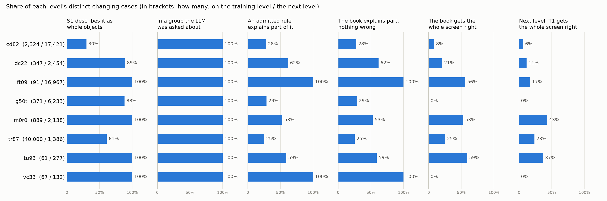
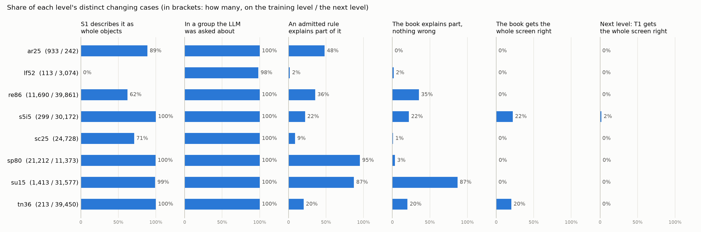

# The funnel: where each game's cases are lost (12 Nov 2026)

**In one line.** On the dev games, S1 describes 83% of a level's changing
cases, a rule the checker admits gets 57% of them right, and the book gets the
whole screen right on 28%. On held-out games those are 78%, 40% and 5%. The
losses are in writing exact rules and in trusting them, not in seeing the board.
Online, what steers Goose is almost all the LLM-free colour rule.

**What this is.** The table the plan promises for the report (§6.1: "the
funnel, one set of numbers per stage"). It reads finished runs only; nothing
was run again and no verdict changes. Tool: `tools/gb_funnel.py`. Tables and
commands: `results/glassbox/funnel/` (`run.sh`).

The three offline runs:

| Run | Games | What it is |
|---|---|---|
| `g1` | 8 dev | The rules the LLM wrote in G1 (17 Oct) |
| `pool_g0b_g1` | 8 dev | The pooled book: G0b's and G1's rules together. **The book the online runs carried** |
| `g3_gb` | 8 A/B-offline | The same stages on held-out games (3 Nov). No artifact was built from them |

## 1. The funnel in cases

A game's training level, mean over the 8 games. Each share is of the level's
distinct changing cases (a case = one screen and one action).

| Step | `g1` | `pool_g0b_g1` | `g3_gb` (held out) |
|---|---:|---:|---:|
| S1 describes the change as whole objects | 83% | 83% | 78% |
| The case is in an action group S2 asked the LLM about | 100% | 100% | 100% |
| A rule the checker admits gets changed cells right | 48% | 57% | 40% |
| The book gets part of it right | 48% | 57% | 21% |
| The book gets the whole screen right | 25% | 28% | 5% |

Game by game (`pool_g0b_g1` for the dev games, `g3_gb` for the held-out ones):

| Game | Changing cases | S1 describes | An admitted rule gets it | Book: part | Book: whole screen |
|---|---:|---:|---:|---:|---:|
| ft09 | 91 | 100% | 100% | 100% | 56% |
| tu93 | 61 | 100% | 59% | 59% | 59% |
| m0r0 | 889 | 100% | 53% | 53% | 53% |
| tr87 | 40,000 | 61% | 25% | 25% | 25% |
| dc22 | 347 | 89% | 62% | 62% | 21% |
| cd82 | 2,324 | 30% | 28% | 28% | 8% |
| vc33 | 67 | 100% | 100% | 100% | 0% |
| g50t | 371 | 88% | 29% | 29% | 0% |
| *s5i5* | 299 | 100% | 22% | 22% | 22% |
| *tn36* | 213 | 100% | 20% | 20% | 20% |
| *su15* | 1,413 | 99% | 87% | 87% | 0% |
| *re86* | 11,690 | 62% | 36% | 35% | 0% |
| *sp80* | 21,212 | 100% | 95% | 3% | 0% |
| *ar25* | 933 | 89% | 48% | 0% | 0% |
| *sc25* | 24,728 | 71% | 9% | 1% | 0% |
| *lf52* | 113 | 0% | 2% | 2% | 0% |

Held-out games in italics.

- **Seeing is not the main loss.** S1 describes every changing case on 7 of
  the 16 games and at least 88% on 11. It fails on lf52 (0%) and cd82 (30%).
- **The LLM is always asked.** No case is lost because its action group was
  skipped.
- **The largest loss on the dev games is at "an admitted rule gets it right":**
  57% of the cases get there with the pooled book, so 43% are lost.
- **On held-out games most admitted rules never reach the book.** sp80: an
  admitted rule gets 95% of cases, the book 3%. ar25: 48% and 0%. Their rules
  are right where they apply but not trusted (61 admitted, 16 trusted).
- **Part right is not whole screen right.** The book gets part of every case
  right on vc33 and of 87% on su15, and the whole screen of none.

## 2. Each stage's own numbers

| Stage | Metric | `g1` | `pool_g0b_g1` | `g3_gb` (held out) |
|---|---|---:|---:|---:|
| S2 | LLM answers | 385 | (none: pooled) | 441 |
| S2 | answers whose code passed the static and runtime checks | 80% | | 75% |
| S2 | answers that ran out of room | 35% | | 46% |
| S2 | tokens per answer | 16,273 | | 17,552 |
| S2 | checked rules that call an H1 primitive | 99% | | 92% |
| S3 | rules admitted / trusted / in the book | 35 / 32 / 23 | 69 / 63 / 26 | 61 / 16 / 14 |
| S3 | cell coverage, mean over games | 32.0% | 40.2% | 13.8% |
| S3 | rules made exact by a fitted guard | 2 | 0 | 1 |
| S4 | T0, untouched book on the next level (per move) | 22.8% | 24.8% | 14.4% |
| S4 | T1, re-bound book | 22.9% | 31.9% | 11.1% |
| S4 | "nothing" / "memory" on the same moves | 15.8% / 41.8% | 15.8% / 41.8% | 10.5% / 18.4% |
| S4 | T1 wrong, mean (worst game) | 0.0% (cd82 0.1%) | 0.6% (m0r0 4.3%) | 1.7% (tn36 8.1%) |
| S4 | games where T1 beats both baselines | none | dc22, ft09 | s5i5 |

- **35% to 46% of the LLM's answers ran out of room**, and 20% to 25% of its
  answers did not pass the checks.
- **Nearly every rule uses the vocabulary** (H1), on held-out games too.
- **Re-binding helps the pooled book** (T0 24.8% → T1 31.9%), mostly through
  m0r0 (6.8% → 51.7%) and ft09 (10.2% → 18.6%). It still loses to "memory"
  on average (41.8%).
- **On held-out games re-binding hurts on average** (14.4% → 11.1%): tn36 goes
  from 23.7% to 0.7% with 8.1% wrong.
- One held-out game (sc25) has no next level to carry to.

## 3. S5: what the book is worth to Goose

**Offline** (the counterfactual on A0's 24 dev recordings, prereg 5a): moves the
carried no-ops would have covered, and that indeed did nothing, in each new
level's first 2,000 actions.

| Game | With the pooled book | With no book (LLM-free) | Covered moves that changed something |
|---|---:|---:|---:|
| vc33 | 60.1% | 60.1% | 0 |
| ft09 | 22.9% | 19.3% | 0 |
| dc22 | 8.4% | 8.4% | 0 |
| cd82 | 6.3% | 5.0% | 0 |
| m0r0 | 5.4% | 5.4% | 0.05% |
| g50t | 1.3% | 0.0% | 0 |
| tu93, tr87 | 0.0% | 0.0% | 0 |

The LLM's no-op rules add at most 3.6 points (ft09) over the colour rule.

**Online** (what the guide did in the runs it steered):

| | G4, 75 runs | Dev sweep 2, 32 runs |
|---|---:|---:|
| Moves the guide changed | 12% | 8% |
| Colours carried as no-ops / dropped later | 114 / 15 | 87 / 12 |
| Rules re-bound / demoted | 60 / 5 | 82 / 6 |
| **Rule survival** (re-bound rules never demoted) | 92% | 93% |
| Goal hints set / dropped after 2,000 quiet moves | 86 / 33 | 54 / 25 |

Every demotion is on vc33 or m0r0. Every dropped colour in dev sweep 2 is on
m0r0; in G4 they are on m0r0 (7), ar25 (3), su15 (3), cd82 and r11l (1 each).

**The replay check for G4** (owed since 8 Nov; `results/glassbox/g4_replay/`,
8 minutes of CPU). S5 v2 replayed G4's 24 GB recordings on the dev games with
the pooled book and the agent's own mask. It carries the 66 colours the runs
carried online, **65 at the same level**. The one exception is cd82 seed 1,
colour 3: the replay counts the moves that ended an attempt, which the online
guide never sees, and one of them was that colour's 20th click (the threshold),
so the replay carries it a level earlier. So online S5 v2 did what its replay
says, as in dev sweep 2 (87 of 87).

## 4. Figures

One funnel figure per run, built by S6 (`make gb-report RUN=<run>`). Copies
are in `figures/`; the report page and its case viewer are beside each
original (`results/glassbox/<run>/s6_show/index.html`, opens offline). `g1`'s
page is from 17 Oct; the other two were built on 12 Nov.

The pooled book on the dev games:

The same stages on the held-out games:

G1's own rules: [`figures/funnel_g1.png`](figures/funnel_g1.png).

## What the report can say

1. Glassbox sees the board on most games; perception is not what limits it.
2. The local model writes an exact, trusted rule for about a quarter of a dev
   game's changing cases as whole screens, and for 5% on games it was not
   developed on.
3. Checked rules are safe to carry: wrong predictions stay at or under 0.1% on
   seven of the eight dev games' next levels (m0r0 4.3%), and rule survival
   online is 92%.
4. What reaches Goose is the LLM-free colour rule. The LLM's rules add at most
   3.6 points of covered moves.

## Limits

- S1's number is "explained" (the change is whole-object items, at most 8). The
  plan's "closure" cannot fail as written. Matt has still to confirm
  "explained" as the perception number.
- The dev games were tuned on. `g3_gb` is the only held-out column.
- Means are over 8 games. tr87 alone holds 40,000 of the dev games' 44,150
  cases, so pooled-by-case numbers would be tr87's.
