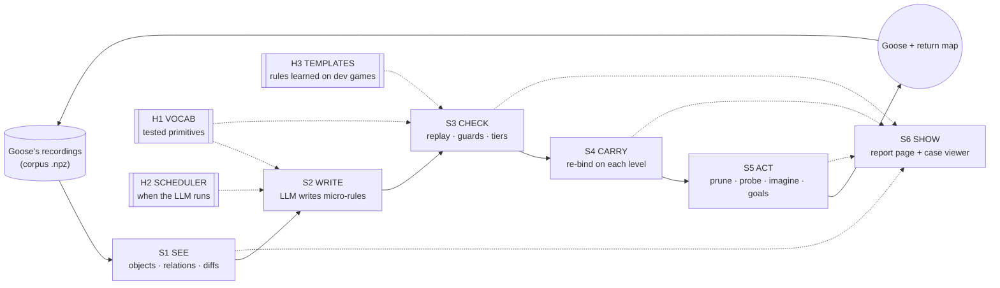
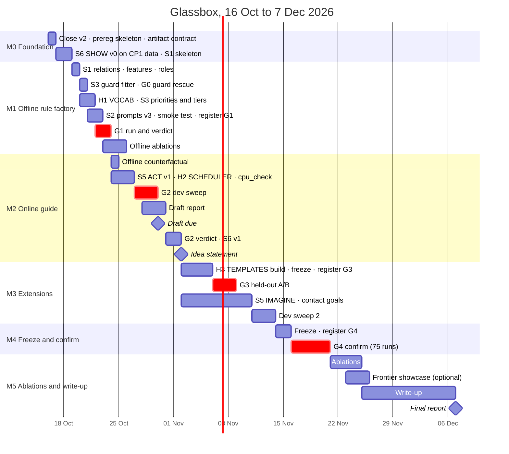

# Glassbox: a modular, inspectable world-model pipeline for Goose

*Plan written 15 Oct 2026 for CMPE 295B (StochasticGoose track). It **replaces Rulebook v2** (`docs/plans/rulebook-v2.md`) after CP1's gate failed on 15 Oct. v1's and v2's results and verdicts stand unchanged; they are reported as the history that motivates this plan. Every Glassbox gate is pre-registered in a new file, `docs/plans/glassbox-prereg.md`, before the run it judges. Intended home in the repo: `docs/plans/glassbox-plan.md`.*

---

## How to read this document

| If you want… | Read |
|---|---|
| What is different between the new overview and our current plan | **Part 1, §1** |
| The new plan on one page | **§2** |
| Why each design choice was made, with evidence | §3 (principles), and the "Why" row of every module card |
| How the pieces stay separate so one can be tuned without touching the others | §4 (the artifact contract) |
| Each module in detail (what, files in/out, how, knobs, test alone, what it shows, pros/cons, risks, cut line) | §5 |
| How we'll know whether it worked | §6 (metrics, arms, pre-registered gates) |
| Dates | §7 (calendar, slip rules, tomorrow's checklist) |
| Compute, risks, open decisions, report outline | §8–§11 |
| Sources | §13 |

**Names used throughout.**

- **Stages:** S1 SEE, S2 WRITE, S3 CHECK, S4 CARRY, S5 ACT, S6 SHOW. **Helpers:** H1 VOCAB (primitive library), H2 SCHEDULER, H3 TEMPLATES (the learned cross-game add-on).
- **Trust tiers:** *hypothesis*, *trusted*, *axiom* (§5.3).
- **Arms:** A0 = `mb_gated_att` (112 levels on 25 games × 3 seeds × 100k actions); GB = Glassbox; GB-free = Glassbox with the LLM switched off.
- **Gates:** G0 (a diagnostic, not a gate), G1–G4 (§6.3).
- A **case** is a distinct (screen with decorations blanked, action), exactly as in `custom_agents/wm/evidence.py`. A **move** is one recorded transition.

---

# Part 1 — What's different: the new overview vs our current plan

## 1. The new overview against Rulebook v2 and the code

### 1.1 The short answer

The overview is mostly a re-description of Rulebook v2 plus about six genuinely new ideas. Roughly half of what it lists as options already exists in `custom_agents/wm/` (composable claimed-cell rules, PARAMS re-binding, counterexample refinement, change-based grading, event triggers), and several things it says the project has "proven" or "implemented" are not in the repo.

What is genuinely new, and worth adopting:

1. explicit **relational facts** computed in Python before the LLM sees a move;
2. a tested **primitive library now**, rather than in CP3;
3. rules split **by mechanic**, with a priority between them (blocking overrides movement);
4. **trust tiers tied to what a rule is allowed to do** (reorder → soft prune → hard prune);
5. a **lookahead** that scores imagined futures by novelty;
6. a **per-stage diagnostic report**, and the principle that every stage writes a small artifact you can inspect and re-test offline.

What it drops are the things that made v2's results believable: pre-registered gates, held-out game tiers, the "nothing changes" and "memory" baselines, the LLM-free ablation, the off-path isolation check, multiple seeds, and a calendar.

The most important thing the overview doesn't know is **CP1's result (15 Oct)**. Re-binding fixed the transfer problem: 0.0% wrong at T1 on all 8 dev games, against v1's 58.8% on ft09. But the 27B wrote no trusted rule at all on tu93, tr87 and m0r0, and only partial rules on g50t and cd82. **The bottleneck has moved from "rules don't transfer" to "the model doesn't write enough exact rules".** Ideas 1–3 attack exactly that, which is the main reason to adopt them now.

### 1.2 Side by side, area by area

Legend for the middle column: ✅ built and run; 📋 planned in v2 but not built; ✖ in neither.

| Area | The new overview proposes | What we have now | The difference that matters |
|---|---|---|---|
| **Objective** | Optimise RHAE, which "heavily penalizes brute-force trial and error" | Levels completed at 100k actions against A0 (112 levels on 25 × 3); RHAE is computed but secondary (`analyze_curves.py`) | Official scoring gives a level min(1.15, h/a)² and budgets AI runs at 5× the human median per level [R1][R2]. At 100k actions every arm we run scores ~0 RHAE, so **levels stay primary**. It also removes the overview's main objection to probing ("experiments cost RHAE"): 30 probe moves are noise in 100,000. |
| **Grid → text** (its Problem 1) | 1A run-length / coordinate lists; 1B object diffs + relational tags; 1C motion-grouped sprites + a VLM | ✅ before/after **images** (Qwen3.8-27B reads them; up to 10 per prompt); ✅ every changed area as text with bounding box and colour flows; ✅ rigid shape-move detection and a description of the clicked region (`wm/rules.py`: `move_text`, `detect_moves`); ✅ `api.layout` (single-colour regions). ✖ relations; ✖ object correspondence beyond rigid moves; ✖ multi-colour objects | We are already past 1A and between 1B and 1C. What's missing is **relations** (touching, blocked-ahead, aligned, distance-to-nearest) and a check of whether the object description explains the *whole* change. |
| **Rule synthesis** (Problem 2) | 2A two-turn split + counterexample retry; 2B micro-rules per mechanic + a coordinator; 2C invent hidden-state variables | ✅ per action group, up to 4 composable rules that each claim cells (`wm/book.py`; a cell claimed two ways is UNKNOWN); ✅ REx-style bandit refinement showing up to 6 failing moves (`tools/wm_refine.py`); ✅ residual and two-level prompts (`wm/rules2.py`); ✅ a code-only retry after an overrun; 📋 `api.t` (planned, cut); conflicts are excluded from trust | **2B already exists**, cut differently: by action group and claimed cells, with no priority between rules. **2A was measured and declined** on 14 Oct (§1.3). 2C isn't built. |
| **Transfer** (Problem 3) | 3A PARAMS + "Schema Fitters"; 3B a core-knowledge DSL; 3C wake-sleep library learning across games | ✅ PARAMS contract, literal lint, re-binding by successive halving (`wm/contract.py`, `wm/lint.py`, `wm/bind.py`); 📋 CP3: helper library (≤ 30 helpers), 12 mechanic schemas, playbook, Goose prior; 📋 CP5: a fine-tuned rule writer | 3A exists as **re-binding**, not schema fitting. 3B was CP3's and was deliberately *not* moved into CP1 on 14 Oct "with no evidence yet"; **CP1's result is now that evidence**. 3C ≈ CP3 + CP5. |
| **Verification** (Problem 4) | 4A change-mask gating; 4B tiers at 1–4 / 5+ / 15+ clean passes; 4C active falsification | ✅ claimed-cell exactness, cell coverage, case coverage, gain, ≥ 20 moves, ≥ 20 changed cells, conflicts excluded; ✅ "nothing" and "memory" baselines with attempt-resampled 95% intervals (`wm/metrics.py`); 📋 CP2: soft suppression ×0.1 (never zero), suspend on the first contradiction, the map counts trusted no-ops as tried, disagreement probes (≤ 5% of moves, ≤ 30 probe moves) | We are **already stricter than 4A**. The overview's thresholds are **much looser than ours**: after 5 clean passes the error rate can still be as high as 45% at 95% confidence (§5.3); our "trusted" needs ≥ 20 moves and 100% on every level seen. |
| **Goals** (Problem 5) | 5A novelty score in a lookahead; 5B an LLM-written goal heuristic; 5C hierarchical sub-goal planning | ✅ Goose's novelty label and the map's frontier routing (no simulation); 📋 CP2: LLM-free goal hints; 📋 CP4: completion test, `progress()`, planner, executor | **No lookahead exists anywhere in the repo.** A lookahead needs whole-screen predictions, and CP1 shows those are rare (g50t's and cd82's rules each claim only part of a change). |
| **Compute** (Problem 6) | 6A synchronous, surprise-triggered calls capped at ~4 s; 6B async System 1 / System 2; 6C a 7B + 27B cascade | 📋 CP2: warm-up, level-up, counterexample and stall triggers; per run 16 requests / 48 completions / 400k tokens; 12,288-token answers; synchronous; one Goose run beside the server; vLLM sleep mode as a fallback | **6A is already CP2's design** (planned, not built). "4 seconds" is off by about 30×: a typical answer is ~10,000 tokens at 80–150 tokens/s. |
| **Diagnostics** | one `run_diagnostics.md` per episode with 4 numbers | ✅ per-run `report.md`, per-game JSON holding every candidate, answer caches, `metrics.json`, curves, `paired_compare` verdicts. ✖ a per-stage funnel; ✖ a per-move viewer | **A real gap.** Our numbers are rigorous but spread over many files, and nothing shows one move's prediction next to what really happened. |
| **Evaluation discipline** | not addressed | ✅ pre-registration; tiers (8 dev / 2 seen / 8 A/B-offline / 7 untouched); sealed results; artifact registry; `tools/cpu_check.py` isolation; `paired_compare --expect`; the LLM-free arm (C2-free) | Without these there is no way to tell a real gain from seed noise (the 9.6× spread from semester 1) or from tuning on the test games. |
| **Calendar** | not addressed | v2 ladder CP0–CP5 with dates; 30 Oct draft, 2 Nov idea lock, 7 Dec final | Any replacement has to fit those three dates. |

### 1.3 Claims in the overview that don't match the repo or the sources

| The overview says | What is actually true | Where to check |
|---|---|---|
| "As implemented in our project's Schema Fitters" | Re-binding (`wm/bind.py`) fits a rule's PARAMS by search. Mechanic schemas were CP3 and were never built. | `rulebook-v2.md` §6.3; `custom_agents/wm/` |
| "Keep our project's proven Two-Turn Split (which completely solved token truncation)" | The split was *proposed* by the 14 Oct review and *declined* after measurement: cutting thinking at 6,144 tokens lost 5 of 8 admitted rules on 208 recorded answers; 12,288 tokens plus the code-only retry lost none. CP1 still had 193 of 439 answers (44%) run out of room; the retry rescues most of them. | `rulebook-v2.md` §10.5; `rulebook-v2-cp1-results.md` §5 |
| "Virtual Lookahead (return_map.py)" | `return_map.py` remembers seen screens and walks the shortest known route back to untried actions. It never simulates a move. | `custom_agents/return_map.py` |
| "As discovered in our wm/metrics.py work … a rule that predicts 'nothing ever moves' is still 99.8% pixel-accurate" | No metric in the repo scores pixel accuracy. v1 graded whole-board exactness per case; v2 grades claimed cells; both are compared against an explicit "nothing changes" baseline. The trap it describes was never in our code. | `wm/metrics.py`, `wm/check.py` |
| "Counterexample debugging fixes 50%+ of simple … errors" | No source is given. Our own measurement: near-miss refinement made 2 of 7 groups exact within 12 calls each, and both got there by covering less. | `rulebook-v2-cp0-results.md` |
| Option 1C's source, "Active Abstraction with Programmatic World Models for ARC-AGI-3 (2026)": a hierarchical parser with common-fate motion grouping and a small VLM | That paper is **Tycho**. It deliberately imposes no fixed object decomposition (the model-writing agent chooses its own state: grid, objects, counters, modes), and it describes no motion-grouping parser and no separate VLM. Its findings that matter here are different (§3). | Tycho [R4] |
| "Autumn: Causal Discovery Through Program Synthesis (Das, Solar-Lezama, Tenenbaum), POPL 2023" | The POPL 2023 paper is *Combining Functional and Automata Synthesis to Discover Causal Reactive Programs*, by Das, Tenenbaum, Solar-Lezama and Tavares. | [R11] |
| "Multimodal Reasoning to Solve the ARC-AGI Challenge (2025)" | I could not find a paper with this title. The closest match is *Think Visually, Reason Textually: Vision-Language Synergy in ARC* (Zhang et al., 2025): images help a model *summarise* a rule, text helps it *apply* one. | [R17] |
| "Probing Spatial Reasoning in Large Language Models (2025)" | Real, under the title *Stuck in the Matrix: Probing Spatial Reasoning in Large Language Models* (Bai et al., Oct 2025): an average 42.7% accuracy loss as grids scale up. | [R15] |
| "No LLM call can ever exceed … 4 seconds" | CP1 ran 551 requests in 9 h 4 min with up to 4 groups in parallel. Online answers will take roughly 1–2 minutes each. | `rulebook-v2-cp1-results.md` §5; `rulebook-v2.md` §5.4 |
| "Almost every ARC-AGI-3 game is built from the same ~15 geometric building blocks" | Unsupported. The ARC-AGI-3 report says environments use core-knowledge priors (objectness, basic geometry and topology, basic physics, agentness) and that later levels compose concepts introduced earlier. | [R1] |
| "A local model (Qwen 27B)" | Qwen3.8-27B, AWQ INT4 (`cyankiwi/Qwen3.8-27B-AWQ-INT4`), served by vLLM from `.venv-llm`. | `CLAUDE.md` |
| "Flattened text rows break vertical relationships" | True in general (Xu et al. saw GPT's accuracy fall on vertical objects in text grids [R14]), but our prompts don't send flattened grids. They send images plus change descriptions. | `wm/rules.py` |

### 1.4 What the overview adds that v2 doesn't have

| # | New idea | Status in v2 | Kept in Glassbox as |
|---|---|---|---|
| 1 | Relational facts computed in Python (touching, blocked ahead, aligned, distance) | absent; v2 sends geometry, not relations | S1 SEE (§5.1) |
| 2 | A tested primitive library before the next LLM run | CP3 (19–31 Oct); declined for CP1 on 14 Oct | H1 VOCAB (§5.7), used from G1 on |
| 3 | Micro-rules per mechanic, with a priority rule for conflicts | composition by cells; a clash is UNKNOWN | priorities + exceptions in S3 (§5.3) |
| 4 | Trust tied to what a rule may do (reorder → soft prune → hard prune) | two tiers (admitted, trusted) and one soft multiplier | three tiers with statistical thresholds (§5.3) |
| 5 | A lookahead scored by novelty, w1·(object changed) + w2·(new position) − w3·(already visited) | no search until CP4 | IMAGINE in S5, built on the return map (§5.5) |
| 6 | Per-stage diagnostics (perception coverage, compile rate, rule survival, action savings) | gate tables only | S6 SHOW: funnel, stage panels, case viewer (§5.6) |
| 7 | "Every stage is an inspectable artifact testable offline in under a second" | one 711-line driver (`tools/wm_tier0a_v2.py`) runs everything | the artifact contract (§4) |

### 1.5 What v2 has that the overview doesn't (and Glassbox keeps)

- **Pre-registration**, held-out tiers, the artifact registry and sealed results (v2 §2.4). Glassbox writes a new pre-registration but keeps the rules.
- **The tier draw.** The A/B-offline and untouched tiers have never been run by any v2 checkpoint, so they are still clean. Glassbox keeps them exactly (`custom_agents/wm/tiers.py`).
- **Two baselines for every offline number** ("nothing changes", "memory"), with intervals that resample attempts.
- **The trust bar** that produced 0.0% wrong at T1 on all 8 dev games.
- **The LLM-free ablation**, so "does the LLM help?" gets a direct answer.
- **Off-path isolation**: removable hooks (`# [tag]` lines) and `tools/cpu_check.py`.
- **Measured budgets**: 12,288-token answers with the code-only retry; the KV-cache arithmetic beside Goose (v2 §5.4).
- **The A0 reference**: 75 reusable `mb_gated_att` confirm runs, so the baseline never has to be re-run.
- **Answer caches** that make every offline rerun exact.

### 1.6 Why change now: what CP1 told us, and where each lesson lands

| CP1 lesson (numbers from `rulebook-v2-cp1-results.md` and `rulebook-v2-cp0-results.md`) | What Glassbox does about it |
|---|---|
| **Transfer form is fixed.** T1 wrong 0.0% on every dev game; ft09's rules re-bound from colour 9 to 12, and its tile rule's claimed cells are right on 99.9% of the 1,346 moves it applies to on the next level. | Keep re-binding as S4, unchanged in substance. |
| **Yield is the bottleneck.** tu93: no admitted rule (best 77% claimed-exact). tr87: no rule got more changed cells right than wrong. m0r0: 11 admitted, none exact (best 99.8%). g50t, cd82: rules explain part of each change. | S1 relations, H1 primitives, S3 guard fitter and exceptions. |
| **Near-misses become exact only by narrowing** (CP0: tu93's exact rule covers 41% of its group, dc22's 7%). | S3's guard fitter learns *when* a rule fails from relational features, without the LLM; an exception rule covers the failing moves instead of deleting them. |
| **Overruns grew**: 44% of answers (v1 22%, CP0 34%). | H1 shortens code; S2 asks for one mechanism per rule. |
| **Memory is strong within a level** (per move: tu93 0.85, tr87 0.48, m0r0 0.45), because moves repeat screens. | S5 uses exact memory (the map's edges) first and rules only for actions never tried. |
| **vc33 had too little to re-fit on** (2 changing cases in the first 300 moves). | S4 online waits for enough changing cases, not a fixed number of moves. |
| **Partial rules are useful but invisible to the whole-screen metric** (g50t, cd82). | S5 uses partial rules for no-op and probe decisions; only IMAGINE needs whole-screen predictions. G1's primary metric credits partial rules (cell coverage). |

---

# Part 2 — The new plan: Glassbox

## 2. The plan on one page

### 2.1 The idea, as it will be declared on 2 Nov

> **Glassbox.** An exploring agent (Goose) works with a local LLM that writes small, replay-checked rules about a game from Goose's own transitions. A deterministic perception stage describes every transition as objects, relations and an object-level change. The LLM writes one mechanism per rule using a tested library of grid primitives, and a guard fitter turns near-miss rules into exact ones without the LLM. Rules earn trust in three tiers, each allowed to do more than the last. They carry from level to level by automatic re-binding, and from game to game as a frozen catalog of rule templates, adopted only when exact on the new game. Trusted rules steer Goose: they suppress moves known to do nothing, direct probes at what the rules can't yet explain, and extend Goose's map with predicted moves that a short novelty-and-goal search can use. Every stage is a separate module with its own files, its own tests and its own diagnostic page.

Work after 2 Nov refines the stages named here; it does not add a new idea.

### 2.2 The pipeline



Solid arrows carry data; dotted arrows are helpers and the read-only diagnostic layer. Offline (gates G1 and G3) the loop is cut after S4: recordings in, scored rule books out. Online (G2 and G4) it runs inside Goose's game loop.

### 2.3 In one minute

- **S1 SEE** turns every move into objects, relations and an object-level diff, and checks whether that diff explains the whole change. No LLM.
- **S2 WRITE** asks the local 27B for one small mechanism at a time, written with the H1 primitives, with the facts from S1 beside the pictures it already sees.
- **S3 CHECK** replays every rule on every recorded case, fits guards that make near-misses exact, composes micro-rules with priorities, and assigns each rule a tier. No LLM.
- **S4 CARRY** re-binds rules on each new level (no LLM). **H3 TEMPLATES**, the learned add-on, re-binds rules learned on dev games on a new game before the LLM is asked.
- **S5 ACT** steers Goose: suppress known no-ops, probe what's unexplained, extend the map with predicted moves, lean toward goal hints. Goose still samples every move and still trains exactly as before.
- **S6 SHOW** builds one offline page per run: a funnel per game, a panel per stage, and a case viewer showing prediction against reality move by move.
- **H2 SCHEDULER** decides when the LLM runs, inside a fixed, measured budget.

### 2.4 What changes from Rulebook v2

| Aspect | Rulebook v2 | Glassbox | Why the change |
|---|---|---|---|
| Structure | one ladder (CP0–CP5); one driver runs the whole offline pipeline | six stages and three helpers, each a pure function from files to files, runnable and testable alone | tune one stage without re-running or re-reading the rest (§4) |
| What the LLM sees | images + exact changed areas + rigid moves | the same, plus objects, their correspondence, relations, and whether the object diff explains the change | object-based text nearly doubled GPT-4 on ARC [R14]; spatial reasoning collapses as grids grow [R15] |
| How rules are written | raw numpy against `api` | primitives from H1, one mechanism per rule, an optional `KIND` and `PRIORITY` | shorter programs, fewer overruns; a DSL let a 220M model work on ARC [R18] |
| Near-misses | LLM refinement (bandit) | guard fitter first (no LLM), then an exception prompt, then refinement | CP0: refinement made 2 of 7 exact, both by narrowing |
| Composition | by cells; a cell claimed two ways is UNKNOWN | the same, plus priority: an exception beats its default where it applies | lets "move" and "blocked" be two simple rules instead of one hard one |
| Trust | admitted / trusted | hypothesis / trusted / axiom, each with fixed uses and thresholds from the rule of three | a single lucky rule can never prune; thresholds are explainable |
| Online use | CP2 guide: soft weights, probes, goal hints, map tried-marking | the same, plus exploration-matrix probes and IMAGINE (the map extended by predicted moves) | memory first, rules for the untried; exploration aimed at the unexplained [R5][R12] |
| Planning | CP4 planner (2–22 Nov, 8–12 days) | no separate planner; IMAGINE and contact goals are short searches inside the map | far less to build; every imagined step is checked |
| Across games | CP3 (helpers, 12 hand-designed schemas, playbook, Goose prior) and CP5 (fine-tune) | H1 hand-written vocabulary now; H3 templates learned from dev-game rules in November; both frozen and registered | your call: hand-written first, a learned add-on after |
| Diagnostics | `report.md` per run | S6 report page and case viewer for every run, PNGs for the report | see where each game breaks, and why |
| Gates | CP1–CP5 | G1–G4 under a new pre-registration; v2's honesty rules kept | full replacement, your call |
| Headline test | Confirm 1 (23–27 Oct) + Confirm 2 (23–28 Nov) | one confirm, 16–20 Nov, on the final frozen configuration | your call: the strongest result by 7 Dec; the 30 Oct draft reports dev-game results |

### 2.5 What is reused and what is new

| Piece | Where it lives | In Glassbox |
|---|---|---|
| Evidence index, masks, splits | `custom_agents/wm/evidence.py` | reused as is: S1's input |
| Sandbox | `wm/sandbox.py` | reused; H1's primitives are injected through `compile_functions(..., extra=...)`, the hook v2 already uses for slot types |
| Rule contract, slot types | `wm/contract.py` | reused; two optional fields added in Glassbox's own wrapper (`KIND`, `PRIORITY`) |
| Literal lint | `wm/lint.py` | reused as is |
| Re-binding search | `wm/bind.py` | reused as is: S4 and H3 |
| Composition worker | `wm/book.py` | wrapped; priority composition is a new worker in `gb/check.py` that falls back to `book.compose` when no rule has a priority |
| LLM client and cache | `wm/llm.py` | reused as is |
| Metrics, intervals, baselines | `wm/metrics.py`, `wm/check.py` | reused as is |
| v1/v2 prompts and pictures | `wm/rules.py`, `wm/rules2.py` | read-only; Glassbox's prompts are a new file that imports their picture and text helpers |
| Bandit refinement | `tools/wm_refine.py` | its policy reused in `gb/write.py` |
| Tiers, registry | `wm/tiers.py`, `wm/registry.py`, `tools/artifacts.py`, `artifacts/registry.json` | reused as is |
| Verdicts, isolation | `tools/paired_compare.py`, `tools/cpu_check.py` | reused as is |
| Server and launchers | `experiments/rulebook/serve.sh`, `llm_run.sh` | reused; new job names |
| Return map | `custom_agents/return_map.py` | subclassed (`GbMap`), never edited |
| Grid helpers | `custom_agents/gridtools.py` | reused; S1 builds on `label_components` and `connected_components` |
| A0 reference | `results/confirm_upgrade/20260927_221915/` (75 runs) | reused as A0 and as the recordings for G1, G3 and the offline counterfactual |
| **New** | `custom_agents/gb/`: `artifacts.py`, `see.py`, `vocab.py`, `write.py`, `guards.py`, `check.py`, `carry.py`, `act.py`, `schedule.py`, `templates.py` | the stages and helpers |
| **New** | `tools/gb_offline.py` (offline driver, `--stage`, `--from-cache`), `tools/gb_report.py` + `tools/gb_view/` (S6) | drivers |
| **New** | `experiments/glassbox/` (`glassbox.toml`, `gb.mk`, launchers), `tests/test_gb_*.py`, `docs/plans/glassbox-prereg.md` | config, tests, registration |

**Two rules that keep v1 and v2 reproducible.** (1) Never edit the prompt text in `wm/rules.py` or `wm/rules2.py`, or `tools/wm_offline.py` and `tools/wm_tier0a_v2.py`: their answer caches are keyed on those prompts. (2) Any change anywhere else in `wm/` must leave CP1's numbers unchanged when CP1 is re-scored from its cache. That is a test (`tests/test_gb_regression.py`), run before every commit that touches `wm/`.

### 2.6 The milestones at a glance

| Milestone | Dates | Ends with | Standalone product if we stop there |
|---|---|---|---|
| **M0** Foundation | Fri 16 – Sun 18 Oct | v2 closed; pre-registration skeleton; artifact contract; S6 v0 on CP1's data | a viewer that explains CP1's results game by game |
| **M1** Offline rule factory | Mon 19 – Fri 23 Oct | G0 (guard rescue, no LLM), **G1** (offline rule test) | an offline rule learner with perception, vocabulary, guards and tiers, measured against CP1 on the same recordings |
| **M2** Online guide | Sat 24 Oct – Sun 1 Nov | **G2** (dev sweep, 8 games × 2 seeds) | the first Glassbox agent; the 30 Oct draft reports M1 and whatever of M2 has finished |
| — | **Mon 2 Nov** | idea statement (§2.1) | |
| **M3** Extensions | Mon 2 – Fri 13 Nov | **G3** (template held-out A/B); IMAGINE built if G1/G2 justify it; dev sweep 2 | cross-game templates and imagined moves, each measured on its own |
| **M4** Freeze and confirm | Sat 14 – Fri 20 Nov | **G4** (25 games × 3 seeds × 100k) | the final agent, adopted or not, with its funnel |
| **M5** Ablations, write-up | Sat 21 Nov – Mon 7 Dec | final report | per-stage ablations; optional frontier showcase |

---

## 3. Design principles

Each principle is used to settle at least one design choice in §5. Evidence numbers [R#] refer to §13.

| # | Principle | What it decides | Why (evidence) |
|---|---|---|---|
| P1 | **Every stage is a pure function from files to files.** | the artifact contract (§4); each stage's test-alone command | You can only tune what you can isolate. Kepler reports that high scores hid faulty components (a broken planner masked by automatic repair), and argues for inspection beyond the score [R6]. Our own history agrees: v1's ft09 rule looked fine until a separate transfer measurement showed it 59% wrong. |
| P2 | **Describe a move as objects and relations before the LLM sees it — and keep the pictures.** | S1; S2's prompt | Object-based text nearly doubled GPT-4's ARC score (13 → 23 of 50) and removed its horizontal/vertical gap [R14]. LLM spatial accuracy falls 42.7% on average as grids grow [R15]; on 7×7 mazes Gemini scored 80% given adjacency lists and 16% given character grids [R16]. Images are better for *summarising* a rule, text for *applying* it [R17]; the Milestone #1 winner credits multimodality [R3]. So relations are added, nothing is taken away. |
| P3 | **Write mechanisms with a small tested vocabulary, and measure whether it gets used.** | H1; S2's contract | A DSL let a 220M model write useful ARC programs [R18]; documentation helps a synthesiser use a library [R31]; learned abstractions cut TheoryCoder-2's tokens to ~28% of WorldCoder's [R13]. Against: the Milestone #1 winner found hand-crafted tools *hurt* its Qwen 27B [R3], and learned libraries are often barely reused [R19]. Hence: small, optional, A/B-tested, usage counted. |
| P4 | **Separate a mechanism from the condition under which it fails, and learn the condition without the LLM.** | S3's guard fitter and exceptions | CP0's near-misses (90–97%) became exact only by shrinking their coverage. Learning preconditions from features is standard in abstraction learning (VisualPredicator's cluster-and-intersect [R20]); PoE-World adds hard constraints beside its experts and lost planning success without them (5/9 → 2/9 on Montezuma) [R9]. |
| P5 | **Trust is statistical and staged by what it allows.** | S3's tiers | With zero failures in n distinct cases, the 95% upper bound on the error rate is 1 − 0.05^(1/n): 45% at n = 5, 14% at 20, 4.9% at 60 [R28]. PoE-World weights and prunes experts by fit [R9]. v1's lesson: trust follows evidence and is suspended at the first contradiction. |
| P6 | **Exact memory first, rules second.** | S5 | Within a level, "repeat what this screen and action did last time" is right on 85% of tu93's moves (CP1). The return map already holds that memory; Go-Explore's lesson is to remember and return [R24]. Rules add value where memory has nothing: untried actions, new screens, new levels. |
| P7 | **Imagine only where the model claims the whole screen, and check every imagined step.** | S5 IMAGINE | Planning with code world models is 4–6 orders of magnitude faster than asking an LLM, but matched the true simulator's return only when the program was fully accurate [R22]. Rodionov's executor compares every predicted frame and stops at the first mismatch [R7]. |
| P8 | **Explore what the model can't explain.** | S5 probes and contact goals | OPINE-World's "ontology error" (mixed outcomes for the same object type, action and context) steers exploration; without its Bayesian layer RHAE fell from 78.4 to 58.2 [R5]. EMPA sets goals to create contacts between object types it hasn't seen interact, and reached human-level efficiency on 79 of 90 games [R12]. |
| P9 | **Call the LLM on events, not on a clock; fewer, better calls.** | H2 | In Tycho's matched study, modelling on request scored 88.5 RHAE and automatic repair after every failure 83.1, even though automatic repair produced more accurate models [R4]. Exactness is not the same as usefulness. |
| P10 | **Carry mechanisms between levels; carry ways of learning between games, adopted only when exact on the new game.** | S4, H1, H3 | Levels compose concepts learned earlier in the same game [R1]; each game is hand-crafted to be novel, and frontier models wasted actions mapping games onto familiar ones [R33]. TheoryCoder-2 reused a learned `move_to` across games [R13]. |
| P11 | **Show every run as a funnel and every failure as a picture; report every seed.** | S6 | With few runs, report interval estimates, all runs and the probability of improvement rather than a single median [R23]. Our semester-1 variance (9.6× across seeds) makes single numbers misleading. |
| P12 | **Keep everything new behind a flag that defaults to off, and prove the off path is unchanged.** | the `# [gb]` hooks; `cpu_check.py` | the repo's standing rule (`CLAUDE.md`), which made every earlier ablation clean. |

---

## 4. The artifact contract: how the stages stay separate

This is the mechanism behind "tweak one part without adjusting the others". Every stage reads files and writes files; nothing passes between stages in memory except inside the online agent, where the same functions are called directly.

### 4.1 One folder per run, one subfolder per stage

```
results/glassbox/<run>/
  manifest.json      git commit, config hash, stage versions, input hashes, timestamps
  config.toml        frozen copy of experiments/glassbox/glassbox.toml as used
  evidence/          <game>_L<k>_{train,fit,score}.npz       wm.evidence.LevelEvidence.save (S1's input)
  s1_see/            <game>_L<k>_<split>.facts.npz           per case: objects, diff class, closure, feature bits
                     <game>_L<k>_<split>.facts.jsonl         per case: the facts text (what S2 shows, what S6 displays)
                     <game>_L<k>.roles.json                  role hints: mover, static, click-changers, counter cells
                     <game>_L<k>.matrix.json                 exploration matrix: (object type, action family) -> outcome counts
  s2_write/          <game>/answers.jsonl                    every LLM answer: prompt hash, text, finish, tokens, seconds
                     <game>/candidates.jsonl                 parsed rules: id, group, KIND, PRIORITY, code, lint, parse status
                     llm_cache.jsonl                         wm.llm's answer cache (exact offline reruns)
  s3_check/          <game>/rules.jsonl                      per rule: tier, per-level grades, bindings, guard, provenance
                     <game>_L<k>.book.json                   the composed book: members, priorities, exceptions
                     <game>_L<k>.status.npz                  per case: EXACT / PARTIAL / WRONG / UNKNOWN, cells right / wrong
  s4_carry/          <game>_L<k+1>.carry.json                bindings, flags, T0 / T1 / T2 with intervals
  s5_act/ (online)   events.jsonl                            every trigger, LLM call, promotion, demotion, prune, probe, imagined step
                     decisions.npz                           per action: Goose's choice, the guide's multiplier, the move taken
  s6_show/           index.html                              the report page and case viewer, one self-contained file
                     figures/*.png                           the same charts, for the written report
                     cases/<game>.json                       the flagged cases the viewer pages through
```

Online runs keep the existing run folder (`results/runs/<ts>/<game>/`: corpus, `run_config.json`, `run_end.json`, TensorBoard) and add a `glassbox/` folder inside it with the same layout.

### 4.2 Provenance and caching

1. Every artifact starts with a header: `{stage, stage_version, config_hash, inputs: {path: sha256}, created}`.
2. A stage's output key is `hash(stage_version, its own config section, its input hashes)`. If an output with that key exists, the stage is skipped.
3. So changing a guard-fitter knob reuses S1 and S2 from disk and reruns only S3, S4 and S6. Changing S1's text format changes S2's prompts; S2 then hits the LLM cache only for the prompts that didn't change.
4. `stage_version` is bumped by hand when what a stage's output *means* changes (not for refactors). A bump invalidates everything downstream.
5. Cross-game artifacts (H1's vocabulary, H3's catalog) are frozen and registered in `artifacts/registry.json` with hashes before any held-out use, exactly as v2 registers its results.

### 4.3 One command per stage

```bash
make gb-see     RUN=<name> GAMES=tu93,m0r0         # S1 only, CPU, about a minute per game
make gb-write   RUN=<name> GAMES=lp85 DRY=1         # render the prompts and token estimates, no LLM
make gb-write   RUN=<name> GAMES=lp85               # S2 against the server
make gb-check   RUN=<name> GAMES=m0r0               # S3 from cached candidates, CPU
make gb-carry   RUN=<name> GAMES=ft09               # S4, CPU
make gb-offline RUN=<name> TIER=dev                 # S1 -> S4 for a whole tier
make gb-report  RUN=<name> [COMPARE=<other run>]    # S6
make gb-case    RUN=<name> CASE=<id>                # re-run one case through S1-S4, printing every intermediate
```

All of them wrap `tools/gb_offline.py --stage <s>` and `tools/gb_report.py`.

### 4.4 One config file

`experiments/glassbox/glassbox.toml`, with one section per stage and helper (the full file is Appendix C). Every run copies it into its own folder, and every gate run's config hash goes into the pre-registration, so "which settings produced this number?" always has one answer.

### 4.5 Why this design, and what it costs

| Pros | Cons |
|---|---|
| A change reruns only its own stage and the ones after it | about half a day of plumbing before any new science |
| Every number in a report traces to the exact files and code behind it | a few hundred MB of per-case facts and statuses per offline run (fine on the D: drive) |
| Offline stages re-test in seconds to minutes instead of a 9-hour run | a change of meaning needs a version bump and a rerun downstream |
| The viewer only reads artifacts, so it can never change a result | until S6 exists there are two places to look, which is why S6 v0 is built first (M0) |
| A teammate can consume one stage's output (say, S3's book) without running the rest; v2's interface (`noop_mask`, `probe_scores`, `goal_hints`, `predict`) stays the way out | |

---

## 5. The modules

Every module card has the same rows: **What it does · Files · How it works · Knobs · Test it alone · What it shows · Why · Pros and cons · Risks · Cut line · Effort.**

### 5.1 S1 SEE — objects, relations and object-level diffs (no LLM)

**What it does.** Turns each case (before board, action, after board, decoration mask) into: the objects on the board, what happened to each one, the relations around the objects that matter for this move, and whether that object-level description reproduces the after board exactly.

**Files.** In: `evidence/*.npz`. Out: `s1_see/*.facts.npz`, `*.facts.jsonl`, `*.roles.json`, `*.matrix.json`.

**How it works.**

1. **Objects.** 4-connected single-colour components of live, non-background cells (`gridtools.label_components`). Regions over 1,024 cells are kept and flagged `large`: they are walls and floors, and they matter as blockers. Each object has an id, colour, cells, bounding box, size, a shape hash (its cells relative to its box) and a centroid.
2. **Correspondence.** For each changed area (8-connected component of the change mask, the same areas `wm/rules.py` boxes in its pictures), the objects touching it before and after are matched: same colour and shape somewhere else → *moved (dy, dx)*; same cells, new colour → *recoloured (c → c′)*; same colour, overlapping but different cells → *reshaped*; unmatched before → *vanished*; unmatched after → *appeared*. Ties go to the smallest displacement.
3. **Closure.** Apply the diff to the before board (move, recolour, erase to background, paint) and compare with the after board on live cells. *Exact closure* means the object description fully explains the move; otherwise S1 records the share of changed cells it explains. **This is the "perception coverage" number**: if it's low on a game, perception is the bottleneck there, not the LLM.
4. **Relations**, only for the objects involved in the change plus the clicked object, to keep the text short. Per direction (up, down, left, right): touching or not, the colour touched, ray distance to the first non-background cell and its colour, at the screen border or not. Also: aligned (same row or column band) with objects of the same colour, and inside (bounding box within a larger object's, such as a container). For a move with a displacement, the same relations are also given **ahead**, in the direction of the displacement: these are the features that explain blocked moves.
5. **Feature bits.** The relations become a fixed boolean vector per case (roughly 100–300 bits: `touching_ahead`, `ray_ahead<=step`, `border_ahead`, `ahead_colour==c` for each colour on the level, `clicked_colour==c`, `clicked_size<=k`, `inside_large`, …). S3's guard fitter works on these.
6. **Roles**, per level, from all its cases: the *mover* (the colour whose objects move under two or more buttons), *static* colours (never change), *click-changers* (colours whose clicks change something), *counter cells* (the bar in the decoration mask). They are exposed to rules as `api.roles`, a hint that `bind()` may read (S4).
7. **Exploration matrix**, per level: rows are (object type = colour + size bucket + shape hash, action family); cells count outcome classes (nothing, moved, recoloured, vanished, appeared, other). Its normalised entropy per row is OPINE-World's "ontology error" [R5]. S5's probes read it.
8. **Text.** A compact rendering per case, at most about 12 lines:

```
ACTION1: object A (colour 9 blue, 2x2, rows 12-13, cols 20-21) moved (-1, 0).
  Ahead of A (up): nothing touching; first non-background cell 3 rows up (colour 4, dark gray).
  A touches colour 4 on its left. 14 other objects unchanged. The object diff explains the whole change.
click at (row 30, col 40) on object B (colour 12 orange, 3x3): B recoloured 12 -> 9.
  B is inside object C (colour 5 black, 20x20). The object diff explains the whole change.
```

**Knobs.**

| Knob | Default | Changes |
|---|---|---|
| `connectivity` | 4 | how cells group into objects (8 merges diagonal neighbours) |
| `large_cells` | 1,024 | above this a region is a wall or floor, kept as a blocker |
| `relations_scope` | `changed+clicked` | `all` describes every object (debugging only; long) |
| `ray_max` | 64 | how far a ray looks |
| `text_lines` | 12 | cap on the facts text per case |
| `mover_min_buttons` / `mover_min_moves` | 2 / 10 | how much evidence makes a role hint |
| `matrix_size_buckets` | 1, 2–4, 5–16, 17–64, 65+ | how object types are binned |

**Test it alone.** `make gb-see TIER=dev` prints closure per game in about a minute on the CPU. Unit tests on synthetic boards cover: a block moves; a block is blocked; a recolour; a push of two blocks; an appear and a vanish; and a two-colour sprite that S1 splits into two objects (a known limit, documented by the test). A golden test pins the text format, because S2's prompt hash depends on it.

**What it shows.** Per game, closure as a stacked bar (exact / partial / none); objects per board; the exploration matrix as a small heatmap (object types × action families, shaded by entropy). In the case viewer, the facts text sits beside every case with matched objects outlined.

**Why.** P2. This is the overview's Option 1B, and our existing change text plus images already cover most of 1A. Option 1C (multi-colour objects by common motion) waits: closure will show whether, and on which games, it's needed.

**Pros and cons.**

| Pros | Cons |
|---|---|
| Deterministic, fast, testable on its own | Single-colour objects split multi-colour sprites (closure shows where it matters) |
| Feeds three consumers: S2 (relations in text), S3 (feature bits), S5 (curiosity targets) | Adds prompt text (capped; facts are added, nothing is removed) |
| Closure measures perception independently of the LLM | A wrong correspondence could mislead the model; the exact changed-area text stays beside it as ground truth |
| A person can read the facts and ask "could I find the rule from this?" — the overview's best test | Relations are hand-chosen; a missing relation means a guard that can't be learned |

**Risks.**

| Risk | Mitigation |
|---|---|
| Hand-made inputs hurt the model, as the Milestone #1 winner found with tools [R3] | G1 reports an ablation without the facts text; if it's worse, facts go to S3 and S5 only |
| Longer prompts raise overruns | the 12-line cap; `rules2.fit` drops examples before the prompt passes 11,500 tokens; tokens are reported per arm |
| Information in animation frames is lost (Goose keeps only the last frame of each action; Kepler found task-relevant information in intermediate frames [R6]) | S1 logs how many frames each action returned; acted on only if closure is low on a game with animations |

**Cut line.** Keep objects, correspondence, closure and the ahead features. Drop first: the entropy column (keep raw counts), role hints, multi-colour grouping.

**Effort.** 1.5 days.

### 5.2 S2 WRITE — the LLM writes micro-rules

**What it does.** Asks the local 27B for candidate rules, one action group at a time, under a slightly extended v2 contract and with H1's primitives available.

**Files.** In: evidence, S1 facts, the H1 card, and (for refinement and exception prompts) S3's `rules.jsonl`. Out: `answers.jsonl`, `candidates.jsonl`, `llm_cache.jsonl`.

**The rule contract, v3** (backward compatible: a v2 rule is a v3 rule with `KIND = "effect"`, `PRIORITY = 0` and no primitives):

```python
RULE = "ACTION1 moves the mover up by its step"
KIND = "effect"            # optional: "effect" (default), "exception", "noop", "counter"
PRIORITY = 0               # optional: 0 (default); exceptions use 1
PARAMS = {"mover": Colour(), "step": Int(1, 4)}

def bind(board0, api):     # optional; may read api.roles, S1's role hints
    return {"mover": api.roles.get("mover"), "step": 1}

def applies(board, act, api, p):
    return act.action == 1 and (board == p["mover"]).any()

def predict(board, act, api, p):
    a = find_object(board, api, p["mover"])          # H1
    return translate(board, api, a, -p["step"], 0)   # H1: returns (next_board, claimed)
```

**Prompt types** (each for one action group):

| Prompt | Content | When |
|---|---|---|
| First round | v2's content (the level's first board; the ticker line; group statistics; up to 6 moves as before/after pictures with the exact changed-area text) **plus** S1's facts under each move, the H1 card and the v3 contract. Instruction: *one rule for one mechanism, the commonest effect; other effects (bars, blocked moves, side effects) get their own rules.* | first calls for a group |
| **Exception** (new) | a rule that is right on most of its moves, plus up to 6 moves where it is wrong, each with S1's facts (the ahead relations first). Asks for a `KIND = "exception"`, `PRIORITY = 1` rule that applies exactly to moves like these. | only when S3's guard fitter couldn't fix the rule by itself |
| Residual (v2) | the trusted rules' one-liners and moves whose changed cells are still unclaimed, only those boxed | a group has a trusted rule but unexplained cells |
| Two-level (v2) | moves from both levels, the rule, how its re-binding went | after a level-up, when re-binding fails |
| De-literal (v2) | a trusted rule the lint flags | lint warnings on a trusted rule |

**Call policy, offline** (G1 uses CP1's budget so the comparison is fair):

1. 4 first-round candidates per group.
2. Up to 8 more calls, chosen by v2's bandit (REx [R29]) on claimed-cell exactness, with one change: **before a call is spent on a near-miss (≥ 95% claimed-exact), S3's guard fitter runs on it (no LLM).** If the fitter makes it exact, no call is spent. If not, that rule's next call is an exception prompt instead of a rewrite.
3. Once a group has a trusted rule with a clean lint, its remaining calls go to residual prompts while at least 10 of its cases still have unclaimed changed cells (as in CP1).

Online, H2 decides when to call and how much (§5.8).

**Thinking and length.** Offline (G1): thinking on, 20,480-token answers, one code-only retry and one repair, exactly CP1's settings. Online: 12,288-token answers with the code-only retry, the setting v2 measured on 208 answers (§1.3). The overview's two-turn split is kept only as an optional ablation arm.

**Knobs.**

| Knob | Default | Changes |
|---|---|---|
| `k_first` / `calls_per_group` | 4 / 8 | offline budget per group (CP1's) |
| `examples` | 6 | recorded moves shown in a first-round prompt |
| `facts` / `vocab` / `exceptions` | on / on / on | the three new inputs; each can be switched off for an ablation |
| `answer_tokens` | 20,480 offline, 12,288 online | the answer cap |
| `thinking` | on | Qwen's thinking mode |
| sampling | Qwen's defaults, as in `wm/rules.py` | temperature, top_p, top_k |

**Test it alone.** `make gb-write DRY=1` renders every prompt to text and PNG files and prints token estimates, with no server. Mock-LLM tests go through `wm.llm.ChatClient(mock=...)`. A golden hash per prompt type makes every prompt change deliberate. `--from-cache` replays a whole run without the GPU.

**What it shows.** Answers; the share that ran, ran out of room, or failed the contract; tokens and seconds per answer; candidates by `KIND`; primitives used per candidate (counted from its syntax tree). In the viewer, a candidate's code sits beside the cases it was graded on.

**Why.** P2, P3, P9; the overview's 2B adapted to our action groups; CP0's and CP1's overruns and narrowing.

**Pros and cons.**

| Pros | Cons |
|---|---|
| Same budget and settings as CP1, so G1 is a clean comparison | More prompt types to maintain |
| One mechanism per rule means shorter answers | The H1 card and facts add roughly 1.5–2.5k prompt tokens (the cap still holds: `rules2.fit` drops examples first) |
| An exception prompt turns "fix your whole rule" into "explain these six moves" | Exception rules can fit the six shown moves and nothing else; the checker grades them on every case |
| Everything is cached, so offline reruns are exact | |

**Risks.**

| Risk | Mitigation |
|---|---|
| The model ignores the primitives | usage is counted; G1's ablation without H1 shows whether they help |
| An exception hides a wrong default | the default, the exception and their composite are each graded on every case |
| Prompts pass the server's limits | `rules2.fit` (≤ 10 pictures, ≤ 11,500 tokens); facts capped at 12 lines per move |

**Cut line.** Keep: first round with facts and H1; residual prompts; the bandit. Drop first: exception prompts (the guard fitter's automatic exceptions remain), then two-level prompts.

**Effort.** 1 day; the prompt builders reuse `wm/rules.py` and `wm/rules2.py` helpers.

### 5.3 S3 CHECK — replay, guards, priorities and trust tiers (no LLM)

**What it does.** Grades every candidate on every recorded case, tries to turn near-misses into exact rules by fitting a guard, composes each group's rules into a book with priorities, and gives every rule a tier that fixes what it is allowed to do.

**Files.** In: evidence, `candidates.jsonl`, S1's feature bits, H1. Out: `rules.jsonl`, `<game>_L<k>.book.json`, `<game>_L<k>.status.npz`.

**How it works.**

1. **Grade (reused).** Each candidate runs in a spawned child process with restricted builtins and H1's primitives injected (`wm.sandbox.compile_functions(..., extra=VOCAB)`). Its PARAMS are fitted by `wm/bind.search` (every combination up to 4,096, successive halving on 10, then 50, then all cases, under a time budget). Per case: does it apply, are its claimed cells exact, how many changed cells it gets right and how many changes it invents. Per rule: claimed exactness, gain, and v2's admission bar (≥ 20 moves, ≥ 95% claimed-exact, gain > 0, ≥ 20 changed cells right, ≤ 5 ms per move).
2. **Guard fitter (new).** For an admitted rule that isn't exact:
   1. split the cases it applies to into right (R) and wrong (W);
   2. take S1's feature bits for those cases, with the *ahead* features aligned to the rule's own predicted displacement;
   3. search single features, then pairs joined by AND, for a guard *g* that is true on every W case and false on every R case, fitted on 70% of the cases and accepted only if it also holds on the other 30%;
   4. prefer the simplest guard: one feature over two, geometry (touching, ray, border) over colour. A colour in a guard becomes a PARAMS slot, so the guard re-binds on the next level like everything else;
   5. emit two new candidates: the **narrowed rule** (`applies ∧ ¬g`), and, when the W cases' claimed cells did not change at all (the typical blocked move), an **automatic exception** (`applies ∧ g` → "these cells stay as they are", `PRIORITY = 1`);
   6. both go back through step 1 like any candidate. A fitted guard is only a hypothesis until replay says otherwise.

   *Example:* a movement rule right on 96% of its moves, wrong exactly where something sits in front of the mover. The fitter finds `touching_ahead` and produces "ACTION1 moves the mover up unless it's touching something above" plus "if it is, nothing moves". Neither needs an LLM call.
3. **Compose with priorities (new).** Up to 4 rules per action group (v2's cap), offered best first. On each case: a cell claimed by one rule, or by several that agree, takes that value; where a higher-priority rule applies, its claims win over lower-priority rules on the cells it claims; equal-priority disagreement is UNKNOWN and both rules are flagged, as in v2. Each case is EXACT, PARTIAL, WRONG or UNKNOWN as in `wm/book.py`. With no priorities in the book this is exactly `book.compose`, which is a regression test.
4. **Trust tiers (new).** Each tier has fixed uses. The thresholds count *distinct* applicable cases, because repeating the same screen and action adds no information; the "95% bound" is the largest per-case error rate consistent with zero failures, 1 − 0.05^(1/n) [R28].

   | Tier | Bar | 95% bound on the error rate | Allowed to | Not allowed to |
   |---|---|---|---|---|
   | **Hypothesis** | admitted (v2's bar) | — | reorder: raise probes, break ties, appear in the case viewer | suppress anything |
   | **Trusted** | 100% claimed-exact on every applicable case of the level, no conflicting cases, ≥ 20 distinct cases | ≤ 14% | soft-suppress (×α) and aim probes | change the map's routing; feed IMAGINE |
   | **Axiom** | trusted on ≥ 2 levels with each level's own binding, or ≥ 60 distinct cases over ≥ 2 attempts of one level | ≤ 4.9% | mark map actions as tried; feed IMAGINE and contact goals | — |

   - **Demotion.** One online contradiction drops a rule to hypothesis at once and logs the case; three contradictions in one group make H2 consider a repair.
   - **Composites.** A default and its exception are each tiered; a case they compose is used at the lower of the two tiers.
   - **For comparison:** the overview's thresholds (5 clean passes before soft pruning, 15 before hard pruning) allow error rates up to 45% and 18% at the same confidence.
5. **Metrics.** v2's (claimed-cell exactness, cell coverage, case coverage, wrong) plus guard rescues, exceptions added, tier counts, and composite coverage per group.

**Knobs.**

| Knob | Default | Changes |
|---|---|---|
| `guard_max_literals` | 2 | 1 = single features only |
| `guard_holdout` | 0.30 | share of cases a guard must also be right on |
| `guard_min_wrong` | 3 | fewer wrong cases than this and no guard is fitted (too easy to fit by chance) |
| `guard_colour_features` | on, as PARAMS slots | off = geometry-only guards |
| `auto_exception` | on | off = the fitter only narrows |
| `priorities` | on | off = v2's composition exactly |
| `trusted_min_cases` / `axiom_min_cases` / `axiom_min_levels` | 20 / 60 / 2 | the tier bars |
| `max_rules_per_group` | 4 | v2's cap |

**Test it alone.** `make gb-check` re-grades cached candidates on the CPU in minutes. Unit tests: a synthetic default with a blocked-move exception; a guard that only fits by chance is rejected by the hold-out; priority composition reduces to `book.compose` with no priorities. **Regression: with H1, guards and priorities switched off, CP1's numbers reproduce exactly from its cache.**

**What it shows.** Tier counts per game (stacked bar); guard rescues (each rescued rule's exactness before and after); composite coverage per group; in the viewer, WRONG and NEAR cases next to the guard that fixed them, and GUARD-FIXED cases.

**Why.** P4 and P5; CP0's narrowing; the overview's 4B (with stricter, explainable thresholds) and its 2B priority idea.

**Pros and cons.**

| Pros | Cons |
|---|---|
| Near-misses are rescued in seconds, without the LLM | Guards can fit by chance when W is small (hold-out, minimum of 3, simplest first) |
| Exceptions keep a rule's coverage instead of narrowing it away | The feature list limits what can be learned: no relation, no guard |
| A lucky rule can never prune: tiers fix what each level of evidence may do | Priority adds one more way to be wrong (graded as a composite; equal-priority clashes stay UNKNOWN) |
| Deterministic, cheap, and regression-tested against CP1 | Distinct cases within a level are correlated, so the bounds are optimistic; the report says so |

**Risks.**

| Risk | Mitigation |
|---|---|
| A guard keys on a coincidental colour | geometry first; colour guards become PARAMS slots and must survive re-binding on the next level |
| Hidden state (g50t's 93 conflict keys, ls20's 71) can't be guarded by what's on the screen | conflicts stay excluded from trust; per-move features (moves since the attempt started, bar fill) are an option behind the cut line |
| Composites multiply the search | at most 4 rules per group and 1 exception per default |

**Cut line.** Keep grading, single-feature guards and tiers. Drop first: two-feature guards, priority composition (automatic exceptions then only narrow), per-move features.

**Effort.** 2 days: guard fitter 1, priority worker 0.5, tiers 0.5.

### 5.4 S4 CARRY — re-binding on each new level (no LLM)

**What it does.** On a new level, re-fits every carried rule's PARAMS without the LLM, keeps only the rules that stay exact, and carries strict no-ops by colour.

**Files.** In: the previous level's book and rules; the new level's evidence (offline: the fit split; online: the moves so far); S1's role hints. Out: `<game>_L<k+1>.carry.json` (bindings, flags, and offline T0, T1, T2).

**How it works.**

1. **Wait for evidence.** Offline (G1) uses CP1's fit split, the transfer level's first 300 moves, so the two runs are comparable. Online, a rule waits until its action family has ≥ 10 distinct changing cases on the new level, or 1,000 moves, whichever comes first: this is the vc33 fix. Until then it is suspended on the new level (no suppression), except for strict carried no-ops.
2. **Re-bind (reused, `wm/bind.search`).** `bind()`'s guess first (which may now read `api.roles`), then the previous level's binding, then everything else; successive halving; only exact bindings survive. Several exact bindings are competing hypotheses, which S5 probes.
3. **Trust across levels (reused, `book.trust`).** A rule stays trusted only if it is exact on every level seen, each with its own binding. Trusted on two levels makes it an axiom.
4. **Strict carried no-ops (LLM-free, v2's C2-free rule).** A clicked colour carries as a no-op only if every click on it on the previous level changed nothing, over at least 20 clicks. It's dropped at its first contradiction. Where colours change between levels, the carry goes through role hints.
5. **Repair.** If a trusted or axiom rule finds no exact binding, H2 may spend one two-level call (S2).
6. **Offline scoring (reused).** T0 (untouched), T1 (re-bound), T2 (after one repair), per move on the score split, beside "nothing" and "memory", with the registered interval (`wm/metrics.gate_interval`).

**Knobs.**

| Knob | Default | Changes |
|---|---|---|
| `fit_moves_offline` | 300 | CP1's fit split |
| `online_min_cases` / `online_max_wait` | 10 / 1,000 moves | when a carried rule is re-bound online |
| `noop_min_clicks` | 20 | strictness of carried no-ops |
| `roles_in_bind` | on | off = `api.roles` is an empty dict (so `bind()` code that reads it still runs) |
| `repair_calls` | 1 per group per level | |

**Test it alone.** `make gb-carry` reproduces CP1's T1 exactly with role hints off (regression test). Unit tests cover the online waiting rule and strict no-ops.

**What it shows.** Per game, T0 / T1 / T2 against "nothing" and "memory" with intervals; each binding before and after ("target 9 → 12"); flags (ambiguous, failed, untested).

**Why.** P10; CP1's result; vc33's thin fit window.

**Pros and cons.**

| Pros | Cons |
|---|---|
| No LLM, and already shown safe (0.0% wrong at T1) | Can't fix a mechanism that really changes between levels (a repair call is needed) |
| Role hints shrink the binding search | The online wait delays carried rules on short levels |
| The online wait fixes thin evidence | Ambiguous bindings need probing online |

**Risks.**

| Risk | Mitigation |
|---|---|
| A role hint misleads `bind()` | the hint is only tried first; the search still has to confirm it |
| The wait never ends on a slow level | capped at 1,000 moves |

**Cut line.** Keep re-binding, every-level trust and strict no-ops. Drop first: role hints in `bind()`, the online waiting rule (fall back to 300 moves).

**Effort.** 0.5 day.

### 5.5 S5 ACT — how the rule book steers Goose (online)

**What it does.** Turns the current book into four bounded, logged changes to what Goose does: **prune**, **probe**, **imagine** and **goals**. Goose still samples every move and still trains exactly as before; the guide reweights Goose's distribution, and replaces the sampled move only on counted, capped probe and walk steps.

**Files.** In (live): the book (S3, S4), S1's functions, Goose's action distribution, the return map. Out: `s5_act/events.jsonl`, `decisions.npz`.

**Interface** (v2 §14, kept so teammates' modules can plug into the same hook): `noop_mask(board)` → per-action multipliers; `probe_scores(board)` → per-action bonuses; `goal_hints()` → colours; `predict(board, act)` → (next board, claimed cells). The hook in `custom_agents/action.py` sits behind `EVAL_GB=1`, every hook line ends in `# [gb]` (removable with `sed -i '/\[gb\]/d'`, like `[return-map]`), and the map extension is a subclass, `GbMap(ReturnMap)`, so `return_map.py` is never edited.

**How it works.**

1. **PRUNE.**
   - A *trusted* no-op on (screen, action): Goose's probability × α (α = 0.1, never zero, so a contradiction can still show up).
   - An *axiom* no-op: also counted as already tried when `GbMap` looks for untried actions and walk targets, so the map never walks across a level to press a button or click a colour the book knows does nothing (v2's 14 Oct addition).
   - The first contradiction demotes the rule (S3) and is logged.
2. **PROBE** (active falsification, bounded).
   - Targets: rows of S1's exploration matrix that were never tried or have mixed outcomes (OPINE-World's ontology error [R5]), and actions on which hypothesis-tier rules or competing bindings disagree.
   - Effect: × (1 + β), β = 2. At the start of a level, up to 30 deliberate probe moves test the carried rules, one applicable case per rule.
   - Caps: once boosted actions make up 5% of a level's moves, probing switches off for that level.
   - Cost: at 100k actions per game, 30 probe moves are 0.03% of the budget, so the overview's objection (experiments cost RHAE) doesn't bite here.
3. **IMAGINE** (built in M3, only if G1/G2 show whole-screen axiom coverage on at least one dev game; §7.3).
   - `GbMap` adds **imagined edges**: for the current screen and each action never tried there, if axiom rules jointly claim the whole live board, predict the next screen and its map key.
   - A key the map has never seen is an **imagined frontier**, scored S = w1·(objects changed or vanished) + w2·(mover at a position new this level) + w3·(goal progress) − w4·(already seen). This is the overview's lookahead score with a goal term added. Defaults: w1 = w2 = w4 = 1, w3 = 2 (w3 counts only when a goal hint or an accepted `progress()` exists).
   - Chains go up to depth 4 on predicted boards, expanding a state only if it makes some object feature true for the first time (IW(1)-style novelty pruning [R25], as EMPA uses [R12]).
   - At a stall, the map's search also accepts imagined frontiers. Every imagined step is checked against the real screen when walked; a mismatch is a counterexample: the rule is demoted, the walk aborts and Goose resumes.
   - Memory comes first (P6): an action already tried on a screen uses the map's real edge, never a prediction.
4. **GOALS.**
   - **Goal hints** (LLM-free; v2's design, after BDR-Pro): at each level-up, compare the board before the winning move with the level's first board; the 2 colours that vanished or shrank most become hints. On the next level, clicks on hint-coloured objects × (1 + γ), γ = 1. A hint is dropped after 2,000 moves with no hint-related change.
   - **Contact goals** (M3, only if some dev game has a trusted mover rule): pick an object type the mover has never touched (EMPA's theory-based curiosity [R12]); search over the mover's predicted positions with the movement rule and its blocking guard (at most 30 steps); walk the path with step checks. This is the overview's 5C sub-goal planning, cut down to what the map can verify step by step.
   - **Progress heuristic** (optional, cut first): an LLM-written `progress(board, p)` is accepted only if it rises on at least 60% of the steps of the won level's winning attempt (v1's hindsight check). It is used only as w3.
5. **Bounds.** Every override (probe move, imagined walk, contact walk) is counted. Caps: 10,000 overridden moves per 100k-action run (v1's executor cap) and a per-level cap; if a level's overrides produce no new screen for 500 moves, overrides switch off for that level.

**Knobs.**

| Knob | Default | Changes |
|---|---|---|
| `alpha` / `beta` / `gamma` | 0.1 / 2 / 1 | strength of prune, probe and hint weights |
| `probe_share` / `probe_moves` | 5% / 30 | probe caps per level |
| `w1`–`w4` | 1 / 1 / 2 / 1 | IMAGINE's scoring |
| `imagine_depth` / `iw_prune` | 4 / on | how far, and how bushy, imagined chains are |
| `contact_max_steps` | 30 | longest contact walk |
| `override_cap_run` / `override_stall` | 10,000 / 500 | safety caps |
| `prune`, `probe`, `imagine`, `contact`, `hints`, `progress` | on, on, off*, off*, on, off | each component separately; *on only after its M3 build and the dev check |

**Test it alone.**

- **Replay mode:** `make gb-replay RUN=<an A0 run>` runs S5 against a recorded run's moves (no game, no GPU) and counts what it *would* have pruned, boosted or imagined. This is the offline counterfactual (§6.2: avoidable waste and masking risk).
- Unit tests for `GbMap`: an imagined edge is added, verified, and rejected on a mismatch.
- `tools/cpu_check.py` with `EVAL_GB` unset must match the pre-change commit move for move, for both `goose` and `mb_gated_att`.

**What it shows.** A timeline per run (level-ups, LLM calls, promotions, demotions, prune and probe rates, imagined walks and how they ended); avoidable waste and masking risk per game; in the viewer, DEMOTED, PRUNED-BUT-CHANGED and IMAGINED-MISMATCH cases.

**Why.** P6, P7, P8; the overview's 4B (soft and hard pruning), 4C (falsification), 5A (novelty lookahead) and 5C (sub-goals), each cut down to something the map can check; v2's CP2 design with its 14 Oct additions.

**Pros and cons.**

| Pros | Cons |
|---|---|
| Uses imperfect rules safely: soft weights; hard pruning only for axioms; every imagined step checked | Expected gains are modest where rules are partial |
| Extends the map, which is already proven, instead of building a planner | IMAGINE and contact goals need whole-screen axioms or trusted mover rules, which may exist on few games |
| Cheap at run time; each component switches off on its own for ablations | Soft weights slow discovery if a new level revives a colour that used to do nothing |
| Probing is nearly free at our budget | More knobs (held at fixed defaults; anything tuned is tuned on dev games and labelled) |

**Risks.**

| Risk | Mitigation |
|---|---|
| A wrongly carried no-op hides a new mechanic | α > 0; demotion at the first contradiction; strict carrying |
| Probes waste moves | the 5% and 30-move caps |
| Imagined walks drift on hidden state (the map already saw drift on dc22 and g50t about 12 steps into long walks) | per-step checks; depth ≤ 4; abort on the first mismatch |
| LLM pauses stretch runs | H2's budget |

**Cut line.** Keep prune, goal hints and disagreement probes. Drop first: the progress heuristic, contact goals, IMAGINE, matrix probes.

**Effort.** 2 days (prune, probe, hints, `GbMap`) in M2; 2 days IMAGINE and 1.5 days contact goals in M3.

### 5.6 S6 SHOW — the report page and the case viewer

**What it does.** Builds one self-contained HTML page per run, plus PNG figures for the written report. It only reads artifacts.

**Files.** In: the whole run folder. Out: `s6_show/index.html`, `figures/*.png`, `cases/*.json`.

**The page, top to bottom.**

1. **Header.** Run name, date, git commit, config hash, model, LLM budget used, wall time.
2. **Verdict box** (gate runs only). Each registered criterion, its number, pass or fail.
3. **The funnel**, one row per game: changing cases → explained by S1 (closure) → in prompted groups → covered by an admitted rule → trusted → axiom → right on the next level (T1) → used online (pruned, probed, imagined) → levels against A0. This is the single most useful figure, because it shows where each game breaks.
4. **Stage panels** S1–S5, three or four numbers each per game, with a small bar per game (definitions in §6.1).
5. **Outcome** (online runs). Levels per game and seed against A0, as dots with paired lines and every seed shown; levels against actions on a log axis (from `analyze_curves.py`); actions-to-level-k with "k of n seeds reached".
6. **Timeline** (online runs). Actions on the x axis; rows for level-ups, LLM calls (width = duration), promotions, demotions, prune and probe rates, imagined walks.
7. **Case viewer.** Filters for game, level, group, rule and flag. Each case shows four panels:

   ```
   ┌──────────┐ ┌──────────────┐ ┌──────────┐ ┌──────────────────────────┐
   │  BEFORE  │ │  PREDICTED   │ │  AFTER   │ │  DIFF                    │
   │          │ │ claimed cells│ │ (real)   │ │ ■ claimed, right         │
   │          │ │ outlined;    │ │          │ │ ✕ claimed, wrong         │
   │          │ │ the rest dim │ │          │ │ ▨ changed, unclaimed     │
   └──────────┘ └──────────────┘ └──────────┘ └──────────────────────────┘
   facts (S1) · rule code and binding · tier history · [copy: make gb-case CASE=…]
   ```

   Keyboard ← → pages through cases. Flags: WRONG, NEAR (at most 3 claimed cells wrong), UNCLAIMED, CONFLICT, GUARD-FIXED, DEMOTED, PRUNED-BUT-CHANGED, IMAGINED-MISMATCH, PROBE, LEVEL-UP.
8. **Compare mode.** `make gb-report RUN=a COMPARE=b` puts two runs' funnels and panels side by side with their differences: G1 against CP1, GB against GB-free, or any ablation.

**How it's built.** Boards are drawn on a canvas from the 64×64 arrays, in the game's own palette (`PALETTE_HEX` in `wm/rules.py`), so the viewer looks like the game. No network and no external libraries (inline JavaScript and SVG), so the page opens offline straight from the run folder. With 8 games × up to 50 cases per flag, a page stays under about 20 MB. The PNGs come from matplotlib with the same numbers, following the colour rules already used by `docs/reports/make_options_chart.py` (colour-blind-checked, every bar labelled with its value). Marks in the DIFF panel differ by shape as well as colour.

**Statistics on the page** (rliable's advice for few runs [R23]): every run is shown; intervals use the registered resampling; the probability of improvement over game-seed pairs is reported beside paired wins and losses; a median never appears alone.

**Knobs.** Cases per flag (50); which flags; PNG size and DPI.

**Test it alone.** It builds from any run folder in under a minute, including CP1's registered output (imported by `tools/gb_offline.py --import-cp1`, which re-runs CP1's books on its cases on the CPU). A snapshot test runs on a tiny fixture.

**What it shows.** Everything above; it is the "show" stage.

**Why.** P1 and P11; the overview's diagnostics; your choice of a report page plus a case viewer.

**Pros and cons.**

| Pros | Cons |
|---|---|
| One page answers "where does it break?" for every game | About 2.5 days of work (v0 1.5, v1 1) |
| Failures become pictures you can reason about, and a case id reproduces any of them | Page size grows with flagged cases (capped) |
| The written report's figures come from the same numbers, with no hand copying | One more consumer of the artifact schemas (it reads stage headers and refuses mismatched versions) |
| Compare mode makes ablations readable | |

**Risks.**

| Risk | Mitigation |
|---|---|
| The viewer becomes a time sink | v0 is only the funnel and the case viewer; polish waits until after G1 |
| A chart misleads | every chart carries its n and its run; numbers come only from artifacts |

**Cut line.** Keep the funnel, the case viewer and PNG export. Drop first: the timeline, compare mode, heatmaps.

**Effort.** 1.5 days for v0 (M0), 1 day for v1 with online views (M2).

### 5.7 H1 VOCAB — the tested primitive library (hand-written, frozen)

**What it does.** Gives rules a small vocabulary of tested grid operations, injected into the sandbox namespace beside `np`. It is also the single implementation of S1's relation features, so the facts the LLM reads and the guards S3 fits are computed by the same code the rules call.

**Contents, version 1** (at most 16 functions and 1,500 tokens of signatures and one-line docs, the cap v2 set for CP3):

| Primitive | Returns | Typical use |
|---|---|---|
| `objects(board, api, colour=None)` | list of objects (colour, cells, mask, box, size) | find movers and targets |
| `find_object(board, api, colour)` | the largest object of that colour, or None | single-agent games |
| `object_at(board, api, rc)` | the object under a click | click rules |
| `ray(board, api, rc, dy, dx)` | (distance, colour) of the first non-background cell | walls, lines of sight |
| `is_blocked(board, api, obj, dy, dx, blockers=None)` | True if the shifted object would land on a non-background cell, a blocker colour, or off the screen | movement guards |
| `touching(board, api, a, b)` | bool | contact rules |
| `features(board, api, obj, dy, dx)` | S1's relation bits as a dict | generated guards (shared with S1) |
| `translate(board, api, obj, dy, dx)` | (next board, claimed) | move by a step |
| `slide(board, api, obj, dy, dx, blockers=None)` | (next board, claimed) | move until blocked |
| `push(board, api, obj, dy, dx, pushable, blockers=None)` | (next board, claimed) | Sokoban-style chains |
| `recolour(board, api, cells, colour)` | (next board, claimed) | click-recolour, toggles (ft09) |
| `cycle(board, api, cells, colours)` | (next board, claimed) | colour or glyph cycles (tr87) |
| `swap(board, api, cells_a, cells_b)` | (next board, claimed) | swaps with a neighbour (dc22) |
| `rotate(board, api, cells, centre, k)` | (next board, claimed) | ring and shape rotations (lp85, cd82) |
| `fill(board, api, rc, colour)` | (next board, claimed) | flood fill, paint |
| `unchanged(board, cells)` | (board, cells) | no-op and exception claims |

**Rules every primitive follows.** Pure numpy, no state, no imports; at most 0.5 ms on a 64×64 board; a docstring with one example; the cells it claims are documented (`translate` claims the old and new cells); it never raises on a missing object (it returns the board unchanged with an empty claim); unit tests on synthetic boards, including the screen border, a blocked move and an empty board.

**Frozen and registered** as `glassbox_vocab_v1` in `artifacts/registry.json` before G1. A change after G1 is version 2 with its own registration, so every result names the vocabulary it used.

**Measured.** The share of candidates and of trusted rules that call at least one primitive, and which ones; tokens per answer and the overrun rate with and without H1 (G1's ablation).

**Why.** P3: a DSL let a small model write useful ARC programs [R18]; documented libraries get used more [R31]; learned abstractions cut tokens [R13]. Against it: the Milestone #1 winner found hand-crafted tools hurt its 27B [R3], and learned libraries are often barely reused [R19]. That is why H1 is small, optional, ablated and counted. The list itself comes from core-knowledge operations (objects, basic geometry, basic physics [R1]) and v2's CP3 candidate list, not from any one game's answer.

**Pros and cons.**

| Pros | Cons |
|---|---|
| Shorter code and less thinking per rule | Up-front time |
| Fewer off-by-one and boundary bugs (each primitive is tested once) | A primitive whose meaning doesn't match a game (push rules differ) can lead the model astray; the checker catches it but yield drops |
| One tested implementation of relations, shared by S1, guards and rules | The model may ignore or misuse the primitives |
| Claimed-cell semantics come built in | It is a human prior, not a learned one, and the report must say so |

**Risks.**

| Risk | Mitigation |
|---|---|
| Tools hurt the model [R3] | optional, documented, ablated in G1 |
| Overfitting to the dev games' mechanics | generic operations only; H3 is where game-derived knowledge goes, under held-out testing |
| Docstrings bloat prompts | the 1,500-token cap, measured with the model's tokenizer |

**Cut line.** Keep 10: `objects`, `find_object`, `object_at`, `ray`, `is_blocked`, `translate`, `slide`, `recolour`, `swap`, `unchanged`. Drop first: `push`, `rotate`, `cycle`, `fill`, `features`.

**Effort.** 1.5 days.

### 5.8 H2 SCHEDULER — when the LLM runs, and how much it may spend (online)

**What it does.** Decides when the online agent calls the LLM, for what, and within what budget, while keeping runs reproducible.

**Triggers.**

| Trigger | Fires when | What happens | LLM? |
|---|---|---|---|
| Warm-up | a level has ≥ 2,000 moves and a changing group has no rule | first-round calls for the most frequent changing groups | yes |
| Level-up | the level counter rises | goal hints; carry; re-binding after S4's wait; probes for unresolved bindings | no |
| Surprise | a trusted or axiom rule is contradicted | demote at once; on the 3rd contradiction in a group, one repair call (exception first, then refinement) | on the 3rd |
| Stall | the map's stall signal fires and the group's cell coverage is below 80% | one residual call for the least-explained group | yes |
| Re-bind failed | a carried trusted or axiom rule has no exact binding after the wait | one two-level call | yes |

**Budget per run** (v2's measured fit beside Goose, §5.4 of `rulebook-v2.md`): 16 requests; k = 2 answers per request, 48 completions including code-only retries; 400,000 generated tokens; 12,288-token answers. When it runs out, no more calls are made and the book keeps working.

**Reproducibility.** Calls are synchronous (Goose waits). Each request has a fixed seed. Goose's own random stream is untouched. Each run writes its own answer cache, which no other scored run ever reads.

**GPU.** One Goose run at a time beside the server (v1 measured about 6 GB spare beside one run). Close GPU-heavy Windows apps during sweeps. If the KV cache is short, use vLLM's sleep mode between calls (it can free "up to 90%+" of GPU memory; level 1 moves the weights to CPU RAM) [R26], measured first: wake time × 16 calls per run.

**Deliberately not used.**

- *Asynchronous System 1 / System 2* (the overview's 6B; the fast/slow idea is SwiftSage's [R27]): it breaks the move-for-move reproducibility our gates and `cpu_check.py` rely on, and our protocol isn't limited by wall-clock time.
- *A 7B + 27B cascade* (6C): no small model has been cached since 3 Oct, VRAM beside Goose is already the binding constraint, and a second model would be one more factor in every result.

**Knobs.** Warm-up moves (2,000); contradictions before a repair (3); stall coverage threshold (0.8); the four budget numbers; k; the answer cap; sleep mode on or off.

**Test it alone.** A mock-LLM online run on ft09 (20k actions) checks that triggers fire in the expected order and that the budget is never exceeded; `events.jsonl` replays the whole sequence.

**What it shows.** On the timeline: calls by trigger, tokens, seconds, share of budget used, and **useful calls** (calls whose rule later changed the weight of at least one action).

**Why.** P9: Tycho's on-request modelling beat automatic repair [R4]; v2's §5.1 and §5.4 measurements.

**Pros and cons.**

| Pros | Cons |
|---|---|
| Reproducible; bounded cost | Goose pauses during calls (1–2 minutes each, up to ~30–60 minutes per run) |
| Calls go where the book is wrong or silent | A fixed budget can stop learning on a long level |

**Risks.**

| Risk | Mitigation |
|---|---|
| The KV cache is too small beside Goose | k = 2, the 12,288 cap, sleep mode |
| A call hangs | `wm.llm` timeouts and retries; after one retry, skip |

**Cut line.** Keep warm-up, surprise and level-up. Drop first: stall residuals, then re-bind repair calls.

**Effort.** 1.5 days.

### 5.9 H3 TEMPLATES — rules learned on dev games, carried to new games (the learned add-on)

**What it does.** Carries rules learned on the dev games to new games as **templates**: before the LLM is asked about an action group on a new game, every template of the same kind is tried by the same re-binding search that carries rules between levels. A template is adopted only if it becomes trusted on the new game.

**How it works.**

1. **Build** (once, by Thu 5 Nov). Collect the trusted and axiom rules from G1 (and from G2's online runs) on the 8 dev and 2 seen games. Keep the lint-clean ones with PARAMS. Deduplicate by behaviour (the same predictions on a fixed bank of 200 synthetic boards from H1's test fixtures) and by code hash. Keep role-based `bind()` guesses, drop game-specific ones. Store each with its code, family (button or click), KIND, source game and the levels it was trusted on. Cap: about 60 templates.
2. **Freeze.** Hash and register the catalog as `glassbox_templates_v1` in `artifacts/registry.json` before any held-out use.
3. **Use on a new game** (offline in G3, online in G4). For each changing action group with enough evidence, run `bind.search` for every template of the same family, within a per-group time budget (default 4 minutes). A template that becomes trusted joins the book like an LLM-written rule. The LLM is called only for groups no template explains, and for residuals.
4. **Measure reuse directly**, because reuse is where library learning usually fails [R19]: the share of trusted rules on held-out games that came from a template; how many distinct templates were reused; LLM calls saved; any template that made a held-out game worse (negative transfer).

**Optional extras**, cut first, in this order: a playbook of short lessons for S2 (at most 25 entries, merged entry by entry; v2's CP3 design); macro extraction (frequent primitive call patterns in trusted rules promoted to new H1 entries [R31]); a fine-tuned rule writer trained on hindsight-relabelled rules on Colab [R32].

**Why.** P10 and your choice (hand-written first, learned add-on after). TheoryCoder-2 reused a learned operator across games [R13]; WorldCoder transferred by reusing and editing old programs [R10]; v2's P7: a prior is a hypothesis, adopted only when exact on the new game.

**Pros and cons.**

| Pros | Cons |
|---|---|
| Uses machinery that already works (`bind.search`), so there is little new code | Dev games' rules may be too game-specific to be reused (a measurable negative result) |
| LLM-free at use time, and it saves calls | Short evidence on a new game could let a template fit by coincidence (same trust bar as any rule: ≥ 20 distinct cases) |
| The cross-game claim becomes "learned from experience, tested on held-out games" | More search time per group on a new game (budgeted) |
| Reuse is measured, not assumed | |

**Risks.**

| Risk | Mitigation |
|---|---|
| Held-out games leak into the catalog | built only from dev and seen games, frozen and hashed first (v2's protocol, unchanged) |
| Search time grows with the catalog | family filter; per-group budget; successive halving |

**Cut line.** Keep the catalog and the held-out A/B. Drop first: the optional extras.

**Effort.** 1.5 days, plus G3's compute.

---

## 6. Evaluation

### 6.1 Metrics

**Headline.** Levels completed on all 25 games × 3 seeds × 100,000 actions, against A0's 112, paired by game and seed. Reported beside it: games with at least one level; paired better / same / worse; levels of 2 and above counted separately.

**Secondary.** Actions to level k with "k of n seeds reached" (censoring); AULC with its T_max; an RHAE-style efficiency score (`analyze_curves.py --human-baselines`), with the caveat that at 100k actions it is near zero for every arm (§1.2).

**The funnel, one set of numbers per stage** (each appears on the report page and in the written report):

| Stage | Metric | Definition |
|---|---|---|
| S1 | closure | share of changing cases whose object-level diff reproduces the after board exactly; also the share of changed cells explained (**perception coverage**) |
| S2 | compile rate | share of answers whose code passes the static and runtime checks |
| S2 | overrun rate | share of answers that ran out of room before writing code |
| S2 | tokens per answer; primitive usage | as named; usage = share of candidates (and of trusted rules) calling ≥ 1 H1 function |
| S3 | tier counts | hypothesis / trusted / axiom rules per game |
| S3 | cell coverage | share of the level's changed cells that the composed book claims and gets right (v2's definition, `book.numbers`) |
| S3 | case coverage; wrong | v2's definitions: share of changing cases whose whole board is right; share with a wrong claimed cell |
| S3 | guard rescues; exceptions | rules made exact by a fitted guard; exception rules admitted |
| S4 | T0 / T1 / T2 | per-move whole-screen exact rate on the transfer level's score split, untouched / re-bound / after one repair, beside "nothing" and "memory", with attempt-resampled 95% intervals (v2's definition) |
| S5 | avoidable waste | in the first 2,000 actions of each new level, actions spent on moves the carried no-ops covered and that indeed did nothing (v2's definition) |
| S5 | masking risk | covered actions that did something |
| S5 | **rule survival** | share of trusted and axiom rules never demoted before their level ended |
| S5 | overrides | probe moves, imagined walks (started / completed / mismatched), contact walks |
| H2 | LLM cost; useful calls | requests, tokens, wall clock, overruns; calls whose rule later changed at least one action's weight |

The overview's four diagnostic numbers map onto these: perception coverage → S1 closure; synthesis compilation rate → S2 compile rate; rule survival → S5 rule survival; action savings → S5 avoidable waste, with masking risk as its "did a pruned move hide the solution?" half.

**Standing rule from `CLAUDE.md`:** never report an exploration metric alone.

### 6.2 Arms

| Arm | What it is | Used in |
|---|---|---|
| **A0** | `mb_gated_att`; its 75 confirm runs are reused (seeds 0–2) | G2, G4; its recordings feed G1, G3 and the counterfactual |
| **CP1** | v2's registered CP1 results (`rulebook_v2_cp1_tier0a`) | G1's comparator |
| **GB** | full Glassbox, configuration frozen per gate | all gates |
| **GB-free** | Glassbox with S2 off, so no LLM: S1, S4's strict carried no-ops, S5's matrix probes and goal hints | G2 (isolates what the LLM adds) |
| **GB+T** | GB with H3's frozen templates | G3; G4 if G3 passes |
| **GB−X** | one component off: offline −facts, −vocab, −guards, −exceptions; online −probe, −imagine, −contact, −hints | reported ablations |
| **F** | the same pipeline with a frontier rule writer (optional; descriptive only) | §6.5 |

**Offline counterfactual, before any online run** (no GPU, no LLM). On A0's recordings (seed 0, and seeds 1–2 where logged), the first 2,000 actions of each level from level 2 up, with G1's books carried by S4: count avoidable waste and masking risk. Registered expectation, kept from v2: avoidable waste ≥ 10% on the games with carried click no-ops (ft09, vc33, m0r0), masking risk ≤ 1%.

### 6.3 Gates (all to be registered in `glassbox-prereg.md` before their runs)

**G0 — guard rescue (a diagnostic, not a gate; no LLM; Tue 20 Oct).** On CP1's registered candidates, run S1 and S3's guard fitter on every admitted-but-not-trusted rule. Report the rules that become trusted, and the book's coverage and T1 before and after. *Expectation, written before running:* at least one of tu93 and m0r0 gains a trusted rule (m0r0 has 11 admitted rules, the best at 99.8%). The result steers M1: no rescues means the features are the problem (S1 gets the remaining time); many rescues means guards are central (exception prompts get it).

**G1 — the offline rule test (dev games; Thu 22 → Fri 23 Oct).**

- *Held equal to CP1:* the 8 dev games; the seed-0 recordings from A0's confirm; the same training level (the first with ≥ 500 moves), transfer level (the next with ≥ 50 distinct cases) and fit split (the transfer level's first 300 moves); the same model with thinking on, 20,480-token answers, one code-only retry and one repair; 4 first-round candidates plus up to 8 calls per group; at most 12 groups per game.
- **Primary:** on the training level, the composed book's **cell coverage is higher than CP1's on ≥ 5 of 8 games**.
- **Safety:** T1 wrong on ≤ 5% of the transfer level's changing cases, on every game (CP1: 0.0% everywhere).
- **Pass = primary and safety.**
- *Reported, not gating:* CP1's own primary (T1 beats "nothing" and "memory" with both 95% intervals above zero; CP1: 2 of 8), so continuity with v2 stays visible; case coverage; trusted rules per game; overrun rate; tokens; H1 usage; G0's rescues inside G1.
- *Ablations, reported:* GB−facts and GB−vocab, first-round calls only (4 candidates per group, no refinement), about 2–3 GPU hours each; GB−guards and GB−exceptions re-scored from the cache at no LLM cost.
- *Why this primary.* CP1's diagnosis is that yield, not transfer form, now limits the result. Cell coverage on the training level measures yield directly, credits partial rules, and is computed by the same code as CP1's. The change of primary is stated here, before the run, and v2's verdict stands as it was.

| Game | CP1 | What Glassbox aims at | Expectation |
|---|---|---|---|
| tu93 | no admitted rule (best 77% claimed-exact); 11 conflict keys; its bar hides a move budget | guards on blocked moves; `translate`, `slide`; a counter rule for the bar | ≥ 1 trusted movement rule; coverage up from zero |
| tr87 | no rule with positive gain; 40,000 checked cases; 1,379 bindings timed out | `cycle`; selector rules; mirrored pairs | uncertain; may stay at zero |
| dc22 | 3 rules carried; beat both baselines | regression check | unchanged or better |
| g50t | 2 rules that never make a whole move right; 93 conflict keys | exceptions; residuals | coverage up a little; still partial |
| vc33 | no rule carried (2 changing cases in the fit window) | nothing offline (the fit split is held equal); S4's online wait in G2 | same as CP1 offline |
| ft09 | 3 rules; beat both baselines | `recolour`; regression check | unchanged or better |
| m0r0 | 11 admitted, none exact (best 99.8%) | the guard fitter | ≥ 1 trusted rule; likely the clearest gain |
| cd82 | 3 rules; whole screen right on 6.3% of changing cases | `rotate`, `fill`; exceptions; priorities | coverage up; still partial |

Rough odds of passing (for planning only): about 55%.

**G2 — the online dev gate (Tue 27 → Thu 29 Oct).** 8 dev games × seeds 0–1 × 100,000 actions; arms A0 (its 16 confirm runs, reused), GB and GB-free.

- **Pass** (v2's dev rule): GB levels ≥ A0; 16 of 16 runs complete; paired wins ≥ losses; no game worse on both seeds. Tool: `tools/paired_compare.py --rule dev --expect 16`.
- *Reported:* GB against GB-free (if they tie, that is reported plainly as "the LLM adds nothing at this stage"); avoidable waste against A0; masking risk; demotions; rule survival; useful calls; budget used; levels of 2 and above.
- Rough odds: about 45%.

**G3 — templates on held-out games (offline; Fri 6 → Sun 8 Nov).** The A/B-offline tier (ar25, lf52, re86, s5i5, sc25, sp80, su15, tn36), from A0's seed-0 recordings; arms GB and GB+T at the same per-group LLM budget. Check before 5 Nov that these games' recordings were logged like the dev games'.

- **Pass:** GB+T has more trusted rules **and** higher training-level cell coverage on ≥ 5 of 8 games; transfer-level wrong predictions (pooled over the 8 games) no higher; overrun rate (pooled) no higher.
- *Reported:* reuse rate; distinct templates reused; LLM calls saved; any negative transfer. GB's own numbers here are also the first held-out test of S1–S4.
- Rough odds: about 35–40%.

**G4 — the confirm (Mon 16 → Fri 20 Nov).** 25 games × 3 seeds × 100,000 actions; the configuration frozen on Sat 14 Nov (GB, or GB+T if G3 passed; each S5 component on or off as frozen) against A0.

- **Adopt:** strictly more than 112 levels; paired wins > losses; no game worse on every seed; 75 of 75 runs complete. Tool: `tools/paired_compare.py --rule confirm --expect 75`.
- *Reported by tier* (dev, seen, A/B-offline, untouched). The untouched tier is the clean held-out headline.
- Rough odds: about 30%.

**After the confirm (reported, dev games only).** Online ablations on the 4 dev games where GB changed the most, × 2 seeds: GB−probe, GB−imagine (if it was on), GB−hints, and GB−templates where relevant.

**When a gate fails, what still happens.**

| Fails | What still happens |
|---|---|
| G1 | M2 goes ahead with whatever trusted rules exist (S5 only ever uses trusted and axiom rules, so it stays safe), plus the LLM-free parts. G1 is reported as a diagnosis with its funnel. |
| G2 | M3 still builds; the 2 Nov statement stands; the confirm runs only if dev sweep 2 (Wed 11 – Fri 13 Nov) shows GB at or above A0 on the dev games. Otherwise the report covers G1, G2 and the funnel, and says where it stopped. |
| G3 | Templates are not adopted; the confirm runs GB. G3 is reported as a result in its own right (reuse is a finding either way). |
| G4 | The method stands as built and measured; the headline is "not adopted", with the funnel showing where it stopped. |

### 6.4 Honesty rules

**Kept from v2:** pre-registration before each run; nothing in a registered section is edited after its run starts (corrections go in the file's last section, dated, with a reason); anything tuned on dev games is labelled as such; the off path is checked with `tools/cpu_check.py`; the world model has its own random stream; answer caches make offline reruns exact and are never shared between scored runs; `paired_compare --expect` blocks verdicts when runs are missing; the tier lists (`wm/tiers.py`) are unchanged and the untouched tier is only ever run inside the confirm; cross-game artifacts (H1, H3) come only from dev and seen games and are frozen and hashed before any held-out use; no learning between scored runs; the frontier showcase's limits (v2 pre-registration §7.2) are unchanged.

**New:** v2 is closed formally (Appendix A): CP0 and CP1 are final; CP2–CP5 were not run and are superseded; the replacement is motivated by CP1's diagnosis; every Glassbox gate is registered before any Glassbox run it judges.

### 6.5 The frontier showcase (optional, last week of November)

Unchanged in spirit from v2 §9A: the same offline pipeline (G1's settings) rerun with a frontier rule writer on the dev games only, reported as a short boxed comparison; never a gate; nothing flows back into the vocabulary, the templates or any setting; a hard spend cap inside the ~$100 budget; cut first if anything is late.

### 6.6 How results are shown, and what they can claim

- Every run is shown as a dot, with paired lines between arms; intervals use the registered resampling; probability of improvement is reported beside wins and losses [R23]; "k of n seeds reached" accompanies every actions-to-level number; AULC always carries its T_max.
- Every result is on the 25 public games; "held-out" means our split, not ARC-AGI-3's private sets.
- Dev-game results are labelled as tuned. H1 is described as a hand-written prior; H3 as learned from dev games and tested on held-out games.
- The frontier showcase supports no claim about our method beyond "this is what a stronger rule writer does in the same pipeline".

---

## 7. Calendar

### 7.1 At a glance



### 7.2 Day by day

| Dates | Work | GPU | Report milestone |
|---|---|---|---|
| **Fri 16 Oct** | Close v2 (Appendix A). Start `glassbox-prereg.md` (tiers, honesty rules, failure taxonomy). `custom_agents/gb/` skeleton, `gb/artifacts.py` (headers, keys, manifest), `glassbox.toml`, `gb.mk`; `check_repo.py` learns the new package's isolation rules. | none | |
| Sat 17 – Sun 18 Oct | `tools/gb_offline.py --import-cp1` (re-runs CP1's books on its cases into Glassbox artifacts; never writes into CP1's registered folder). **S6 v0**: funnel and case viewer on CP1's data. S1 skeleton: objects, correspondence, closure. | none | |
| Mon 19 Oct | S1: relations, feature bits, role hints, exploration matrix. Closure report on the 8 dev games. | none | |
| Tue 20 Oct | S3 guard fitter. **G0** on CP1's candidates. Start H1. | none | |
| Tue 20 – Wed 21 Oct | H1: 16 primitives with tests; register `glassbox_vocab_v1`. S3: priority composition, tiers. Regression test: CP1 reproduces with everything off. | none | |
| Wed 21 – Thu 22 Oct | S2: v3 contract and prompts, exception prompt, dry runs. Smoke test on lp85 (a seen game). **Register G1.** | ~1 h | |
| **Thu 22 → Fri 23 Oct** | **G1** overnight on the 8 dev games; verdict and report page on Friday. | 6–10 h | |
| Fri 23 – Sun 25 Oct | Offline ablations (GB−facts, GB−vocab; −guards and −exceptions from the cache). | 4–6 h | |
| Sat 24 Oct | Offline counterfactual on A0's recordings. | none | |
| Sat 24 – Mon 26 Oct | S5 v1 (prune, probe, hints, `GbMap`); H2; online S1–S4 calls. `cpu_check.py` with the flag off for `goose` and `mb_gated_att`. Online smoke test (ft09, 20k actions); measure the KV cache beside Goose. | ~1 h | |
| **Tue 27 → Thu 29 Oct** | **Register G2**; G2 dev sweep (16 GB runs one at a time, 16 GB-free runs). | 16–24 h | |
| Wed 28 – Fri 30 Oct | Write the draft while the sweep runs. | | **Fri 30 Oct: full draft** (history, design, G0, G1, ablations, counterfactual, G2 if finished) |
| Sat 31 Oct – Sun 1 Nov | G2 verdict; S6 v1 (online views: outcome, timeline). | none | |
| **Mon 2 Nov** | **Idea statement** (§2.1) committed. | | **ideas concrete** |
| Mon 2 – Thu 5 Nov | H3: build the catalog from G1 and G2's trusted rules; freeze and register `glassbox_templates_v1`; **register G3**. Check the A/B-offline recordings. | none | |
| Mon 2 – Wed 11 Nov | S5 IMAGINE and contact goals, each only if its precondition holds (§7.3). | short tests | |
| **Fri 6 → Sun 8 Nov** | **G3** (GB and GB+T on the 8 A/B-offline games). | 12–18 h | |
| Wed 11 – Fri 13 Nov | Dev sweep 2: the candidate final configuration on the dev games (a regression check: no game worse on both seeds; tuned on dev, labelled). | 12–20 h | |
| **Sat 14 – Sun 15 Nov** | **Freeze** the configuration; **register G4**. | none | |
| **Mon 16 → Fri 20 Nov** | **G4 confirm**, 75 runs; time the first 10 and project the end. | 55–95 h | |
| Sat 21 – Tue 24 Nov | Ablations (online on 4 dev games × 2 seeds × 3 arms; offline where cheaper). | 18–30 h | |
| Mon 23 – Wed 25 Nov | Frontier showcase (optional; API, dev games, offline). | none locally | |
| Wed 25 Nov – Sun 6 Dec | Write-up; figures straight from S6. (Thanksgiving is Thu 26 Nov.) | none | |
| **Mon 7 Dec** | | | **final report** |

### 7.3 Slip rules and preconditions

- **G1 hasn't run by Sun 25 Oct:** G2 starts on Tue 27 Oct with whatever S1–S4 exist (S5 only ever uses trusted and axiom rules, so this is safe). The draft reports G0 and whatever of G1 exists.
- **G2 isn't finished by Sun 1 Nov:** the 2 Nov statement is still made (it's about the design; G1 and the counterfactual support it). G2 finishes early in M3, and M3 shrinks (contact goals go first).
- **IMAGINE's precondition:** on at least one dev game, the axiom rules of the book (from G1 offline or G2 online) claim the whole live board on at least 20% of a level's cases, measured offline on A0's recordings with S4 re-binding. If no game qualifies, IMAGINE is not built; the coverage numbers are reported as the reason, and its two days go to contact goals or to S1/S3 yield.
- **Contact goals' precondition:** a trusted mover rule (with its blocking guard) on at least one dev game. Otherwise skipped.
- **H3 isn't frozen by Thu 5 Nov:** G3 moves to 9–11 Nov, and dev sweep 2 shrinks to 4 games.
- **The confirm starts by Tue 17 Nov at the latest.** If the first 10 runs project an end later than Mon 23 Nov, ablations shrink; the confirm itself is never shortened.
- **Cut order if time runs short:** frontier showcase → progress heuristic → online ablations (down to 2 games) → contact goals → IMAGINE → H3's optional extras → H3 itself (then the cross-game claim rests on H1, labelled as hand-written).

### 7.4 Tomorrow (Fri 16 Oct), in order

1. Pull `refactor/shared-baselines` and check the tree is at `8c42e75`.
2. Paste Appendix A into `rulebook-v2-prereg.md` §10 and add one status line to `rulebook-v2.md` and `CLAUDE.md`. Commit.
3. Create `docs/plans/glassbox-prereg.md` with its sections 1–3 and 8–9 (Appendix D gives the outline). G1's section must be committed before Thu 22 Oct.
4. Create `custom_agents/gb/__init__.py` and `gb/artifacts.py`, `experiments/glassbox/glassbox.toml` (Appendix C) and `gb.mk`; teach `check_repo.py` the package's isolation rules (it may import `wm/`; nothing in `wm/` may import it).
5. Write `tools/gb_offline.py --import-cp1`, then start S6 v0 against the import.

---

## 8. Compute

| Job | When | Local GPU | Notes |
|---|---|---|---|
| G0 guard rescue | Tue 20 Oct | none | CPU sandbox children |
| lp85 smoke test | Thu 22 Oct | ~1 h | real model, one seen game |
| **G1** | Thu 22 → Fri 23 Oct | 6–10 h | CP1 took 9 h 4 min for 551 requests; overnight, on AC power, GPU-heavy Windows apps closed |
| Offline ablations | Fri 23 – Sun 25 Oct | 4–6 h | two first-round-only arms |
| Offline counterfactual | Sat 24 Oct | none | CPU |
| Online smoke test | Mon 26 Oct | ~1 h | ft09, 20k actions; measures the KV cache beside Goose |
| **G2** dev sweep | Tue 27 → Thu 29 Oct | GB 12–20 h; GB-free ~4 h | GB runs one at a time beside the server: ~14 min of Goose (≈ 118 moves/s beside the LLM, v1's measurement) plus up to 30–60 min of LLM time |
| **G3** | Fri 6 → Sun 8 Nov | 12–18 h | 2 arms × 8 A/B-offline games |
| Dev sweep 2 | Wed 11 → Fri 13 Nov | 12–20 h | 16 runs |
| **G4** confirm | Mon 16 → Fri 20 Nov | 55–95 h | v2's estimate for the same budget, 75 runs one at a time |
| Ablations | Sat 21 → Tue 24 Nov | 18–30 h | 24 online runs |
| Frontier showcase | Mon 23 → Wed 25 Nov | none | API, inside the ~$100 budget |

**Total:** roughly 120–200 GPU hours over seven weeks, in blocks that don't overlap.

**Memory facts carried from v2 §5.4.** The served model takes 19.6 GiB; Goose peaks near 4 GB; Windows holds 1.4–3.6 GB; the cache costs about 84 KB per token, so beside one Goose run the server holds roughly 40,000–65,000 tokens. A k = 2 request at full online limits needs at most 49,152 tokens (2 × (12,288 prompt + 12,288 answer)). Offline (G1, G3) the server runs alone, with CP1's larger cache.

**Colab credits** stay unused unless H3's optional fine-tune runs.

---

## 9. Risks

| Risk | Where | Likelihood | Mitigation |
|---|---|---|---|
| One person, seven weeks | all | high | milestones that each stand alone; cut lines; slip rules (§7.3) |
| Replacing the plan after a failed gate looks like gate-shopping | the report | medium | v2's verdicts stand unchanged; every Glassbox gate is registered before its run; G1 compares directly with CP1 on the same recordings; the reason (CP1's diagnosis) is stated up front |
| The 27B still writes few exact rules | S2, S3 | high | guards and automatic exceptions need no LLM; H1; H3 saves calls; the funnel shows exactly where yield is lost |
| Hand-made inputs (facts, vocabulary) hurt the model | S1, H1, S2 | medium | G1's ablations; each can be switched off on its own |
| Better rules don't become more levels (in Tycho, the most accurate policy didn't score best [R4]) | S5 | high | the online gates judge levels, not rules; S5's components are ablated; the funnel is reported either way |
| Hidden state (g50t's and ls20's conflicts, tu93's bar) | S3, S5 | high | conflicts stay out of trust; per-step checks online; per-move features behind a cut line |
| Imagined walks drift | S5 | medium | depth ≤ 4; every step checked; abort at the first mismatch |
| One GPU shared by everything | online | high | one Goose run at a time; sleep mode if needed; GPU jobs scheduled (§8) |
| The confirm overruns | G4 | medium | starts by Tue 17 Nov; first 10 runs timed; never shortened |
| Templates are rarely reused | H3 | medium–high | reuse is measured and reported as a finding either way |
| Held-out contamination | H3, G4 | low | tiers, registry, hashes; templates only from dev and seen games |
| Plumbing and the viewer eat the schedule | §4, S6 | medium | v0 first and minimal; polish only after G1 |
| A stronger design exists: per-turn LLM agents on local mid-size models won Milestone #1 [R3] | strategy | — | out of scope by design. Our question is what an LLM adds to an exploring agent at 100k actions, and per-move LLM advice was tested here and failed (the Coach: 21 hits against 21.2 expected by chance). Discussed in the report's related work. |

---

## 10. Decisions (defaults in bold) and what's still open

| # | Decision | Default |
|---|---|---|
| 1 | Replace Rulebook v2 with Glassbox | **yes** (decided 15 Oct) |
| 2 | Keep v2's tier lists and honesty rules | **yes, unchanged** |
| 3 | G1's primary: training-level cell coverage above CP1's on ≥ 5 of 8, with CP1's transfer criterion reported beside it | **yes**, registered before G1 |
| 4 | G1's settings held equal to CP1's (20,480-token answers, the same budget and splits) | **yes** |
| 5 | One confirm (16–20 Nov) instead of two | **yes** (your priority: the strongest result by 7 Dec) |
| 6 | Build IMAGINE only if a dev game meets its precondition (§7.3) | **yes** |
| 7 | Build contact goals only with a trusted mover rule on a dev game | **yes** |
| 8 | The learned add-on is H3's templates; playbook, macro extraction and fine-tuning are optional extras | **yes** |
| 9 | The LLM progress heuristic | **cut first** |
| 10 | Frontier showcase | **optional; last week of November; offline; dev games only** |
| 11 | vLLM sleep mode | **only if the online smoke test shows the KV cache is short** |
| 12 | Thinking: 12,288-token answers with the code-only retry online; the two-turn split only as an ablation | **yes** (measured 14 Oct) |
| 13 | Name | **Glassbox** (free to change until 2 Nov) |

**Still open, and yours:**

- **a)** Does the advisor expect a confirmed result in the 30 Oct draft? You chose "strongest result by 7 Dec", so the draft carries dev-game results (G1, the counterfactual, G2 if finished). If the advisor wants more, G2's dev sweep is the draft's online result, and nothing in the calendar has to move.
- **b)** Should teammates' LLM modules plug into S5's interface for a joint arm in M5? Default: yes if they are ready by 14 Nov; otherwise they're compared side by side under the same arms and rules.

---

## 11. What goes into the report

| Report section | Content | Source | In the 30 Oct draft? |
|---|---|---|---|
| Introduction | ARC-AGI-3; Goose; the level-2/3 ceiling | semester-1 results | yes |
| Related work | world-model agents on ARC-AGI-3 [R4][R5][R6][R7][R8]; program-synthesis world models [R9][R10][R11][R12][R13][R22]; object representations and spatial reasoning [R14][R15][R16][R17]; libraries and DSLs [R18][R19][R31]; exploration [R21][R24][R25][R30]; per-turn LLM agents [R3] | §3, §13 | yes |
| Method I: the exploring agent | novelty label, return map, `mb_gated_att` (54 → 79 → 112 levels) | existing results docs | yes |
| Method II: what didn't work, and why | the Judge (at chance), the Coach (21 hits vs 21.2 expected), Rulebook v1 (2 of 8), v2's CP0 (2 of 7 exact) and CP1 (2 of 8; 0.0% wrong) | §1.6 | yes |
| Method III: Glassbox | §2–§5: the pipeline figure, the module table, the trust tiers | this plan | yes |
| Experiments | G0, G1 and its ablations, the counterfactual, G2, G3, G4 | §6 | G0, G1, counterfactual; G2 if finished |
| Results | the funnel; tier counts; T0 / T1 / T2; levels against A0; two or three case-viewer stills (a success, a failure, a guard rescue) | S6 figures | partial |
| Cross-game | H1 (hand-written) against H3 (learned); G3 | §5.7, §5.9 | no |
| Confirm | G4, by tier | §6.3 | no |
| Discussion | where it breaks; accuracy against usefulness; what the LLM adds (GB against GB-free); limits (hidden state, public games only) | | partial |

**If we stop after each milestone, the report says:**

- **M0.** We built a diagnostic layer that shows, move by move, why an LLM-written rule book succeeded or failed on each game.
- **M1.** Describing moves as objects and relations, giving the model a tested vocabulary, and fitting guards without the LLM raised the rule book's coverage over CP1's on N of 8 dev games, with zero wrong predictions after re-binding.
- **M2.** Guided by its rule book, Goose completes X levels against A0's Y on the dev games; an LLM-free ablation shows the LLM's share.
- **M3.** Rule templates learned on dev games are reused on held-out games at rate R (adopted or not); predicted moves extend the map where rules claim whole screens.
- **M4.** Against `mb_gated_att` on 25 games × 3 seeds × 100k actions, Glassbox completes X levels to 112 (adopted or not), and its funnel shows where each game stops.

---

## 12. Glossary

| Term | Meaning |
|---|---|
| Action group | each button, and clicks grouped by the colour clicked (`wm/evidence.group_of`) |
| Case / move | a distinct (screen with decorations blanked, action) / one recorded transition |
| Closure (perception coverage) | whether S1's object-level diff reproduces the after board; the share of changed cells it explains |
| Relations, feature bits | S1's touching / ray / border / aligned / inside facts, and their boolean vector per case |
| *Ahead* features | relations measured in the direction a rule moves its object |
| Role hints (`api.roles`) | S1's guesses at the mover, static colours, click-changers and counter cells, readable by `bind()` |
| Exploration matrix | per level, outcome counts for each (object type, action family); its entropy is OPINE-World's ontology error |
| Micro-rule | one rule for one mechanism; `KIND` is effect, exception, noop or counter |
| Guard | a condition, fitted from feature bits, that separates a rule's wrong cases from its right ones |
| Exception | a `PRIORITY = 1` rule that overrides its default where it applies |
| Composite | a default with its exceptions, graded case by case |
| Tiers | hypothesis (admitted), trusted (exact, ≥ 20 distinct cases), axiom (trusted on ≥ 2 levels or ≥ 60 cases) |
| Demotion | dropping a rule to hypothesis at its first online contradiction |
| Re-binding | fitting a rule's PARAMS to a new level by search, with no LLM call |
| Strict carried no-op | a colour whose every click on the previous level (≥ 20) changed nothing |
| Imagined edge / frontier | a map edge predicted by axiom rules for an untried action; a never-seen screen it leads to |
| Contact goal | an object type the mover has never touched, reached by a checked walk |
| Goal hint | a colour the last win removed or shrank most |
| Avoidable waste / masking risk | on new levels: moves the carried no-ops covered that did nothing / that did something |
| Rule survival | the share of trusted and axiom rules never demoted before their level ended |
| Useful call | an LLM call whose rule later changed at least one action's weight |
| Template | a trusted rule from a dev or seen game, frozen, tried by re-binding on new games |
| Funnel | per game, how many changing cases survive each stage, from perception to levels |
| A0 / GB / GB-free / GB+T | `mb_gated_att` / Glassbox / Glassbox without the LLM / Glassbox with templates |

---

## 13. References

Findings are paraphrased. Most ARC-AGI-3 results below are frontier models on the public games, so treat their scores as context and their designs as the part that transfers. [R29]–[R33] are carried from v2's evidence base (`rulebook-v2.md` §16) and were not re-checked for this plan.

| # | Source | Used for |
|---|---|---|
| R1 | ARC Prize Foundation, *ARC-AGI-3: A New Challenge for Frontier Agentic Intelligence*, technical report, 2026. [arXiv 2603.24621](https://arxiv.org/abs/2603.24621) | levels compose concepts learned earlier; core-knowledge priors; level score min(1.15, h/a)²; AI budget of 5× the human median per level |
| R2 | ARC Prize, [scoring methodology](https://docs.arcprize.org/methodology) | RHAE: per-level (h/a)², capped; level-weighted; completion cap |
| R3 | ARC Prize, [ARC Prize 2026: ARC-AGI-3 Milestone Prize #1](https://arcprize.org/blog/arc-prize-2026-milestone-1) | the winner (Qwen 3.6 27B, a local REPL agent) found hand-crafted tools hurt and multimodality helped; runner-up Reki's dead-signature check |
| R4 | J. Lehmann, A. Aioanei, S. Vahdati, *Tycho: Active Abstraction with Programmatic World Models for ARC-AGI-3*. [arXiv 2607.28287](https://arxiv.org/abs/2607.28287) | claimed cells and abstention; per-level start state; modelling on request 88.49 vs automatic repair 83.07 RHAE despite repair's higher accuracy; no fixed object decomposition |
| R5 | D. Courtis, W. Li, S. Sanner, *OPINE-World*. [arXiv 2607.01531](https://arxiv.org/abs/2607.01531) | ontology error steering exploration; 20 of 25 games, 78.4 RHAE; 58.2 without its Bayesian layer |
| R6 | W. Wu, *Kepler: Auditable World Models for ARC-AGI-3*. [arXiv 2610.00834](https://arxiv.org/abs/2610.00834) | high scores can hide faulty components; animation frames carried information missing from settled grids |
| R7 | S. Rodionov, *Executable World Models for ARC-AGI-3 in the Era of Coding Agents*. [arXiv 2605.05138](https://arxiv.org/abs/2605.05138) | the executor checks each predicted frame and stops at the first mismatch; premature commitment to a wrong model |
| R8 | S. Rodionov, *Do Coding Agents Need Executable World Models, Simplification, and Verification to Solve ARC-AGI-3?* [arXiv 2607.15439](https://arxiv.org/abs/2607.15439) | related work (as in v2) |
| R9 | W. T. Piriyakulkij, Y. Liang, H. Tang, A. Weller, M. Kryven, K. Ellis, *PoE-World: Compositional World Modeling with Products of Programmatic Experts*, NeurIPS 2025. [arXiv 2505.10819](https://arxiv.org/abs/2505.10819) | many small programs combined, weights fitted by maximum likelihood and pruned; hard constraints (Montezuma planning 5/9 → 2/9 without them); a hierarchical planner over object contacts |
| R10 | H. Tang, D. Key, K. Ellis, *WorldCoder, a Model-Based LLM Agent*, NeurIPS 2024. [arXiv 2402.12275](https://arxiv.org/abs/2402.12275) | counterexample-driven repair chosen by REx; optimism as a constraint between the model and a planner; transfer by editing old code |
| R11 | R. Das, J. B. Tenenbaum, A. Solar-Lezama, Z. Tavares, *Combining Functional and Automata Synthesis to Discover Causal Reactive Programs*, POPL 2023. [Programme page](https://popl23.sigplan.org/details/POPL-2023-popl-research-papers/56/Combining-Functional-and-Automata-Synthesis-to-Discover-Causal-Reactive-Programs) | latent state added by automata synthesis; the correct title of the overview's "Autumn" citation |
| R12 | P. Tsividis et al., *Human-Level Reinforcement Learning through Theory-Based Modeling, Exploration, and Planning* (EMPA). [arXiv 2107.12544](https://arxiv.org/abs/2107.12544) | goals to create contacts between unobserved object pairs; novelty pruning; within 0.1–10× human efficiency on 79 of 90 games |
| R13 | Z. Ahmed, K. Irie, J. B. Tenenbaum, C. J. Bates, S. J. Gershman, *Learning Abstractions for Hierarchical Planning in Program-Synthesis Agents* (TheoryCoder-2). [arXiv 2602.00929](https://arxiv.org/abs/2602.00929) | learned abstractions reused across games; about 121.5k tokens against WorldCoder's 437.7k |
| R14 | Y. Xu, W. Li, P. Vaezipoor, S. Sanner, E. B. Khalil, *LLMs and the Abstraction and Reasoning Corpus: Successes, Failures, and the Importance of Object-based Representations*, TMLR 2024. [arXiv 2305.18354](https://arxiv.org/abs/2305.18354) | GPT-4 from 13 to 23 of 50 tasks with object-based text; accuracy fell for vertical objects in text grids |
| R15 | M. Bai, A. K. Cohen, E. Koss, C. Lichtenbaum, *Stuck in the Matrix: Probing Spatial Reasoning in Large Language Models*. [arXiv 2510.20198](https://arxiv.org/abs/2510.20198) | an average 42.7% accuracy loss as grids scale |
| R16 | W. Li, Y. Zhu, P. Dube, R. Das, *Do LLMs Build Spatial World Models? Evidence from Grid-World Maze Tasks*. [arXiv 2604.10690](https://arxiv.org/abs/2604.10690) | Gemini on 7×7 mazes: 80% with adjacency lists, 16% with character grids |
| R17 | B. Zhang et al., *Think Visually, Reason Textually: Vision-Language Synergy in ARC*. [arXiv 2511.15703](https://arxiv.org/abs/2511.15703) | images help summarise a rule, text helps apply it |
| R18 | N. Butt et al., *CodeIt: Self-Improving Language Models with Prioritized Hindsight Replay*, ICML 2024. [arXiv 2402.04858](https://arxiv.org/abs/2402.04858) | a DSL (Hodel's) let a 220M model reach 59 of 400 ARC evaluation tasks |
| R19 | I. Berlot-Attwell, F. Rudzicz, X. Si, *Library Learning Doesn't: The Curious Case of the Single-Use "Library"*. [arXiv 2410.20274](https://arxiv.org/abs/2410.20274) | learned library functions were rarely reused (TroVE: 3 reuses across 3,201 questions); measure reuse directly |
| R20 | Y. Liang et al., *VisualPredicator: Learning Abstract World Models with Neuro-Symbolic Predicates for Robot Planning*, ICLR 2025. [arXiv 2410.23156](https://arxiv.org/abs/2410.23156) | predicates invented from interaction; preconditions learned from successes and failures |
| R21 | W. T. Piriyakulkij, C. Langenfeld, T. A. Le, K. Ellis, *Doing Experiments and Revising Rules with Natural Language and Probabilistic Reasoning*, NeurIPS 2024. [arXiv 2402.06025](https://arxiv.org/abs/2402.06025) | choosing experiments by expected information |
| R22 | N. Dainese et al., *Generating Code World Models with Large Language Models Guided by Monte Carlo Tree Search*, NeurIPS 2024. [arXiv 2405.15383](https://arxiv.org/abs/2405.15383) | code models plan 4–6 orders of magnitude faster than LLM-as-model, but matched the true return only when fully accurate |
| R23 | R. Agarwal et al., *Deep Reinforcement Learning at the Edge of the Statistical Precipice*, NeurIPS 2021 ([rliable summary](https://research.google/blog/rliable-towards-reliable-evaluation-reporting-in-reinforcement-learning/)) | intervals, all runs, probability of improvement when runs are few |
| R24 | A. Ecoffet et al., *Go-Explore: a New Approach for Hard-Exploration Problems*. [arXiv 1901.10995](https://arxiv.org/abs/1901.10995) | remember promising states, return, then explore |
| R25 | N. Lipovetzky, *Planning for Novelty: Width-Based Algorithms for Common Problems in Control, Planning and Reinforcement Learning*, IJCAI 2021. [arXiv 2106.04866](https://arxiv.org/abs/2106.04866) | novelty (width-based) pruning for IMAGINE |
| R26 | vLLM documentation, [Sleep Mode](https://docs.vllm.ai/en/latest/features/sleep_mode/) | freeing GPU memory between calls |
| R27 | B. Y. Lin et al., *SwiftSage: A Generative Agent with Fast and Slow Thinking for Complex Interactive Tasks*, NeurIPS 2023. [arXiv 2305.17390](https://arxiv.org/abs/2305.17390) | the fast/slow agent pattern behind the overview's 6B |
| R28 | J. A. Hanley, A. Lippman-Hand, "If nothing goes wrong, is everything all right? Interpreting zero numerators", *JAMA* 249(13), 1983 | the "rule of three": with 0 failures in n trials the 95% upper bound is about 3/n (exactly 1 − 0.05^(1/n)) |
| R29 | H. Tang et al., *Code Repair with LLMs gives an Exploration-Exploitation Tradeoff* (REx), NeurIPS 2024, arXiv 2405.17503 | the refinement bandit (v2 S15) |
| R30 | E. Rudakov et al., *Graph-Based Exploration for ARC-AGI-3 Interactive Reasoning Tasks*, arXiv 2512.24156 | related work (v2 S20) |
| R31 | G. Grand et al., *LILO: Learning Interpretable Libraries by Compressing and Documenting Code*, ICLR 2024, arXiv 2310.19791 | documented libraries; macro extraction (v2 S11) |
| R32 | J. Pourcel et al., *Self-Improving Language Models for Evolutionary Program Synthesis: A Case Study on ARC-AGI* (SOAR), ICML 2025, arXiv 2507.14172 | the optional fine-tuned writer (v2 S16) |
| R33 | G. Kamradt, *Analyzing GPT-5.5 & Opus 4.7 with ARC-AGI-3*, ARC Prize blog, 1 May 2026, [link](https://arcprize.org/blog/arc-agi-3-gpt-5-5-opus-4-7-analysis) | games are hand-crafted for novelty; false analogies to familiar games wasted actions (v2 S2) |

---

## Appendix A. Closing out Rulebook v2 (text to paste)

**Into `docs/plans/rulebook-v2-prereg.md`, section 10:**

> **16 Oct 2026 — v2 closed; superseded by Glassbox.** CP0 (7 Oct) and CP1 (15 Oct; gate FAIL, primary 2 of 8, safety met on all 8) are final and will never be re-scored. CP2–CP5 were not run. Sections 5–7 of this file are withdrawn unrun: no result will be judged by them. The successor plan is `docs/plans/glassbox-plan.md`, motivated by CP1's diagnosis (rule-writing yield, not the form of the rules, now limits the result). Its gates are registered in `docs/plans/glassbox-prereg.md` before any Glassbox run. The tier lists (section 2) and the honesty rules (section 8) carry over unchanged.

**At the top of `docs/plans/rulebook-v2.md`:**

> **Status, 16 Oct 2026.** Closed after CP1 (gate FAIL, 2 of 8; 0.0% wrong at T1 on all 8 dev games). CP2–CP5 not run; superseded by `glassbox-plan.md`. CP0 and CP1 results stand.

**In `CLAUDE.md`, "Semester 2: where things stand":** mark Rulebook v2 as closed on 16 Oct after CP1, name Glassbox as the current plan (`docs/plans/glassbox-plan.md`, gates in `glassbox-prereg.md`), and extend the reproducibility rule: do not edit the prompt text in `wm/rules.py` or `wm/rules2.py`, `tools/wm_offline.py` or `tools/wm_tier0a_v2.py`.

## Appendix B. Build list, file by file

| File | Stage | New or reused | Milestone | Effort |
|---|---|---|---|---|
| `custom_agents/gb/__init__.py`, `gb/artifacts.py` | §4 | new | M0 | 0.5 d |
| `experiments/glassbox/glassbox.toml`, `gb.mk`, launchers | §4 | new (launchers copy `experiments/rulebook/llm_run.sh`'s pattern) | M0 | in the above |
| `tools/gb_offline.py` (`--stage`, `--from-cache`, `--import-cp1`) | driver | new; structure from `tools/wm_tier0a_v2.py` | M0–M1 | 1 d |
| `tools/gb_report.py`, `tools/gb_view/` | S6 | new | M0 (v0), M2 (v1) | 2.5 d |
| `gb/see.py` | S1 | new, on `gridtools.py` | M0–M1 | 1.5 d |
| `gb/vocab.py` | H1 | new | M1 | 1.5 d |
| `gb/guards.py` | S3 | new | M1 | 1 d |
| `gb/check.py` (priority worker, tiers) | S3 | new; wraps `wm/bind.py` and `wm/book.py` | M1 | 1 d |
| `gb/write.py` (v3 contract, prompts, call policy) | S2 | new; uses `wm/rules.py`, `wm/rules2.py` helpers and `wm/llm.py` | M1 | 1 d |
| `gb/carry.py` | S4 | new; wraps `bind.search` and `book.trust` | M1–M2 | 0.5 d |
| `gb/act.py` (guide, `GbMap`, probes, hints) | S5 | new | M2 | 2 d |
| `gb/schedule.py` | H2 | new | M2 | 1.5 d |
| `custom_agents/action.py` (`# [gb]` hooks), `custom_agents/presets.py` (a new preset, e.g. `glassbox`) | S5 | extended, removable | M2 | in S5 |
| `gb/act.py`: IMAGINE, contact goals | S5 | new | M3 | 3.5 d |
| `gb/templates.py` | H3 | new | M3 | 1.5 d |
| `tests/test_gb_*.py` (see, vocab, guards, check, carry, act, schedule, templates, report, regression) | all | new | throughout | inside each item |
| `check_repo.py` | isolation | extended | M0 | 0.1 d |
| `docs/plans/glassbox-prereg.md` | §6 | new | from M0 | — |

**Total build:** about 21–23 person-days, plus about 8 days of writing. M1 is the tightest week; its cut lines (two-feature guards, priority composition, exception prompts) exist for that reason.

## Appendix C. `experiments/glassbox/glassbox.toml`

```toml
# Every Glassbox knob, one section per stage. A run copies this file into
# results/glassbox/<run>/config.toml; gate runs hash it into the pre-registration.

[run]
tier = "dev"                      # dev | seen | ab_offline | untouched (untouched: only inside the confirm)
manifest = "results/confirm_upgrade/20260927_221915/manifest.tsv"
seed = 0

[see]                             # S1
version = 1
connectivity = 4
large_cells = 1024
relations_scope = "changed+clicked"
ray_max = 64
text_lines = 12
mover_min_buttons = 2
mover_min_moves = 10
matrix_size_buckets = [1, 4, 16, 64]

[vocab]                           # H1
version = 1                       # registered as glassbox_vocab_v1
enabled = true
max_doc_tokens = 1500

[write]                           # S2
k_first = 4
calls_per_group = 8
max_groups = 12
examples = 6
facts = true
exceptions = true
thinking = true
answer_tokens_offline = 20480
answer_tokens_online = 12288
code_only_retry = true
repairs = 1

[check]                           # S3
guard_max_literals = 2
guard_holdout = 0.30
guard_min_wrong = 3
guard_colour_features = "params"  # "params" | "off"
auto_exception = true
priorities = true
max_rules_per_group = 4
trusted_min_cases = 20
axiom_min_cases = 60
axiom_min_levels = 2

[carry]                           # S4
fit_moves_offline = 300
online_min_cases = 10
online_max_wait = 1000
noop_min_clicks = 20
roles_in_bind = true
repair_calls = 1

[act]                             # S5 (online)
prune = true
probe = true
hints = true
imagine = false                   # on only after its M3 build and precondition (section 7.3)
contact = false
progress = false
alpha = 0.1
beta = 2.0
gamma = 1.0
probe_share = 0.05
probe_moves = 30
hint_drop_moves = 2000
w = [1.0, 1.0, 2.0, 1.0]          # w1 changed, w2 new position, w3 goal progress, w4 already seen
imagine_depth = 4
iw_prune = true
contact_max_steps = 30
override_cap_run = 10000
override_stall = 500

[schedule]                        # H2 (online)
warmup_moves = 2000
contradictions_before_repair = 3
stall_coverage = 0.80
requests = 16
k = 2
completions = 48
tokens = 400000
sleep_mode = false

[templates]                       # H3
enabled = false                   # true only in GB+T arms
catalog = "artifacts/glassbox_templates_v1.jsonl"
search_budget_s = 240
max_templates = 60

[show]                            # S6
cases_per_flag = 50
flags = ["WRONG", "NEAR", "UNCLAIMED", "CONFLICT", "GUARD-FIXED", "DEMOTED",
         "PRUNED-BUT-CHANGED", "IMAGINED-MISMATCH", "PROBE", "LEVEL-UP"]
png_dpi = 200
```

## Appendix D. Outline of `docs/plans/glassbox-prereg.md`

| Section | Content | Registered by |
|---|---|---|
| 1 | v2 is closed (Appendix A's text) | Fri 16 Oct |
| 2 | Game tiers, copied unchanged from v2's section 2 (`wm/tiers.py`) | Fri 16 Oct |
| 3 | G0: what is run, and the expectation (§6.3) | before Tue 20 Oct |
| 4 | G1: what is held equal; primary; safety; reported numbers; ablations; per-game expectations; the config hash | before Thu 22 Oct |
| 5 | The offline counterfactual and G2 | before Tue 27 Oct |
| 6 | G3, with the template catalog's registry entry and hash | before Fri 6 Nov |
| 7 | G4, with the frozen configuration's hash | before Mon 16 Nov |
| 8 | Honesty rules (v2's, plus §6.4's new one) | Fri 16 Oct |
| 9 | Failure taxonomy: v1's and v2's flags, plus *perception gap* (closure below 50% on a game), *guard overfit* (a guard that fails its hold-out or the next level), *imagined mismatch*, *template coincidence* (a template trusted on a held-out game's training level but wrong at T1) | Fri 16 Oct |
| 10 | Frontier showcase limits (v2's section 7.2, unchanged) | Fri 16 Oct |
| 11 | Changes after registration (dated, with reasons) | as needed |

