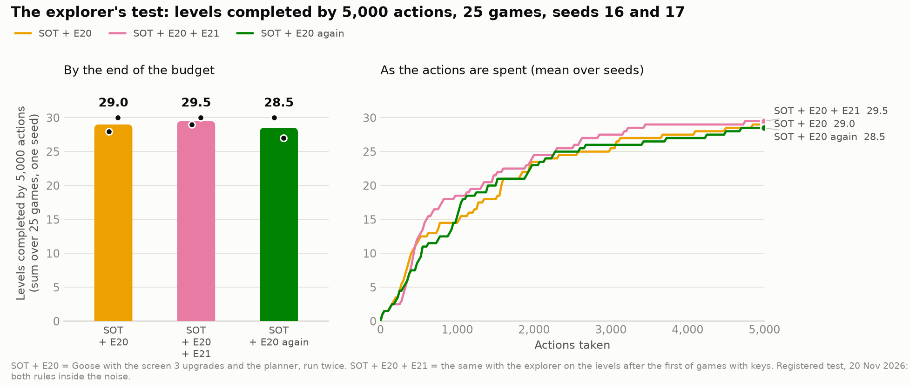

# The explorer's test: results (20 Nov 2026)

**In one line.** **Both rules: inside the noise.** With the explorer, Goose
with the planner ended on 59 levels, against 58 and 57 for the two control
runs (25 games x seeds 16 and 17 x 5,000 actions): +1 against a bar of 9.
Where the explorer plays, its levels came sooner in 4 races of 5 against the
first control: +3 against a bar of 4. The explorer cleared 8 levels, all on
cd82 (2) and tu93 (6), the two games where it was chosen. On the ten other
games with keys where it played it entered 14 later levels and cleared none,
and Goose cleared none there either. Nothing is adopted.

**Status.** Registered on 20 Nov, before any run
([`kp-explorer-test.md`](kp-explorer-test.md)). Run 20 Nov, 13:48 to 19:21:
150 of 150 runs, none failed. Verdict by the registered command, run once, on
20 Nov at 19:22. Runs: `results/kp/test_e21/20261120_134836/` (`verdict.md`,
`runs.csv`). No preset is created.

The three arms: **`SOT-KP`** is Goose with upgrade screen 3's three upgrades
and the planner (a groupmate's agent E20), the arm that passed the planner's
test. **`SOT-KP21`** is the same with the explorer on (the groupmate's agent
E21, unedited): on a game with keys Goose plays level 1 and the explorer plays
the levels after it. **`SOT-KP2`** is `SOT-KP` again, to measure chance.

**Read it as:** the explorer repeats what it did on cd82 and tu93 and reaches
no other game, and a gain that small cannot be told from chance in a 50-run
total at two seeds.



## The verdict

| | The registered rule | Result | |
|---|---|---|---|
| A (1) | `SOT-KP21`'s levels are above both `SOT-KP`'s and `SOT-KP2`'s | 59 against 58 and 57 | met |
| A (2) | `SOT-KP21 - SOT-KP` is above the 97.5th percentile of the chance gap | **+1** against a bar of **9** | not met |
| **Rule A, more levels** | (1) and (2) | | **INSIDE THE NOISE** |
| B (1) | On the levels after the first of the 18 games with keys, the net of level races is above zero against both controls | +3 and +7 | met |
| B (2) | The net against `SOT-KP` is above the 97.5th percentile of the chance gap | **+3** against a bar of **4** | not met |
| **Rule B, sooner where it plays** | (1) and (2) | | **INSIDE THE NOISE** |

Command: `E21TEST=1 uv run python experiments/kp/kp_test.py verdict`.

**Rule A's bar.** It is built from the test's 50 differences
`SOT-KP2 - SOT-KP`, one per game and seed. Six are not zero and they sum to
-1. Of the 10,000 chance gaps drawn from them, 4,509 are +1 or more. One pair
makes most of the bar: tu93 at seed 16, where `SOT-KP` cleared no level and
`SOT-KP2` cleared 4. Without that pair the bar would be 4, and +1 is under
that too (this is not the rule, it only shows what the bar is made of).

**Rule B's bar.** It is built from the 36 nets of `SOT-KP2` against `SOT-KP`.
35 are zero and one is -2 (tu93 at seed 17), so the bar rests on one pair of
runs. Of the 10,000 chance gaps, 598 are +3 or more.

**Why +3 and not more.** A level is raced only where both runs started it. At
seed 16 `SOT-KP` never cleared level 1 of tu93, so the three races of that
pair did not take place. That left five races against `SOT-KP` (four won, one
lost) and eight against `SOT-KP2` (seven won, none lost, one undecided).

## Where the levels are

| Games | Runs an arm | `SOT-KP` | `SOT-KP21` | `SOT-KP2` |
|---|---:|---:|---:|---:|
| **cd82** | 2 | 2 | **4** | 2 |
| **tu93** | 2 | 4 | **8** | 7 |
| The 16 other games with keys | 32 | 19 | 14 | 15 |
| The 7 games with clicks only (the arms are the same agent) | 14 | 33 | 33 | 33 |
| **All 25** | **50** | **58** | **59** | **57** |

On the 18 games with keys, level 1 is Goose's in every arm and the levels
after it are the explorer's in `SOT-KP21`:

| The 18 games with keys | `SOT-KP` | `SOT-KP21` | `SOT-KP2` |
|---|---:|---:|---:|
| Runs with a level 1, of 36 (Goose's in every arm) | 22 | 18 | 19 |
| Levels after the first | 3 | **8** | 5 |
| of them on cd82 | 0 | 2 | 0 |
| of them on tu93 | 3 | 6 | 5 |
| of them on the 16 other games (entered / cleared) | 19 / 0 | 14 / 0 | 15 / 0 |

So against `SOT-KP` the +1 is **+5 on the levels after the first and -4 on
level 1**, and against `SOT-KP2` the +2 is +3 and -1. Level 1 is chance: in
the explorer's arm all 117,144 moves on level 1 of these games were Goose's
own, and its level-1 races split 17 to 13 and 16 to 14, as the two controls'
do (16 to 13).

Of `SOT-KP21`'s 59 levels, 16 were cleared by planning (ft09 10, lp85 6), 8 by
the explorer and 35 by Goose. Each control arm: 16 by planning, the rest by
Goose.

## cd82 and tu93, level by level

Actions spent on the level, from the level-up before it.

| Game, seed | Level | `SOT-KP` (Goose) | `SOT-KP21` (the explorer) | `SOT-KP2` (Goose) |
|---|---:|---|---|---|
| cd82, 16 | 2 | not cleared in 4,231 | **1,043** | not cleared in 4,451 |
| cd82, 17 | 2 | not cleared in 4,524 | **1,446** | not cleared in 4,456 |
| tu93, 16 | 2 | no level 1 | **29** | 139 |
| tu93, 16 | 3 | | **519** | 761 |
| tu93, 16 | 4 | | **686** | 1,571 |
| tu93, 17 | 2 | 188 | **32** | 455 |
| tu93, 17 | 3 | 1,515 | **556** | 2,735 |
| tu93, 17 | 4 | **420** | 686 | not cleared in 303 |

- **cd82:** level 2 in both explorer runs and in none of the four control
  runs. With the recordings and the dev sweep that is 11 of 11 for the
  explorer and 0 of 13 for Goose.
- **tu93:** 4 levels in both explorer runs, with nearly the same actions at
  each seed (the dev sweep: 36, 547, 671 and 31, 568, 689). Of the three
  control runs that cleared level 1, two reached 4 levels and one 3.
- **Neither went further:** the explorer did not clear cd82's level 3 (3,496
  and 3,025 moves) or tu93's level 5 (1,740 and 2,345 moves).

## By tier, by budget, pair by pair

Reported, not part of a rule.

| Tier | Games | `SOT-KP` | `SOT-KP21` | `SOT-KP2` |
|---|---:|---:|---:|---:|
| dev (tuned) | 8 | 29 | 34 | 31 |
| seen (tuned) | 2 | 12 | 11 | 11 |
| A/B-offline (held out) | 8 | 10 | 9 | 10 |
| untouched (held out) | 7 | 7 | 5 | 5 |
| **Tuned tiers** | 10 | 41 | **45** | 42 |
| **Held-out tiers** | 15 | 17 | **14** | 15 |

| Games with keys, by whose games they are for E21 | Games | `SOT-KP` | `SOT-KP21` | `SOT-KP2` |
|---|---:|---:|---:|---:|
| This project's dev and seen (cd82, dc22, g50t, ls20, m0r0, tr87, tu93) | 7 | 15 | 19 | 16 |
| Held-out here, used by E21's author (ar25, bp35, cn04, ka59, lf52) | 5 | 6 | 5 | 5 |
| Held-out here, used by nobody for E21 (re86, sb26, sc25, sk48, sp80, wa30) | 6 | 4 | 2 | 3 |

On the 11 held-out games with keys every level is a level 1, so the 10, 7 and
8 there are Goose's level 1 in each arm.

| Levels completed by | `SOT-KP` | `SOT-KP21` | `SOT-KP2` | `SOT-KP21 - SOT-KP` |
|---|---:|---:|---:|---:|
| 1,000 actions | 29 | 37 | 31 | +8 |
| 2,000 actions | 47 | 49 | 46 | +2 |
| 5,000 actions | 58 | 59 | 57 | +1 |

**The lead at 1,000 actions is chance.** None of those 37 levels is the
explorer's: its first level came at action 1,338. The +8 is Goose's own play,
on level 1 of games with keys (ar25, cn04, sp80) and on games with clicks
only (s5i5, su15, vc33), where the arms are the same agent. The interval with
games resampled is [+3, +15] there and does not reach zero. So that interval
does not guard against two runs of one agent differing.

| Difference | Levels | 95% interval, games resampled | Pairs better / same / worse | Games worse on every seed |
|---|---:|---|---|---|
| `SOT-KP21 - SOT-KP` | +1 | [-8, +12] | 5 / 38 / 7 | none |
| `SOT-KP21 - SOT-KP2` | +2 | [-4, +8] | 8 / 36 / 6 | none |
| `SOT-KP2 - SOT-KP` | -1 | [-7, +7] | 1 / 44 / 5 | none |

**Level races** (which arm finished a level in fewer actions):

| Levels | Against | Races | `SOT-KP21` faster | Control faster | Same or undecided | Net |
|---|---|---:|---:|---:|---:|---:|
| 2 and up, games with keys (rule B) | `SOT-KP` | 5 | 4 | 1 | 0 | +3 |
| 2 and up, games with keys (rule B) | `SOT-KP2` | 8 | 7 | 0 | 1 | +7 |
| 1, all games | `SOT-KP` | 36 | 17 | 13 | 6 | +4 |
| 1, all games | `SOT-KP2` | 35 | 16 | 14 | 5 | +2 |

`SOT-KP2` against `SOT-KP`: 0 against 2 on levels 2 and up of the games with
keys, 16 against 13 on level 1. All of rule B's races are on cd82 and tu93.

## Every game

Levels by 5,000 actions, written `seed 16, seed 17`. The last column is for
the `SOT-KP21` runs.

| Game | Tier | Keys | `SOT-KP` | `SOT-KP21` | `SOT-KP2` | The explorer: later levels entered / cleared, its moves |
|---|---|---|---|---|---|---|
| **cd82** | dev | yes | 1, 1 | **2, 2** | 1, 1 | 4 / **2**, 8,986 |
| **tu93** | dev | yes | 0, 4 | **4, 4** | 4, 3 | 8 / **6**, 6,449 |
| dc22 | dev | yes | 1, 1 | 1, 1 | 1, 1 | 2 / 0, 1,828 |
| g50t | dev | yes | 1, 1 | 0, 1 | 1, 1 | 1 / 0, 2,153 |
| m0r0 | dev | yes | 1, 1 | 1, 1 | 1, 1 | 2 / 0, 7,846 |
| tr87 | dev | yes | 1, 0 | 1, 0 | 0, 0 | 1 / 0, 2,684 |
| ls20 | seen | yes | 1, 1 | 0, 1 | 1, 0 | 1 / 0, 2,704 |
| ar25 | A/B-offline | yes | 1, 1 | 0, 1 | 1, 1 | 1 / 0, 4,007 |
| lf52 | A/B-offline | yes | 1, 1 | 1, 1 | 1, 1 | 2 / 0, 7,382 |
| re86 | A/B-offline | yes | 0, 0 | 0, 0 | 0, 0 | no level 1 |
| sc25 | A/B-offline | yes | 0, 0 | 0, 0 | 0, 0 | no level 1 |
| sp80 | A/B-offline | yes | 1, 1 | 1, 1 | 1, 1 | 2 / 0, 8,906 |
| bp35 | untouched | yes | 0, 0 | 1, 0 | 0, 0 | 1 / 0, 3,262 |
| cn04 | untouched | yes | 1, 1 | 1, 0 | 0, 1 | 1 / 0, 4,386 |
| ka59 | untouched | yes | 0, 0 | 0, 0 | 0, 0 | no level 1 |
| sb26 | untouched | yes | 1, 0 | 0, 0 | 1, 0 | no level 1 |
| sk48 | untouched | yes | 0, 1 | 0, 0 | 0, 0 | no level 1 |
| wa30 | untouched | yes | 0, 0 | 0, 0 | 0, 0 | no level 1 |
| ft09 | dev | no | 6, 6 | 6, 6 | 6, 6 | |
| vc33 | dev | no | 2, 2 | 2, 2 | 2, 2 | |
| lp85 | seen | no | 5, 5 | 5, 5 | 5, 5 | |
| s5i5 | A/B-offline | no | 1, 1 | 1, 1 | 1, 1 | |
| su15 | A/B-offline | no | 1, 1 | 1, 1 | 1, 1 | |
| tn36 | A/B-offline | no | 0, 0 | 0, 0 | 0, 0 | |
| r11l | untouched | no | 2, 1 | 1, 2 | 2, 1 | |
| **All 25** | | | **28, 30** | **29, 30** | **30, 27** | 26 / 8, 60,593 |

One row per game with the action of each run's last level:
`results/kp/test_e21/per_game.md`.

## What the explorer did

- **Where it played.** Its path was taken on the 18 games with keys and on no
  other. On the levels after the first it made 60,593 moves; 71 more were
  Goose's, the moves on which the explorer had nothing left to try (bp35 44,
  tu93 27).
- **What it cleared.** Eight levels: cd82's level 2 and tu93's levels 2 to 4,
  at both seeds.
- **Where it cleared nothing.** 14 later levels on ten other games, with 269
  to 4,793 moves on each. Seven of them are on held-out games (ar25, bp35,
  cn04, lf52 twice, sp80 twice: 27,943 moves).
- **Goose cleared nothing there either.** In the two control arms Goose
  entered 34 later levels of those 16 games and cleared none. So at this
  budget the explorer lost no level by taking them from Goose.
- **Where it never played.** ka59, re86, sb26, sc25, sk48 and wa30: Goose
  cleared no level 1 in the explorer's arm.
- **The planner is untouched.** In all three arms ft09 was won with the same
  178 clicks (5 levels by planning a run) and lp85's levels 2 to 4 were
  planned (level 5 was Goose's).
- **No error in 150 runs.** No move went by unseen, and every move the
  explorer or the planner chose was the move sent.
- **Cost: none.** 109 ms per action against 111 and 111 at the median; a run
  took 545 seconds against 554 and 557.

## What the written expectation got right and wrong

| Written before the runs (`kp-explorer-test.md`) | What happened | |
|---|---|---|
| The seven games with clicks only: no effect | 33 levels in each arm | right |
| ft09: 6 levels in every run of every arm | 6 in all six runs | right |
| lp85: 4 to 7 levels where Goose clears level 1 | 5 in all six runs | right |
| cd82: 2 levels in each explorer run against 1 in each control run, so +2 | 2 and 2 against 1 and 1, twice | right |
| tu93: 4 levels in each explorer run; a control has 4 in about two of three; +0 to +2 | 4 and 4 against 0 and 4, and 4 and 3: +4 and +1 | **the count is outside the range against one control:** a control run with no level 1 was not foreseen |
| tu93: levels 2 to 4 sooner | sooner in 7 of 8 decided races | right, but for level 4 at seed 17 against `SOT-KP` |
| dc22, g50t, ls20, m0r0, tr87: the same count; no arm clears a second level | no second level; 9 against 7 and 7, all of it level 1 | right on the later levels; level 1 moved the count by 2 |
| The 11 held-out games with keys: between -2 and +3 | 10 against 7 and 8: -3 and -1, all of it level 1 | a little below the range against one control |
| ar25: the explorer takes level 2 from Goose and may lose it | no control cleared ar25's level 2 (0 of 4), and the explorer did not in its one try | not seen either way |
| re86, sb26, sc25, wa30: no level 1, so the explorer will not play | it did not play. Both controls cleared sb26's level 1 at seed 16, which no arm did in the planner's test | right for the explorer |
| sp80 and sk48: the two games nobody used for E21 on which it will play | sp80: both runs, 8,906 moves, nothing cleared. sk48: no level 1 in its arm | half |
| `SOT-KP` and `SOT-KP2` near 62 each | 58 and 57 | a little high |
| `SOT-KP21 - SOT-KP` about +3, between -1 and +7 | +1 | inside the range |
| Rule A's bar: between 5 and 9 | 9 | the top of the range |
| Rule A more likely says "inside the noise" | inside the noise | right |
| Rule B: about +8 from cd82 and tu93 if they repeat, against a bar of 4 to 7; about even, leaning to a pass | cd82 and tu93 did repeat. +3 against a bar of 4, because one control run had no level 1 to race from; +7 against the other control | **wrong: it did not pass** |

## Did the test work?

| Check | Result |
|---|---|
| The run set | 150 of 150 runs, each in the manifest once. None failed and none was retried (there is no `failed.tsv`). 144 played 5,000 actions; the six ft09 runs stopped at 349 to 1,067 because they won the game |
| The frozen code | Started from `041e76f` with a clean tree. Code hash `bf4882f94f0ade61` and settings hashes `d468480ec9387b71` and `991f479318fce2d0`, as registered, and the same after the runs. No file a run loads differs from `4e310f7` |
| The arms | `SOT`'s flags in all 150 `run_config.json`. The explorer on in the 50 `SOT-KP21` runs only, with the committed settings |
| Training | A step on at least 87% of actions in every run but ft09's six (30% to 75%: the game was won in 349 to 1,067 actions) |
| Sanity anchor | `SOT-KP` 58 and `SOT-KP2` 57: inside 40 to 80, and near the 62 expected |
| The verdict | Run once. `kp_explorer_verdict.py` is unchanged (sha256 starts `42464b7b9bee7142`). The totals by budget, the pair counts, the intervals and the level-1 races were counted a second time by `tools/levels_by_budget.py` and agree |
| Changes after the start | None |
| Looks before the end | At 13:58 (4 runs in) and 15:56 (52 runs in): errors, settings and how each run ended. No level count was read, and nothing was changed, stopped or rerun |

## What it means

- **On cd82 and tu93 the explorer did again what it did before.** cd82's
  level 2 in 2 of 2 runs, where no control run cleared it in 4,200 to 4,500
  actions. tu93's 4 levels in 2 of 2 runs, with the same actions a level as in
  the dev sweep.
- **It reaches no other game at this budget.** The test added ten games with
  keys where it played, five of them held-out: 14 levels entered, none
  cleared. Goose cleared none there either, so it cost nothing.
- **A gain of this size cannot show in the total.** The explorer's own levels
  are worth +3 to +5 in 50 runs. Goose's level 1 on the same games moved the
  three arms by as much (22, 18 and 19 runs with a level 1), and two control
  runs of tu93 came 4 levels apart.
- **"Sooner where it plays" is not shown either.** The races went the
  explorer's way (4 of 5, and 7 of 8), but they are few and on two games, and
  the count against the first control is under its bar.
- **So the explorer stays what it was before the test:** a narrow result on
  two dev games, with the offline check as its evidence (cd82's level 2 from
  7 of 7 recordings), and no measurable effect on the 25-game score.

## Limits

1. **Where the explorer was chosen is in the test.** All eight of its levels
   are on cd82 and tu93, where it was picked over E22 and E24.
2. **Two seeds, 5,000 actions.** Nothing here says what happens in a longer
   run, where the explorer has more time on the levels it did not clear, and
   Goose does too.
3. **The bars are yardsticks.** Rule A's came mostly from one pair of runs,
   and rule B's from one pair alone.
4. **Rule B had 5 and 8 races, all on two games.**
5. **Few held-out levels.** The explorer played 7 later levels on 5 held-out
   games. On six games with keys it never played, because Goose cleared no
   level 1 in its arm.
6. **The base is `SOT-KP`,** which is not adopted.

## Open, Matt's

Nothing below is decided or done.

1. **What the result leads to.** The explorer's switch is off by default and
   there is no preset. Whether it stays in the code, as the carry switches
   did after their test.
2. **How the report words it.** The registered result is "inside the noise on
   both rules". The cd82 and tu93 numbers are a tuned-tier description.
3. **Naming and credit:** E21 is the groupmate's code, as E20 is.

## Files

| | |
|---|---|
| The test and its two rules | [`kp-explorer-test.md`](kp-explorer-test.md) |
| How the explorer was chosen, and its dev sweep | [`kp-explorer.md`](kp-explorer.md) |
| The verdict page and one row per run | `results/kp/test_e21/20261120_134836/verdict.md`, `runs.csv` |
| The runs | `results/kp/test_e21/20261120_134836/runs/<arm>/<game>_s<seed>/`; a run's `kp/` folder holds `kp_stats.json`, `events.jsonl` and `store.json` |
| The figure and the table by game | `figures/explorer_test.png`; `results/kp/test_e21/per_game.md` |

```bash
E21TEST=1 uv run python experiments/kp/kp_test.py verdict        # the verdict page again
M=results/kp/test_e21/20261120_134836/manifest.tsv
uv run python tools/levels_by_budget.py --base $M:SOT-KP --new $M:SOT-KP21 --budgets 1000,2000,5000 --by-game
uv run python experiments/kp/sweep_table.py --by-game --arms "SOT + E20=$M:SOT-KP" "SOT + E20 + E21=$M:SOT-KP21" "SOT + E20 again=$M:SOT-KP2"
uv run python experiments/kp/ladder_chart.py --out results/kp/test_e21/chart_test --colours 4,5,6 \
    --series "SOT + E20=$M:SOT-KP" "SOT + E20 + E21=$M:SOT-KP21" "SOT + E20 again=$M:SOT-KP2"
```
