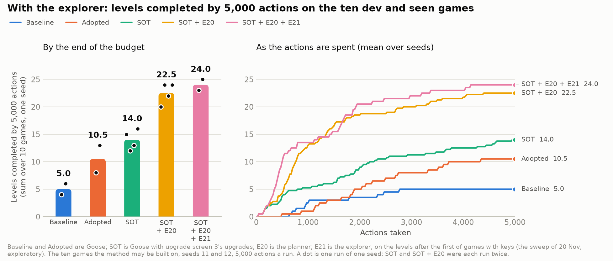

# Knowledge Planner: an explorer for keyboard games (20 Nov 2026)

**In one line.** The planner (E20) does nothing on games played with keys. Of
the groupmate's three later agents for those games, one helps behind this
project's Goose: E21, an explorer that searches the screens systematically.
From recordings, after Goose's own level 1 it cleared level 2 of cd82 from 7
of 7 recordings where Goose cleared it from none, and reached 4 levels of tu93
from 7 of 7 where Goose did from 4 of 7: 63 levels against 52 over 35
recordings, never fewer than Goose. The planner on top of it (E22) and the
other explorer (E24) both lose levels. E21 now runs behind a switch that is
off by default. In a GPU sweep on the ten dev and seen games it ended on 48
levels against 46 without it: one more level of cd82 at each seed, the same
count everywhere else, and no error.

**Status: exploratory.** Dev and seen games only, the games the method may be
built on, and cd82 is one the groupmate built E21 on. No rule was written
before the runs. Nothing is adopted, there is no preset, and no held-out game
was touched.

**20 Nov, later: its registered test.** Matt asked for a test on all 25 games
the same day. It stayed inside the noise on both of its rules: 59 levels
against 58 and 57, and sooner in 4 level races of 5, which is under that
rule's bar. The explorer cleared cd82's level 2 and tu93's levels 2 to 4
again, and no level on any other game:
[`kp-explorer-results.md`](kp-explorer-results.md).

Asked by Matt on 20 Nov: can the groupmate's agents for the other games do
more now that Goose clears a level 1 for them to learn from, and can anything
in the data improve on them? The planner's own test is `kp-results.md`.

## Where the planner stops

In the test, 19 of the 25 games had a level 1 cleared by 5,000 actions, and
the planner acted on two of them. Of the other 17, 13 are played mostly or
only with keys (Goose's own moves there are 85% to 100% key presses), and E20
books clicks only. The last four are click games whose pieces move (r11l,
s5i5, su15, vc33).

The groupmate's report (5 Nov) has three more agents for games with keys.
None was in the first four files received; all are in the same archive.

| Agent | What it adds | In the groupmate's own test (8 other games, 48 episodes of 1,500 actions, their small Goose) |
|---|---|---|
| E21 | A graph of the screens seen: try every move not yet tried on a screen, walk back to the nearest screen that still has one. It carries to the next level what a cleared one taught: which moves do something, the piece the keys move, what it was touching when the level ended, the move that ended it | 18 levels against 5. With nothing carried (E21b): 16 |
| E22 | E21, and a movement model, goal rules ("touch this", "none of these left") and a search | 18, the same as E21: "its movement planner never acts" |
| E24 | E21 with another way of choosing where to explore (Go-Explore) | 17 |

Their report names the cause: the two games with a piece to steer never had a
level 1 cleared. This project's Goose clears it (dc22 in 6 of 6 test runs).

## The check, from recordings

`experiments/kp/explorer_probe.py`, on the CPU. A recording of Goose is
replayed on the engine. While level 1 lasts the agent is handed the
recording's moves in the one place where it chooses a move, so it learns from
each as if it had chosen it. From the first move of level 2 it plays alone, as
the groupmate built it, to the recording's action 5,000. "Goose" is what the
same recording went on to do.

Recordings: `SOT` Goose, 43 of them (the test's `SOT` and `SOT2`, the first
dev sweep's `SOT`, upgrade screen 3's `SOT`) on the seven dev and seen games
with keys. 35 have a level 1 inside 5,000 actions; tr87 has none.

Levels by action 5,000, summed over the recordings:

| Game | Recordings | Goose | E21, nothing carried | **E21** | E22 | E24 |
|---|---|---|---|---|---|---|
| cd82 | 7 | 7 | 13 | **14** | 14 | 14 |
| tu93 | 7 | 24 | 28 | **28** | 23 | 12 |
| dc22 | 7 | 7 | 7 | 7 | 7 | 7 |
| m0r0 | 7 | 7 | 7 | 7 | 7 | 7 |
| ls20 | 4 | 4 | 4 | 4 | 4 | 4 |
| g50t | 3 | 3 | 3 | 3 | 3 | 3 |
| **All** | **35** | **52** | 62 | **63** | 58 | 47 |

- **E21 against Goose: better in 10 recordings, the same in 25, worse in
  none.** All of it is on two games.
- **cd82:** level 2 from 7 of 7, in 583 to 1,891 actions (median 1,342). Goose:
  0 of 7.
- **tu93:** each later level in fewer actions.

  | tu93 | Goose | E21 |
  |---|---|---|
  | Level 2 | 7 of 7, median 170 actions | 7 of 7, median 32 |
  | Level 3 | 6 of 7, median 1,335 | 7 of 7, median 598 |
  | Level 4 | 4 of 7, median 1,579 | 7 of 7, median 724 |

- **Most of the levels come from the systematic search, not from what level 1
  taught:** with nothing carried, 62 levels against 63. Carrying makes them
  come sooner: cd82's level 2 in a median of 1,342 actions against 3,859, and
  tu93's level 4 in 724 against about 1,060.
- **The planner (E22) cleared nothing.** It did learn from Goose's level 1: a
  piece it controls, its moves and goal rules on dc22, g50t, ls20 and tu93. It
  planned on dc22 (7 steps each time), g50t (142 to 164) and tu93 (28 to
  1,969). No level ended on a planned move, and on tu93 it ended below Goose
  in 3 of 7 recordings.
- **E24 loses tu93** (12 levels against 28; below Goose in 6 of 7).
- **On dc22, g50t, ls20 and m0r0 nobody cleared level 2**, Goose included.

## Other options tried on the same recordings

| Option | Result | Kept? |
|---|---|---|
| E21 or E24 from the first move, with no Goose level 1 | 27 and 26 levels on 43 recordings, where Goose had 52. E21 never cleared level 1 of dc22, g50t or ls20 | No: Goose keeps level 1 |
| E21 on vc33, a game with clicks only where the planner does nothing | 14 levels against Goose's 17 on 7 recordings. Level 2 came sooner in 6 of 7; level 3 never came (Goose: 3 of 7) | No: it stays off games with clicks only |
| E22's planner, E24's exploring | the table above | No |
| Nothing carried (E21b) | one level fewer, and later | No: the carry stays on |

So the one thing built is E21 as received, with its carry, for the levels
after the first on games with keys.

## What was built

`[explore] keys = "e21"` in the planner's settings. It is off in
`experiments/kp/kp.toml`, which is left as the test ran it (its hash is still
`d468480ec9387b71`), and on in `experiments/kp/kp_e21.toml`.

- **The file:** `custom_agents/kp_ref/e21_object_explorer.py`, byte for byte
  from the groupmate's archive (hash in that folder's README). It is a
  subclass of E20 and calls E20 unchanged on a game that offers only clicks.
- **The bridge** (`custom_agents/kp_bridge.py`): E21 chooses a move in one
  place. The bridge stands there. Level 1 is Goose's move. A later level is
  E21's own move, until it has nothing left to try on a screen; that move is
  Goose's again. E21 books the move either way, so it learns from Goose's
  level 1.
- **Not changed:** `action.py` and its 18 lines tagged `# [kp]`. With
  `EVAL_KP` unset no line of the bridge runs, so the standard agents are
  untouched.
- **Tests:** 7 new in `tests/test_kp_bridge.py`, on Walk, a made-up game with
  keys (`tests/kp_games.py`): the explorer wins it after Goose's level 1; a
  game with clicks only gives the planner's moves exactly; with planning off
  it only watches; it draws no random number.

## The bridge gives the probe's results

`tools/kp_offline.py takeover --config experiments/kp/kp_e21.toml`, which
drives the real bridge with the hook's own calls: 28 episodes, no error, no
replay mismatch.

| Game | Episodes | Against |
|---|---|---|
| cd82 | 7 | the probe: the same level-2 action count in 7 of 7 (583 to 1,891) |
| tu93 | 7 | the probe: the same action count for every level up to the explorer's first move with nothing to try, in 7 of 7 |
| ft09 | 7 | the planner alone (`kp.toml`) on the same recordings: the same row in 7 of 7. Won each time, with 23, 37, 34, 47 and 37 actions |
| lp85 | 7 | the planner alone on the same recordings: the same row in 7 of 7. Level 4 from the 6 that have a level 1, stopping on level 5 after 41 wrong predictions |

And in the real agent loop, on the CPU (cd82, seed 0, 300 actions, the adopted
Goose's flags): Goose cleared level 1 in 9 moves, the explorer made the next
289, and no move went by unseen.

## The dev sweep (GPU)

`SOT-KP` (Goose with upgrade screen 3's upgrades and the planner) against
`SOT-KP21` (the same with the explorer on) x the ten dev and seen games x
seeds 11 and 12 x 5,000 actions = 40 runs, 20 Nov 11:21 to 12:45, none failed,
no error in the planner's files (`results/kp/dev_e21/20261120_112115/`).



| Levels completed by | `SOT-KP` | `SOT-KP21` | Difference | Pairs better / same / worse | 95% interval, games resampled |
|---|---|---|---|---|---|
| 1,000 actions | 22 | 27 | +5 | 4 / 13 / 3 | [-6, +19] |
| 2,000 actions | 37 | 41 | +4 | 5 / 14 / 1 | [-1, +10] |
| **5,000 actions** | **46** | **48** | **+2** | **2 / 18 / 0** | [+0, +6] |

| Game | `SOT-KP` (seed 11, seed 12) | `SOT-KP21` | What the explorer did |
|---|---|---|---|
| **cd82** | 1, 1 | **2, 2** | cleared level 2, in 1,052 and 1,358 actions |
| tu93 | 4, 4 | 4, 4 | cleared levels 2, 3 and 4 in 36, 547 and 671 moves, and in 31, 568 and 689. Goose in the other arm took 110, 876 and 1,351, and 181, 1,139 and 1,702 |
| dc22, g50t, ls20, m0r0 | 1, 1; 0, 1; 1, 1; 1, 1 | the same | played the levels after the first and cleared none |
| tr87 | 0, 0 | 0, 0 | nothing: no level 1 |
| ft09 | 6, 6 | 6, 6 | nothing: clicks only. The planner won both, 5 levels by planning each |
| lp85 | 5, 7 | 5, 7 | nothing: clicks only. 3 and 5 levels by planning in both arms |
| vc33 | 3, 2 | 3, 2 | nothing: clicks only |

- **The gain is where the recordings said it would be:** cd82's level 2, at
  both seeds. Nothing else changed in the count, and no pair lost a level.
- **On tu93 the count is the same and the levels came sooner:** level 4 at
  action 3,181 and 2,956 against 4,062 and 4,379. Goose happened to reach 4
  levels in both of the other arm's runs; in the recordings it did in 4 of 7.
- **Level by level on the games with keys:** of the 8 levels after the first
  that both arms started and one finished, the explorer's arm was faster on 8.
- **The planner is untouched.** ft09 and lp85 give the same levels by
  planning in both arms.
- **Cost:** none measurable. A run took 495 seconds against 501.

**How to read it.** +2 levels is what chance alone moves these totals by: the
same `SOT-KP` arm ended on 44 levels on these ten games in the test and on 46
here. So the sweep's count does not settle it. What does carry weight is the
offline check, which repeats exactly: cd82's level 2 from 7 of 7 recordings,
and now from 2 of 2 runs.

The five agents on these ten games, levels a seed: baseline 5.0, adopted
10.5, `SOT` 14.0, `SOT-KP` 22.5 (four runs), `SOT-KP21` 24.0
(`experiments/kp/ladder_chart.py`; every game: `results/kp/dev_e21/per_game.md`).

## Limits

1. **Two games.** All of the gain is on cd82 and tu93. On the other four dev
   and seen games with keys the explorer changes nothing at this budget.
2. **Tuned tier.** These are games the method may be built on, and E21 was
   built by the groupmate with cd82, dc22 and g50t among its games.
3. **It is an explorer, not a planner.** It replaces Goose's moves on the
   later levels of games with keys. The groupmate found it worse than their
   Goose where screens rarely repeat (cn04). On a held-out game where Goose
   would have cleared a later level, it could lose that level.
4. **5,000 actions.** Nothing here says what happens in a longer run.

## Open, Matt's

- ~~Whether to register a test on all 25 games.~~ Registered and run on 20
  Nov at Matt's word (entry 12 of the pre-registration's section 11):
  [`kp-explorer-results.md`](kp-explorer-results.md).
- Naming and credit: E21 is the groupmate's code, as E20 is.

## Run it again

```bash
uv run python experiments/kp/explorer_probe.py                        # E21 after Goose's level 1 (3 minutes)
uv run python experiments/kp/explorer_probe.py --agents E21b          # nothing carried
uv run python experiments/kp/explorer_probe.py --agents E22,E24 --ref <a folder with their two files>
uv run python experiments/kp/explorer_probe.py --agents E21,E24 --from-start --ref <the same folder>
uv run python experiments/kp/explorer_probe.py --games vc33 --force-keys
uv run python tools/kp_offline.py takeover --config experiments/kp/kp_e21.toml --out results/kp/e21_offline \
    --games cd82,tu93,ft09,lp85
E21=1 uv run python experiments/kp/kp_test.py plan                    # the dev sweep: also start, status, pause, resume
uv run python experiments/kp/sweep_table.py --arms "SOT-KP=<manifest>:SOT-KP" "SOT-KP21=<manifest>:SOT-KP21"
uv run python tools/levels_by_budget.py --base <manifest>:SOT-KP --new <manifest>:SOT-KP21 --budgets 1000,2000,5000 --by-game
```

Tables of 20 Nov: `results/kp/explorer_probe/` (the probe), `results/kp/e21_offline/`
and `results/kp/e21_offline_plain/` (the bridge, with the explorer and without),
`results/kp/dev_e21/` (the sweep).
