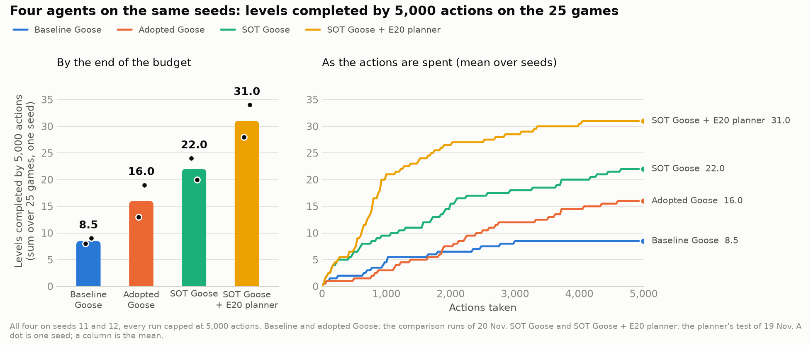

# Four agents at the same budget and on the same seeds (20 Nov 2026)

**In one line.** On all 25 games, seeds 11 and 12, 5,000 actions a run: the
baseline Goose completes 8.5 levels a seed, the adopted Goose 16.0, Goose with
upgrade screen 3's upgrades (`SOT`) 22.0, and `SOT` with the knowledge planner
(E20) 31.0.

**Status: exploratory.** A table and a figure. No rule was written before the
runs and nothing is adopted from it. Asked by Matt on 20 Nov: one comparison
of the baseline, the adopted Goose, `SOT` and E20 at 5,000 actions, with two
seeds. The last two rows are the planner's registered test (`kp-results.md`);
the first two were run for this page.



## The table

Levels completed by 5,000 actions, summed over the 25 games.

| Agent | Seed 11 | Seed 12 | **Mean a seed** | By 1,000 actions (mean) | By 2,000 (mean) | Games with a level 1 at either seed |
|---|---|---|---|---|---|---|
| Baseline Goose (`goose`, no flag) | 8 | 9 | **8.5** | 4.5 | 6.5 | 9 |
| Adopted Goose (`mb_gated_att`'s flags) | 13 | 19 | **16.0** | 3.0 | 7.5 | 14 |
| `SOT` Goose | 24 | 20 | **22.0** | 9.5 | 15.5 | 17 |
| `SOT` + the planner (`SOT-KP`) | 28 | 34 | **31.0** | 21.0 | 26.5 | 18 |

`SOT` run again in the planner's test (`SOT2`): 22 and 25, mean 23.5.

Each step up: +7.5 levels a seed (the adopted Goose over the baseline), +6.0
(`SOT` over the adopted Goose), +9.0 (the planner over `SOT`).

## By tier

Two seeds summed.

| Tier | Baseline | Adopted | `SOT` | `SOT-KP` |
|---|---|---|---|---|
| dev (8 games) | 7 | 18 | 23 | 32 |
| seen (2) | 3 | 3 | 4 | 12 |
| A/B-offline (8) | 2 | 7 | 11 | 11 |
| untouched (7) | 5 | 4 | 6 | 7 |
| **All 25** | **17** | **32** | **44** | **62** |

The planner's step is all on ft09 and lp85 (`kp-results.md`). The first two
steps reach the held-out games too: on the 15 of them, 7, 11 and 17 levels.

## Every game

Each cell is written seed by seed (seed 11 / seed 12). Moves: the action at
which the run's last level was completed; `-` where no level was. Compare
moves only where the level counts match: a run with more levels shows the
moves for a later level.

| Game | Baseline: levels | moves | Adopted: levels | moves | `SOT`: levels | moves | `SOT-KP`: levels | moves |
|---|---|---|---|---|---|---|---|---|
| ar25 | 0 / 0 | - / - | 1 / 1 | 2,209 / 2,380 | 2 / 1 | 3,717 / 911 | 2 / 1 | 1,849 / 902 |
| bp35 | 0 / 0 | - / - | 0 / 0 | - / - | 0 / 0 | - / - | 0 / 1 | - / 3,344 |
| cd82 | 0 / 1 | - / 1,017 | 1 / 1 | 1,626 / 1,218 | 1 / 1 | 623 / 581 | 1 / 1 | 868 / 981 |
| cn04 | 1 / 0 | 2,986 / - | 0 / 1 | - / 2,581 | 1 / 1 | 4,160 / 3,709 | 0 / 1 | - / 499 |
| dc22 | 0 / 0 | - / - | 0 / 1 | - / 2,745 | 1 / 1 | 1,981 / 1,985 | 1 / 1 | 1,886 / 3,285 |
| ft09 | 2 / 1 | 2,754 / 751 | 1 / 2 | 1,109 / 3,519 | 2 / 1 | 3,631 / 425 | 6 / 6 | 793 / 763 |
| g50t | 0 / 0 | - / - | 0 / 0 | - / - | 1 / 0 | 4,267 / - | 1 / 1 | 4,049 / 2,837 |
| ka59 | 0 / 0 | - / - | 0 / 0 | - / - | 0 / 0 | - / - | 0 / 1 | - / 1,692 |
| lf52 | 0 / 0 | - / - | 0 / 0 | - / - | 1 / 1 | 2,089 / 1,848 | 1 / 1 | 905 / 1,630 |
| lp85 | 1 / 2 | 687 / 2,475 | 1 / 2 | 857 / 2,030 | 1 / 1 | 213 / 166 | 5 / 7 | 2,692 / 988 |
| ls20 | 0 / 0 | - / - | 0 / 0 | - / - | 1 / 1 | 2,923 / 1,889 | 0 / 0 | - / - |
| m0r0 | 0 / 1 | - / 1,782 | 1 / 1 | 1,899 / 3,623 | 1 / 1 | 1,568 / 561 | 1 / 1 | 550 / 529 |
| r11l | 1 / 1 | 228 / 1,002 | 1 / 1 | 1,865 / 808 | 1 / 1 | 42 / 99 | 1 / 1 | 42 / 99 |
| re86 | 0 / 0 | - / - | 0 / 0 | - / - | 0 / 0 | - / - | 0 / 0 | - / - |
| s5i5 | 0 / 0 | - / - | 1 / 1 | 4,056 / 3,723 | 1 / 1 | 762 / 848 | 1 / 1 | 915 / 2,014 |
| sb26 | 0 / 0 | - / - | 0 / 0 | - / - | 0 / 0 | - / - | 0 / 0 | - / - |
| sc25 | 0 / 0 | - / - | 0 / 0 | - / - | 0 / 0 | - / - | 0 / 0 | - / - |
| sk48 | 1 / 1 | 66 / 1,631 | 1 / 0 | 66 / - | 1 / 1 | 66 / 134 | 1 / 1 | 66 / 134 |
| sp80 | 1 / 1 | 24 / 123 | 1 / 2 | 24 / 4,598 | 1 / 1 | 24 / 247 | 1 / 1 | 24 / 247 |
| su15 | 0 / 0 | - / - | 0 / 0 | - / - | 1 / 1 | 2,234 / 2,052 | 1 / 1 | 1,352 / 868 |
| tn36 | 0 / 0 | - / - | 0 / 0 | - / - | 0 / 0 | - / - | 0 / 0 | - / - |
| tr87 | 0 / 0 | - / - | 0 / 1 | - / 4,348 | 0 / 0 | - / - | 0 / 0 | - / - |
| tu93 | 0 / 0 | - / - | 2 / 3 | 1,854 / 3,704 | 4 / 4 | 4,427 / 3,269 | 3 / 4 | 3,079 / 3,980 |
| vc33 | 1 / 1 | 2,345 / 964 | 2 / 2 | 3,308 / 2,482 | 3 / 2 | 4,643 / 1,067 | 2 / 3 | 894 / 1,726 |
| wa30 | 0 / 0 | - / - | 0 / 0 | - / - | 0 / 0 | - / - | 0 / 0 | - / - |
| **All 25 games** | **8 / 9** |  | **13 / 19** |  | **24 / 20** |  | **28 / 34** |  |

The planner acts on ft09 and lp85 only. On every other game `SOT` and `SOT-KP`
are the same agent, so their differences there are chance. Five games were
cleared by no agent: re86, sb26, sc25, tn36 and wa30.

## The same agents on other seeds

The first three rows repeat what earlier runs gave at action 5,000.

| Agent | Here (seeds 11, 12) | Earlier |
|---|---|---|
| Baseline Goose | 8, 9 | 10, 7, 7 (seeds 0 to 2, the 100,000-action runs of 17-22 Sep, read at action 5,000) |
| Adopted Goose | 13, 19 | 16, 15, 16 (27 Sep) and 15, 18, 16 (7-8 Nov), read the same way; 15 and 15 (upgrade screen 3, seed 0) |
| `SOT` Goose | 24, 20 and 22, 25 | 22 (upgrade screen 3, seed 0) |

## How to read it

- **It is a short budget.** At 100,000 actions the baseline and the adopted
  Goose complete 54 and 112 levels on three seeds (18 and 37 a seed). `SOT`
  and the planner have never been run past 5,000.
- **Two seeds.** A seed's total moves by several levels by chance: the adopted
  Goose's two seeds are 13 and 19, and two runs of `SOT` on the same seeds
  ended 3 levels apart over the two seeds. The steps between the rows are
  larger than that, and the planner's step is the one tested against a rule.
- **Nothing is adopted beyond the adopted Goose.** `SOT` is one seed of an
  exploratory screen plus this test's runs, and the planner's gain is on two
  games.

## The runs

`results/kp/ladder/20261120_102540/`: `goose` and `adopted` x 25 games x seeds
11, 12 x 5,000 actions = 100 runs, 20 Nov 10:25 to 11:19, none failed, about
2.1 minutes a run with four at a time. Every run is `run_local.py --agent
goose --offline` with its arm's flags, as in the planner's test; `adopted` is
`EVAL_LABEL=novel EVAL_RETURN_MAP=1 EVAL_UPGRADES=bars,map_gated,attempt`. The
runs started from commit `16ce338` with the launcher's new run set not yet
committed; these two arms load none of the planner's files.

```bash
LADDER=1 uv run python experiments/kp/kp_test.py plan        # also start, status, pause, resume
uv run python experiments/kp/ladder_chart.py --out results/kp/ladder/chart2_same_seeds \
    --series "Baseline Goose=results/kp/ladder/20261120_102540/manifest.tsv:goose" \
             "Adopted Goose=results/kp/ladder/20261120_102540/manifest.tsv:adopted" \
             "SOT Goose=results/kp/test/20261119_181131/manifest.tsv:SOT" \
             "SOT Goose + E20 planner=results/kp/test/20261119_181131/manifest.tsv:SOT-KP"
```

`ladder_chart.py` also writes the figure's numbers as a `.csv`. The table of
every game: `experiments/kp/sweep_table.py --by-game --arms "Baseline
Goose=<manifest>:goose" ...` (the same four series).
