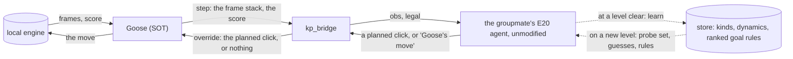

# Knowledge Planner (KP): the groupmate's E20 behind Goose with the screen 3 upgrades (`SOT`)

*Implementation plan · 19 Nov 2026, third version: 5,000 actions a run, 2 seeds, `SOT` as the base agent · written for Matt, to be carried out with Claude Code · nothing in it is built yet.*
*Suggested home in the repo: `docs/4-knowledge-planner/kp-plan.md`. Read from branch `goose-screen3` at `170d117`.*

## In one line

Goose with all three screen 3 upgrades (`SOT`) plays level 1 as it does now. Each time a level is cleared, the agent learns three things from its own play: what is clickable, what a click does, and which rule was true only on the solved board. On the next level it probes, checks its model, plans to the best-supported rule, and hands the level back to Goose when it cannot. The core has no LLM. It is tested at 5,000 actions a game on all 25 games, 2 seeds, against `SOT` without it.

## What changed since the first version

Matt, 19 Nov: every run is at most 5,000 actions, on all the games, with 2 seeds; and the planner sits on `SOT`, not on the adopted Goose. Six things follow.

| | First version | Now |
|---|---|---|
| The base agent | the adopted Goose (`mb_gated_att`) | **`SOT`**: the adopted Goose's flags with `map_sched` in `map_gated`'s place, `objclick`, and `EVAL_TRAIN_EVERY=1 EVAL_TRAIN_RECENT=16`. Screen 3's best arm: 22 levels by 5,000 actions against 15 and 15 (one seed, exploratory, nothing adopted) |
| The test | 25 games x 3 seeds x 100,000 actions, about 22 GPU-hours | 25 games x 2 seeds x 5,000 actions, about 5.5 GPU-hours. `SOT` trains on nearly every action and runs at a third of the adopted Goose's speed |
| Measuring chance | resampling earlier 100,000-action runs | the baseline is run twice in the test itself, as upgrade screen 3 did |
| The rule | the confirm rule on levels | "clears the noise": above both baselines, and further ahead than chance puts two runs of the same agent (section 6.2 says why screen 3's interval does not fit) |
| The code | ported into a new package first, because the groupmate's code is too slow for 100,000 actions | **run unmodified through a small bridge.** At 5,000 actions it is fast enough with one cache. The clean port is now an optional last phase |
| Time to a verdict | about seven working days | about five |

**What it gives up.**

1. KP's numbers will sit beside upgrade screen 3's (22 levels for `SOT` and 15 for the adopted Goose at 5,000 actions, seed 0), not beside the project's 100,000-action totals (112, 101, 110). This plan gives KP no row in that table.
2. The base is not a confirmed agent. `SOT`'s 22 levels are one run a game at one seed. This test has no adopted-Goose arm, so it does not confirm `SOT`: it shows what the planner adds on top of it, whatever `SOT` itself turns out to be worth on new seeds.

## How to use this file

- **Claude Code:** read `CLAUDE.md` first; its rules apply to everything here (section 12 lists the ones that bite). Do the phases of section 5 in order. Every phase ends in a **STOP**: show Matt the output named there and wait.
- **Never start a GPU run, or any run over 30 minutes, without asking Matt.** Commit and push only when asked.
- A first message that works: "Read `CLAUDE.md` and `docs/4-knowledge-planner/kp-plan.md`. Do Phase 0 and stop at STOP 0."
- Numbers marked *expected* are predictions. Everything else is quoted from the report, the four source files, the repo, or a source in Appendix E.
- The four source files from the groupmate (`e18_knowledge_planner.py`, `e19_adaptive_planner.py`, `e20_learned_knowledge.py`, `knowledge_bank.py`) are needed in Phase 0. Appendix C has their hashes.

---

## 1. What is being brought in

### 1.1 The method, in five steps

The groupmate's agents E18, E19 and E20 are one method built in three layers. E20 is the full version.

1. **See.** A screen becomes a list of objects (connected non-background pieces). Each object gets a scale-free *signature*, and the screen becomes a tuple of signatures at fixed positions, the *slots*. This tuple is the state.
2. **Learn at every level clear.** From the level just played:
   - **K1, interactive kinds:** which object shapes changed the state when clicked.
   - **K2, dynamics:** do clicks *recolour* objects in place (one successor table explains every change) or *move* them between slots; and the cycle length.
   - **K3, goal rules:** every rule from a fixed rule space that is true on the solved board and false on every other board seen on that level. Each rule keeps a count of levels that confirmed it and levels that refuted it.
3. **Probe on the next level.** Click each object of a K1 kind once, then each object of a never-seen kind.
4. **Check the model.** Recolour successors are re-learned on each level. Buttons that move tiles are pressed again until they predict correctly three times in a row.
5. **Plan, act, re-check.** Plan to the top-ranked rule: an exact per-tile solver, GF(2) elimination for coupled 2-cycles, breadth-first search otherwise. Every planned click carries a predicted next state. A wrong prediction sends that button back to step 4. A board the rule calls solved that does not end the level refutes the rule, and the next rule is tried. When nothing is left, the explorer takes the level.

The rule space is the same for every game: a quantifier (every / some / every moving object has), a subject (colour *marks*, *frames* closed by four identical marks, multi-colour square *patterns*), a relation (nearest, adjacent, same row, same column, enclosed, pattern cell) and a colour relation (same, different, or learned per symbol), plus two global rules (all one colour; no two neighbours alike).

### 1.2 What the report shows

Protocol: 6 seeds x 1,500 actions per episode. Main table on ft09 and lp85.

| Agent | Levels per episode | Notes |
|---|---|---|
| E0, their Goose (a ~36k-parameter CPU port) | 0.92 | level 2 once in 12 episodes |
| E18, goal from 3 hand-written templates | 2.50 | levels 2 and 3 every time, never level 4 |
| **E20, goal rules induced and re-tested** | **4.33** | ft09: all 6 levels on 5 of 6 seeds. lp85: level 4 or 5 on 5 of 6 seeds |

- ft09, levels 2 to 5: 23, 37, 34 and 47 actions each. lp85, levels 2 to 4: 104, 45 and 226.
- Every episode that cleared level 1 also cleared levels 2 to 4. The two that did not (ft09 seed 1, lp85 seed 0) failed at level 1, which is E0's job.
- E18 against E20 is the report's second lesson: carried knowledge must be re-tested. At level 4 both games outgrow what level 1 taught: ft09's tiles cycle through 3 colours instead of 2, and lp85 has 17 buttons, where one probe a button no longer pins down what each does.

### 1.3 What it does not show

- **The two games are both the development set and the test set**, and the author read their source code to write E18's templates and to debug E19 and E20. Two of the three subject types (frames closed by four marks; odd square multi-colour patterns) are those two games' goal structures.
- **On the eight games it was not developed on, E20 learns nothing** and plays exactly as E0 (5 levels in 48 episodes each). Its observer records only clicks, and a screen is usable only when its objects sit on the level's slots.
- **The baseline is not this project's Goose.** E0 is the groupmate's small CPU port, neither the adopted Goose nor `SOT`.
- **Twelve episodes.** E2 (a noise control) moved lp85's level-1 rate from 5 of 6 to 3 of 6 by re-rolling weights. E20's effect is far outside that; nothing else in the table is.

### 1.4 Why it is worth doing, and why a short budget suits it

Upgrade screen 3 ran nine arms at exactly this budget (seed 0, 5,000 actions, all 25 games; `docs/1-goose-upgrades/upgrade-screen3-runs.csv`): among them the adopted Goose twice (`base`, `base2`) and `SOT` once.

| | Adopted Goose by 5,000 actions (two runs) | `SOT` by 5,000 actions (one run) | E20, 1,500 actions (report) | Levels in the game |
|---|---|---|---|---|
| ft09 | 1 and 2 levels. Level 1 at action 1,660 and 804 | 1 level, at action 1,382 | 6 on 5 of 6 seeds | 6 |
| lp85 | 2 and 1 levels. Level 1 at action 439 both times | 1 level, at action 171 | 4 or 5 on 5 of 6 seeds | 8 |
| All 25 games | 15 and 15 levels | 22 levels | | 183 |

- **Level 1 leaves most of the budget unused.** Over all nine arms of screen 3, level 1 came by action 264 to 1,660 on ft09 and by 171 to 718 on lp85, in 9 of 9 runs each. `SOT` then spent the remaining 3,600 and 4,800 actions without another level on either game. By the report, the planner needs a few hundred for the rest of ft09.
- **`SOT` gives the planner more games to try.** The planner starts only after a first level is cleared. `SOT` cleared one on 16 of the 25 games, the adopted Goose on 12 and 11, and on the 12 first levels both finished `SOT` took a median of 0.38 of the adopted Goose's actions (`upgrade-screen3-results.md`). On vc33 that is level 1 at action 114 against 1,896 and 1,765; on dc22, level 1 at 2,146 against never.
- **The planner can act on at most 19 of the 25 games.** In screen 3's four arms with `objclick`, Goose never sampled a click on g50t, ls20, re86, tr87, tu93 or wa30. Phase 0.5 fixes the list from the engine probe.
- ***Expected* gain: about +14 levels over the two seeds, somewhere between +8 and +18,** on a base of about 44 if `SOT` repeats its screen 3 score. ft09: 4 to 5 levels a run. lp85: 0 to 4 a run. `SOT` and `OT` ended lp85 on 1 level, but the other two arms that train the same way ended on 3 and 5 (`ST`, `T`), so the baseline there is the least certain number in this plan.
- **Against chance that is large if both games carry, and at the edge if only ft09 does.** Nothing says how far two `SOT` runs come apart: screen 3 has one. The adopted Goose's two runs differed on 6 of the 25 games by one level each, a spread (root mean square) of 0.49 levels between two runs of one game, or about 3.5 levels for the gap between two 50-run totals. Under three guesses at `SOT`'s noise built from screen 3's arms (Appendix B.5), the bar the gain must clear comes out at 6 to 9 levels.
- **In actions per level it is larger still.** E20's later ft09 levels take 23 to 47 actions each. The published human baseline for the whole game is 208 actions over 6 levels (Appendix E, source 3).
- **It fills the gap the 10 Nov review named for Glassbox:** no stage finds the goal. IMAGINE was dropped because LLM-written rules never covered a whole screen; E20 gets a usable model more cheaply, from slot states and two effect families fitted by probing.
- **The risk is the other games.** Nothing shows the rule space, or the slot view of a screen, fits them. Phase 2 measures that on the CPU before the test.

---

## 2. Decisions

### 2.1 Made by Matt (19 Nov)

| Question | Answer |
|---|---|
| Scope | E20 (click games). E21, E22 and E23 are not in this plan (section 4.7 says why) |
| Time | About a week |
| LLM | An optional last phase, behind its own flag (section 8) |
| Source code | The four files received 19 Nov |
| **Budget** | **At most 5,000 actions a run, on all 25 games** |
| **Seeds** | **2** |
| **Base agent** | **`SOT`** ("our best case"), in every arm of the test. Asked 19 Nov with the choices "both", "`SOT` only" and "adopted Goose only": "`SOT` only" |

### 2.2 Made in this plan (say so if you disagree)

| # | Decision | Why |
|---|---|---|
| 1 | **Run the groupmate's code as received, through a small bridge** (`custom_agents/kp_bridge.py`). The clean port is optional and last (section 9) | The first version ported the code first, for one reason: it parses each screen 3 to 5 times a move at 12 to 16 ms a parse (Appendix B.3), which would add an hour or more to a 100,000-action run. At 5,000 actions that is minutes at worst, and a cache of one parse per screen removes most of it. Running the reference unmodified reaches the test about three days sooner, and it cannot drift from what the report tested |
| 2 | **Goose plays level 1 and is the fallback; in this plan Goose means `SOT`.** KP hooks into `action.py` behind `EVAL_KP=1`, on lines tagged `# [kp]`, after every other override. The hook does not depend on which upgrades are on | The repo's pattern (`[return-map]`, `[upgrades]`, `[gb]`). Goose's logging, training and map keep running, and the corpus holds every move |
| 3 | **Every run starts with an empty store.** No knowledge bank across runs | Runs stay independent and comparable with the baseline. E23's replay gain is a different protocol |
| 4 | **Offline first.** The planner is tested on the CPU from recorded Goose prefixes before any GPU run | Deterministic, free, and it uses the project's recordings. It also answers the go/no-go question on day 1 |
| 5 | **Build on dev and seen games only.** The other 15 games are touched once, in the test, with the code frozen | `tiers.py` and the pre-registration rules |
| 6 | **Defaults are the reference's behaviour.** Any change sits behind a setting and is adopted only by the rule in Phase 2 | Stops quiet tuning, and keeps "the groupmate's E20, unmodified" true unless a write-up says otherwise |
| 7 | **The test runs the baseline twice** (arms `SOT` and `SOT2`) | It measures chance at this budget on the test's own seeds, as screen 3's `base` and `base2` did. Nothing else can: screen 3 has one `SOT` run a game, and the project's earlier noise numbers are for the adopted Goose at 100,000 actions |
| 8 | **Two seeds means the GPU runs:** the test (seeds 11, 12) and the dev sweep (14, 15; the smoke uses 14). Nothing in the plan plays a game past 5,000 actions; two optional flags replay recordings that already run longer (`--all` in Phase 0.3, `--at each` in Phase 2.1). Two CPU checks look at more seeds: Phase 0.2 reruns the report's own table (its 6 seeds x 1,500 actions on its two games, the groupmate's agents only), and Phase 0.4 replays level 1 from recordings the project already has | Phase 0.2 can only be put beside the report at the report's seeds. To hold it to two as well, use seeds 2 and 3 (the report: ft09 6 and 6, lp85 4 and 5) |
| 9 | **The CPU checks cover both agents.** The repo's two standard runs (`goose`, the adopted Goose's flags) show the hook is inert when off; two more under `SOT`'s flags show the bridge leaves `SOT`'s own moves alone (Phase 1.2) | `CLAUDE.md` asks for the first pair before any hook is committed. The second pair is the one this test rests on. `SOT` trains on nearly every action, so its CPU runs are kept to 500 actions |
| 10 | **Names:** Knowledge Planner, `kp`, flag `EVAL_KP`, tag `# [kp]`, docs folder `docs/4-knowledge-planner/`, branch `kp` cut from `goose-screen3` | The docs folders are numbered in the order things happened |

### 2.3 Still open, Matt's

1. **What a pass leads to.** At 5,000 actions and two seeds this is a short-budget test, closer in the repo's terms to a screen than to a confirm. Whether a pass earns a preset, or a longer confirm later, is Matt's call. A preset would have to carry `SOT`'s three switches as well, and `SOT` itself is not adopted. The plan creates no preset.
2. **How the report names the method and credits the groupmate**, and whether `README.md` and `CLAUDE.md` gain a fifth part ("The project in four parts").
3. **Whether Phase 5 (the LLM) or Phase 6 (the clean port) is done** with the days the shorter test frees, and whether the instructor must OK Phase 5 under the 2 Nov idea statement.
4. **`SOT`'s own confirm.** Screen 3's results page proposes `base`, `SO` and `SOT` on seeds 1 to 3. This test does not replace it: it has no adopted-Goose arm. Its two baseline arms do add 100 `SOT` runs on new seeds, which that confirm could later be read beside.

---

## 3. What the plan rests on

Checked facts, with where each comes from and what it changes.

| # | Fact | Source | What it changes |
|---|---|---|---|
| 1 | The solved board is taken from **`obs.frame[-2]`** of the level-completing move (the report says `frame[0]`). If that move returns one frame, there is no solved board, and E20 learns no goal rule for the level, without saying so | `e18_knowledge_planner.py`, `act()` | Phase 0 must record what that move returns on each game. A fallback sits behind a setting (4.5) |
| 2 | The observer records **clicks only**. A key press is not recorded, and boards reached by keys are not negatives | `e18`, `_record_click` | KP is inert on keyboard moves. On games with no click action it can stay dormant |
| 3 | A screen is usable only if its objects' centres are **exactly** the level's first-screen slots. Anything that appears, vanishes, moves off its slot or changes size makes the screen unreadable, and the planner gives the level up | `e18`, `LevelLayout.encode` | This is the method's reach: slot puzzles. The funnel (section 7) counts it per game |
| 4 | The only decoration rule is "a 1-cell-thick line on the border, at least half the screen long" | `e18`, `Obj.hud` | Other bars and counters would break the slots. Goose's own decoration mask is the candidate fix (setting `mask`) |
| 5 | The JSON store is written at every level clear and **never read back**; the run uses the in-memory copy. Loading exists only in `knowledge_bank.py` | `e20`, `_extract_knowledge`; `knowledge_bank.py` | The per-run store file is a record. Nothing depends on reading it |
| 6 | **E0 reseeds torch's global generator at every level** (`_new_level_model` calls `torch.manual_seed`) | `e18`, `StochasticGooseAgent` | Inside Goose's process that would change Goose's own moves. The bridge must switch it off, and a CPU check proves it did (Phase 1.2 c) |
| 7 | E19 replaces a function inside E18 at import time (`e18.legend_ok = legend_ok`), and E20 swaps E19's colour table for its own | `e19`, `e20` | The bridge gets this right by importing the real modules. A port would have to copy it (section 9) |
| 8 | The reference parse costs 12 to 16 ms a screen on made-up boards, and the reference parses 3 to 5 times a move | timed 19 Nov in a sandbox (Appendix B.3); counted in the code | At 5,000 actions: a cache of one parse per screen, nothing more |
| 9 | A RESET restarts only the current level when an action has been issued since the last level transition; two in a row restart the game | ARC docs (Appendix E, 1) | The planner never sends RESET. Goose's reset after a game over keeps the level, and KP keeps its model |
| 10 | ft09 ends an attempt about every 36 moves | `custom_agents/return_map.py` | Plans are cut by game overs. The reference handles it (plan dropped, model kept) through `note()`; the bridge must call it |
| 11 | Same moves on the CPU give the same screens (`cpu_check` is identical move for move) | `CLAUDE.md`, `tools/cpu_check.py` | A recorded run can be re-driven on the engine. Phase 0 confirms it per game |
| 12 | Recordings since 6 Oct hold every move, including the one that ends an attempt (`game_over=1`); a RESET is an action but not a row. A0's 75 runs of 27 Sep lack those moves | `eval_common.py` | Recordings that can be replayed: G4, dev sweep 2, the carry test, screen 3 |
| 13 | At 5,000 actions and seed 0, `SOT` completed 22 levels on the 25 games; the adopted Goose 15, and 15 when run again. The adopted Goose's two runs differed on 6 games by one level each (a spread of 0.49 levels between two runs of one game). `SOT` was run once a game | `upgrade-screen3-runs.csv`; `upgrade-screen3-results.md` | The test's sanity anchor. Chance for `SOT` is unknown until the test's own two baseline arms are in (section 6) |
| 14 | With 4 runs at once `SOT` made a median of 9.8 actions a second (9.4 to 11.1), where the adopted Goose made 30 (24 to 52). The arms with T took a training step on 96% of their actions | the same files | A 5,000-action `SOT` run takes about 8.5 minutes (7.5 to 8.9), and 150 of them about 5.3 hours |
| 15 | Screen 3 used all 25 games outside a confirm at Matt's request, noted as entry 10 of section 11 of `docs/3-glassbox/glassbox-prereg.md`, and reported by tier | `docs/1-goose-upgrades/upgrade-screen3.md` | This test does the same and needs the same kind of note |
| 16 | **`SOT` is three switches, all off by default, none adopted:** `EVAL_UPGRADES=bars,map_sched,attempt,objclick` with `EVAL_TRAIN_EVERY=1 EVAL_TRAIN_RECENT=16`. The repo's status: exploratory, one seed, "a candidate for a registered confirm, not a result" | `experiments/goose/screen3.py`, `CLAUDE.md` | Every arm is run by flags, as screen 3 ran them. No preset is involved |
| 17 | **`objclick` (O)** redraws 9 of 10 of Goose's clicks by shape (weight = click probability / size of the cell's shape), inside `upgrades.override`, before the map's override, from its own generator. On ft09, lp85 and vc33 it redrew about 4,400 clicks in 5,000 actions | `custom_agents/upgrades.py`, `ObjClick`; the run table | Level 1 is played with clicks spread over the shapes, so the planner learns from different level-1 play than under the adopted Goose. Phase 0.4 checks that it still works. KP's override comes after it and wins |
| 18 | **`map_sched` (S)** is a bandit over five map schedules, chosen again at every game over and after 100 decisions without one, and credited with new screens per decision | `custom_agents/upgrades.py`, `UpgradedReturnMap` | While KP is planning, its clicks and the screens they find are credited to whichever schedule is running. Left as it is, and said in the write-up |
| 19 | **T** trains every action, with the 16 newest stored moves in every batch of 64; it draws from Goose's random stream exactly as often as before | `custom_agents/train_more.py` | A planned click is stored and trained on like any move. Nothing to wire |
| 20 | cd82's first level is cleared at action 10 in all nine arms of screen 3 | the run table | A 500-action CPU run on cd82 passes through a level clear, which is where the reference would reseed torch (fact 6). It is the game for Phase 1.2's passive check |

---

## 4. Design

### 4.1 Where it sits



- Goose samples a move on every step, as now. KP sees every result. When KP is planning, its click replaces Goose's sample; otherwise it only watches.
- On level 1 KP only watches, so the agent's moves there are `SOT`'s.
- KP uses no random numbers once the bridge has switched off E0's model building (4.3). Given the same screens it makes the same decisions.

### 4.2 The files

| Path | What it is |
|---|---|
| `custom_agents/kp_ref/` | The groupmate's four files, **byte for byte**, with a `README.md`: whose they are, when received, the hashes of Appendix C, "do not edit" |
| `custom_agents/kp_bridge.py` | **The problem it fixes:** the reference agent expects its own harness and its own small Goose. The bridge runs it inside the project's Goose, whichever upgrades are on: it hands it each screen, takes its planned clicks, and tells it which move Goose made. One file, about 200 lines |
| `experiments/kp/kp.toml` | The settings (4.5) |
| `experiments/kp/run_reference.py` | The reference in its own harness: `repro` (the report's table), `replay-check` (can a recording be re-driven, and what a level-completing move returns), `prefix` (the reference planner after a recorded Goose level 1; with `--whole`, the reference checked step by step against a recorded KP run) |
| `tools/kp_offline.py` | CPU tools on recordings, built on `prefix`: `induct`, `takeover`, `funnel` |
| `experiments/kp/kp_test.py` | The dev sweep and the test: `plan`, `smoke`, `start`, `status`, `pause`, `resume`, `verdict`. Modelled on `experiments/goose/screen3.py` |
| `tests/test_kp_bridge.py`, `tests/kp_games.py` | The bridge's tests, and one made-up game (4.3) |
| `docs/4-knowledge-planner/` | This plan and one write-up per result (section 13) |

### 4.3 The bridge

**Loading.** Put `custom_agents/kp_ref` on `sys.path`. The reference files import pandas at the top and use it only inside `main()`: if pandas is not installed, register an empty stand-in module under that name before importing them, rather than adding a dependency. Then import `e18_knowledge_planner`, `e19_adaptive_planner`, `e20_learned_knowledge`.

**Three replacements made at run time, none in the files.**

| Replaced | By | Why |
|---|---|---|
| `e18.StochasticGooseAgent.act` (E0 choosing a move) | A function that does E0's bookkeeping (`self._check_level_up(obs)`, one added to `step_count` and to `level_actions`) and returns a marker in the reference's form `(MARKER, {}, "goose", True)` | The marker means "this move is Goose's". The reference then books nothing for it, and the bridge books Goose's real move afterwards |
| `e18.StochasticGooseAgent._new_level_model` | A function that does nothing | It builds a CNN nobody uses and calls `torch.manual_seed`, which would reseed the generator Goose itself draws from (fact 6) |
| `e18.parse_objects` | The same function behind a cache keyed by the screen's bytes (`parse_cache` screens, least recently used out first; it returns a copy of the list) | The reference calls it 3 to 5 times a move on the same screen |

**One agent per run:** `e20.LearnedKnowledgeAgent(seed=0, knowledge_path=<run folder>/kp/store.json)`, then `reset()` once. The seed is unused once E0 is switched off.

**Each step.**

1. `step(frames, score, available_actions, mask)` keeps what the last move returned. Nothing else happens yet.
2. `override(action_idx, coords, coord_idx)`, called after Goose has sampled: build a stand-in `obs` (`frame` = the frame stack, `levels_completed` = the score) and `legal` (one small object per available action, with `name` and `is_complex()`, true for ACTION6), and call `agent.act(obs, legal)`.
   - It returns the marker: Goose's move stands.
   - It returns a click `{"x", "y"}`: that is a probe, a verify press or a plan step. Return `action_idx = 5`, `coords = (y, x)`, `coord_idx = 64*y + x`.
3. `record(final_index)`, called with the move actually sent (`0-4` keys, `5 + 64*y + x` clicks): if the reference returned the marker and the move is a click, call `agent._record_click(grid, {"x": x, "y": y})`, which is what the reference does for its own explorer's clicks. A key press needs nothing.
4. `on_game_over()`: `agent.note("GAME_OVER")`. The reference drops its plan and keeps its model.

**Rules.**

- **Dormant without clicks.** Until a game first offers ACTION6, `override()` returns its input and the reference is not called. On a game that never offers a click the agent is Goose without KP, move for move (Phase 1.2 b checks it under `SOT`'s flags).
- **`EVAL_KP_PLAN=0`** (or `plan = false`): put a function that returns `None` in place of `_plan_act` on the agent instance. The reference then watches and learns and never proposes. It exists for the passive check of Phase 1 and for the offline tools.
- **Errors never end a run.** Any exception inside the bridge or the reference is caught, logged once with its traceback in `kp/events.jsonl`, counted (`kp_errors`), and KP is switched off for the rest of the run: after an exception the reference's state cannot be trusted. A run with `kp_errors > 0` is named in every write-up.
- **A skipped step.** Goose's "weird frame" path returns without calling the hooks. The bridge drops a pending click that is more than one step old (`agent.pending = None`).
- **The return map** keeps observing and recording. If it starts a route while KP is planning, KP's click wins, the route's next check fails, and the map drops the route, as it already does for any mismatch.
- **With `objclick`.** It redraws Goose's click before KP is asked, from its own generator, whether or not KP then takes the move. So its random stream, and Goose's, run the same with KP on or off until KP's first planned click. Its counters (`objclick_redrawn`, `objclick_kept`) count clicks sampled, not clicks sent: on a KP run they include clicks KP replaced.
- **With `map_sched`.** The schedule bandit keeps choosing and is credited with the screens KP's clicks find (fact 18). Nothing is changed for this. If a schedule's "untried button first" press is due while KP is planning, KP's click wins, as with a route.
- **With T.** Planned clicks are stored and trained on like any move.
- **Refused together:** `EVAL_KP=1` with `EVAL_GB=1` stops the run (both steer clicks; nothing wires them together).
- **Never:** edit a file under `kp_ref/`; add pandas to the requirements; leave torch reseeded; draw from `np.random` or torch's global generator inside the bridge.

**One made-up game for the tests** (`tests/kp_games.py`): *Toggle*, a tiny engine that returns frame stacks the way the real one does (on a win: the solved board, then the next level's first screen). A lattice of one-colour tiles that cycle through 2 colours when clicked, and one 3x3 multi-colour pattern drawn at 2x whose cells say "same as my centre" or "different" for the eight tiles around it; a move budget and a game over. The test plays its level 1 from a script and lets the reference plan level 2 through the bridge. The tests skip when `arc_agi` is not installed, because the reference imports it.

### 4.4 The hook in Goose

About 18 lines in `custom_agents/action.py`, every one ending in `# [kp]`, removable with `sed -i '/\[kp\]/d'`.

```python
# __init__, after the [gb] block
        # Knowledge planner (custom_agents/kp_bridge.py): off unless EVAL_KP=1.  # [kp]
        self.kp = None  # [kp]
        if env_flag("EVAL_KP", False):  # [kp]
            import kp_bridge  # [kp]
            self.kp = kp_bridge.from_env(self.game_id, self.seed, os.path.join(env_dir, "kp"))  # [kp]

# in write_run_config(...)
            **(self.kp.config() if self.kp is not None else {}),  # [kp]

# with the other atexit dumps
        if self.kp is not None:  # [kp]
            atexit.register(self.kp.dump, os.path.join(env_dir, 'kp', 'kp_stats.json'))  # [kp]

# choose_action, in the GAME_OVER block, beside the [upgrades] line
            if self.kp is not None and latest_frame.state == GameState.GAME_OVER:  # [kp]
                self.kp.on_game_over()  # [kp]

# choose_action, after the [gb] step and before the [return-map] observe
        if self.kp is not None:  # [kp] the last move's result: the whole stack, a level-up's solved board is in it
            self.kp.step(latest_frame.frame, latest_frame.score, latest_frame.available_actions,  # [kp]
                         self.upgrades.live_mask(self.canon.mask) if self.upgrades is not None and self.canon is not None  # [kp]
                         else (self.canon.mask if self.canon is not None else None))  # [kp]

# choose_action, after the [return-map] override (KP has the last word)
            if self.kp is not None:  # [kp] a probe, a verify press or a plan step takes the move
                action_idx, coords, coord_idx = self.kp.override(action_idx, coords, coord_idx)  # [kp]

# choose_action, after self.return_map.record(...)
        if self.kp is not None:  # [kp] the move actually sent
            self.kp.record(self.prev_action_idx)  # [kp]
```

`check_repo.py`: add `kp_bridge` to `LOCAL`, and the check Glassbox has: baseline files import `kp_bridge` only on lines tagged `# [kp]`.

### 4.5 Settings

`experiments/kp/kp.toml` (another file can be named with `EVAL_KP_CONFIG`). Its hash goes into `run_config.json` (`kp_config_hash`), as Glassbox's does. **Every default is the reference's behaviour.** Every setting is read by code.

```toml
[bridge]
plan = true                 # false = watch and learn only (also EVAL_KP_PLAN=0)
parse_cache = 4096          # screens whose objects are remembered (speed only)

[see]
mask = "none"               # "none" = the reference | "agent" = Goose's decoration mask, bars run to the edge
win_frame = "second_last"   # the reference (frame[-2]) | "last_valid" = the last earlier frame that fits the level's slots

[rules]
try_unconfirmed = 0         # 0 = the reference | N = actions per level spent on rules that have no confirmation yet

[llm]
enabled = false             # Phase 5
```

How each non-reference option is done without editing the reference:

| Setting | How |
|---|---|
| `mask = "agent"` | In the cached parse: cells under the mask are painted with the screen's commonest colour before the reference parses it. Offline, the mask is rebuilt from the recording as `tools/probe_engine.py` builds it (`OnlineCanonicalizer`, `BarDetector`, `gridtools.complete_bars`) |
| `win_frame = "last_valid"` | At a level-up the bridge hands the reference a two-frame stack: the last earlier frame that fits the old level's slots, then the new level's first screen. The reference takes `frame[-2]` as before |
| `try_unconfirmed = N` | A subclass of `LearnedKnowledgeAgent` inside the bridge overrides `_ground_goal`: once the confirmed rules are used up, every other rule `enumerate_hyps` can ground on the level is tried in order of simplicity, each set aside the moment its "solved" board does not end the level, inside N actions |

The reference's own constants stay where they are, in its files; Appendix B lists them.

### 4.6 What a run writes

Under the run's own folder, `results/runs/<ts>/<game>/kp/`:

| File | Content |
|---|---|
| `store.json` | The reference's own knowledge file, rewritten at each level clear: K1, K2, every ranked rule with its counts and learned symbols, the level history |
| `events.jsonl` | The reference's `log` and `knowledge_log` lists, written out at exit: probe sets, the goal chosen, plans found, wrong predictions, rules refuted, next rule, fallbacks to Goose; and the bridge's own lines: level starts, errors |
| `kp_stats.json` | Totals: levels cleared by planning and by exploring (the store's history), planned clicks by kind (the reference tags them `probe`, `verify`, `plan`), wrong predictions, fallbacks, the share of screens that fitted the slots (a counter around `LevelLayout.encode`), errors, parse time |

`run_config.json` gains `kp`, `kp_plan` and `kp_config_hash`.

### 4.7 Not brought in, and why

| Left out | Why |
|---|---|
| E21 and E22 (keyboard games) | No source in hand. Their 18 against 5 levels came almost entirely from systematic level-1 exploration at a 1,500-action budget against the small port (16 with transfer off). The adopted Goose already has a return map, and upgrade screen 3 is this project's own result of that kind |
| E23's bank across games and episodes | The report found no cross-game benefit, and replaying a seen game is not the project's protocol |
| A port into separate, tested files | Optional, section 9. Nothing at 5,000 actions needs it |

---

## 5. The work, phase by phase

Days are working days; the dates in section 11 assume a start on Fri 20 Nov.

### Phase 0. Three checks before anything is built (Day 1, CPU only)

**The questions.** Does the reference run here and give the report's numbers? Can a recorded run be re-driven on the engine? Does the reference planner still work when this project's Goose, and `SOT` in particular, played level 1, and not its own small port? The third is the go/no-go for the whole plan, and it needs a short driver and no bridge.

| # | Task |
|---|---|
| 0.1 | `custom_agents/kp_ref/`: the four files, byte for byte (check the hashes of Appendix C), and the `README.md` of 4.2 |
| 0.2 | `experiments/kp/run_reference.py repro`. Load the reference as 4.3 says (path, pandas stand-in), with **nothing replaced**. Run E0 (`StochasticGooseAgent`), E18 (`KnowledgePlannerAgent`) and E20 (`LearnedKnowledgeAgent`) through the reference's own `run_episode` on its two games x seeds 0-5 x 1,500 actions. Use the repo's engine set-up (`run_local.make_arcade`). Try the reference's game ids first (`ft09-0d8bbf25`, `lp85-305b61c3`), the short ids if those are not found, and record which were used. If scorecards are not available offline, pass `None` through a thin wrapper around the arcade; do not edit the reference. Print the per-episode levels next to Appendix D's |
| 0.3 | `experiments/kp/run_reference.py replay-check --runs <manifest>:<arm>`. Re-drive each recording on the engine: `env.reset()`, then each row's action. By default only a recording's first 5,000 actions are replayed, the test's budget; `--all` replays a whole long recording to see more level-ups, which is optional and starts no new run. A RESET is an action but not a row: send one wherever `action_nums` jumps by 2 (after each `game_over=1` row, and at the start if the first row is numbered 2). Engine set-up as in `tools/probe_engine.py`; the game seed is the run's `run_config.json` seed modulo 2^31 - 1. After every move the engine's last frame must equal the row's `next_frame`. Report per run: moves matched and the first mismatch. For every level-completing move, also: how many frames it returned, and which of the frames before the last fit the old level's slots (the reference's own `LevelLayout.encode`) |
| 0.4 | `experiments/kp/run_reference.py prefix --games ft09,lp85`. The reference agent inside the reference's `run_episode`, with one replacement made at run time: E0's `act` becomes a function that calls `self._check_level_up(obs)`, adds one to `step_count` and `level_actions` as E0's own `act` does, and returns the recording's next move in the reference's form `(action, data, raw, ok)`, the action taken from `legal` by name. `run_episode`'s `seed` argument is the recording's game seed and the game id is the recording's, so the engine starts as it did in the recording. Before each move, check that the engine's screen is the recorded one. The recording stands in for E0 until its first level-up; from there the reference planner plays. If the agent asks the explorer for a move after the prefix has ended, stop the episode and log "gave up on level k". **Cap: 5,000 actions in all, the prefix included**, which is the test's budget. One row per prefix: the arm, the action of the first level-up, levels reached by action 5,000, actions for each planned level, how it stopped. A second mode, `--whole`, is used in Phase 1: the recording stands in for the explorer for the whole run, and every click the reference proposes is compared with the recording's move at that step |
| 0.5 | Fix the list of games that offer no click action from the engine probe's table (`results/glassbox/engine_probe/`, column "Actions offered"; re-run `tools/probe_engine.py` if it is gone) |

**Recordings to use** (unguided arms, recorded after 6 Oct). First, upgrade screen 3's nine arms (`results/screen3/20261116_235041/`, seed 0, 5,000 actions: the test's own budget): `SOT` itself, the three other arms that click as it does (`O`, `SO`, `OT`), and `S`, `T`, `ST`, `base` and `base2`. All nine cleared level 1 on ft09 and on lp85. Then the adopted Goose's longer runs: G4's `A0-fresh` (`results/glassbox/g4/online/manifest.tsv`, seeds 0-2); dev sweep 2's `A0-fresh` (`results/glassbox/dev2/online/manifest.tsv`, seeds 3-6); the carry test's `A5` (its manifest under `results/sweeps/`, seeds 7-10). That gives up to 20 prefixes for ft09 and 16 for lp85, four of each played with `objclick`. The table lists `SOT`'s own row first, then the other three `objclick` arms, then the rest. **Dev and seen games only**: `run_reference.py` and, later, `kp_offline.py` refuse the other tiers without `--registered`.

| Check | Pass |
|---|---|
| 0.2 reproduction | E20's mean is at least 4.0 levels per episode over the 12 episodes (the report: 4.33). Every episode that clears level 1 reaches level 6 on ft09 and at least level 4 on lp85. An exact match with Appendix D is noted, not required: the torch and engine versions may differ, which moves E0's level 1 |
| 0.3 replay | On ft09 and lp85 every replayed move matches. The other dev and seen games are reported |
| 0.3 frames | The solved board is among the returned frames on ft09 and lp85. The other games are tabulated |
| **0.4 prefix: go/no-go** | Inside 5,000 actions, ft09 reaches level 5 or more from at least 80% of its prefixes, and lp85 level 4 or more from at least 60%. **And** among the four prefixes played with `objclick` (`SOT`, `O`, `SO`, `OT`): ft09 from at least 3, lp85 from at least 2 |

**Output:** `docs/4-knowledge-planner/kp-phase0.md` with the three tables and the no-click list.

**STOP 0.** If 0.4 fails on ft09, build nothing. Find out why first. The likely causes, in order: the solved board is not `frame[-2]` in this harness; Goose's longer level 1 visits boards that refute the true rule; the game version differs. If it passes on the adopted Goose's prefixes and fails on the `objclick` ones, the cause is how `SOT` plays level 1: show Matt the two tables side by side, because the choice of base is his.

### Phase 1. The bridge and the hook (Day 2; CPU, then a GPU smoke of about 15 minutes)

`SOT`'s flags, used below and in section 6.1: `EVAL_LABEL=novel EVAL_RETURN_MAP=1 EVAL_UPGRADES=bars,map_sched,attempt,objclick EVAL_TRAIN_EVERY=1 EVAL_TRAIN_RECENT=16`. The adopted Goose's: `EVAL_LABEL=novel EVAL_RETURN_MAP=1 EVAL_UPGRADES=bars,map_gated,attempt`.

| # | Task |
|---|---|
| 1.1 | `custom_agents/kp_bridge.py` (4.3), `experiments/kp/kp.toml` (4.5), the tagged lines of 4.4, the `check_repo.py` additions, and `tests/test_kp_bridge.py`: the reference plans Toggle's level 2 through the bridge; index conversion both ways; dormancy without clicks; `plan = false` never proposes; an exception inside the reference leaves the run alive and counts one error; a skipped step drops the pending click; the states of torch's global generator and of `np.random` are the same before and after the bridge is built and a level is cleared; `EVAL_KP` with `EVAL_GB` is refused |
| 1.2 | CPU checks with `tools/cpu_check.py` (**ask Matt first**), kept in `results/cpu_check/<date>_kp/` with a `RESULT.md`, as the earlier checks are. **(a) Off**, the repo's standard pair, 2,000 actions and about 20 minutes a run: before and after the change, `goose` on ft09 and the adopted Goose's flags on tu93. **(b) Dormant, under `SOT`'s flags**, 500 actions: `SOT` with `EVAL_KP=1` on tu93 against `SOT` on tu93. **(c) Passive, under `SOT`'s flags**, 500 actions: `SOT` with `EVAL_KP=1 EVAL_KP_PLAN=0` on cd82 against `SOT` on cd82. cd82 is a click game whose first level is cleared at action 10 (fact 20), so the reference's click recording and its level-clear code both run inside the check; this is the proof that the bridge leaves `SOT`'s random numbers alone. A 500-action `SOT` run takes about 480 training steps, where a standard 2,000-action check takes about 400: expect 20 to 30 minutes each, time the first one, and tell Matt before the rest |
| 1.3 | CPU, end to end, with planning: `EVAL_KP=1` on ft09 under **the adopted Goose's flags**, seed 0, cap 5,000 actions (**ask first**; under an hour, less if the game is won). The bridge is the same code under either set of flags, and the adopted Goose trains a fifth as often, which is what makes a CPU run of this length affordable |
| 1.4 | **The bridge against the reference.** Feed 1.3's own recording to Phase 0.4's driver in `--whole` mode: the recording stands in for the explorer for the whole run. At every step the reference in its own harness must do what the bridge did: propose the same click where the bridge's move was a planned one, and ask the explorer where it was Goose's. The count of planned clicks must equal the one in the run's `kp_stats.json`. Both sides are deterministic, so any difference is a bridge bug |
| 1.5 | GPU smoke (**ask first**): `kp_test.py smoke` = ft09, lp85, tu93 x seed 14 x 5,000 actions x the arms `SOT` and `SOT-KP` of section 6.1; six runs, about 15 minutes |
| 1.6 | **The bridge against the reference, under `SOT`'s flags.** 1.4 again on the smoke's two `SOT-KP` recordings (ft09, lp85). A GPU run cannot be repeated, but its recording can be re-driven on the engine, and the planner's part is deterministic |

| Check | Pass |
|---|---|
| 1.2 (a), (b), (c) | IDENTICAL on every move, all four comparisons |
| 1.3 | *Expected:* the game is won inside the cap, 6 levels, levels 2 to 6 cleared by planning, each in under 150 actions. Anything else is a finding to explain before going on |
| 1.4 | The same planned clicks at the same steps, to the last one, and the same count |
| 1.5 | No run ends on an error; `kp_errors = 0`; every `run_config.json` shows `SOT`'s flags and its `train_stats.json` a training step on nearly every action; an `SOT-KP` run takes at most 1.5 times as long as its `SOT` run; on tu93 the two take the same time |
| 1.6 | As 1.4, on both games |
| Repo | `make check`; `uv run python -m pytest tests -q` |

**STOP 1.** These are the first numbers in the project's own harness. Show 1.3's level-up table, the smoke's six rows, and the results of 1.4 and 1.6.

### Phase 2. Where it works and where it does not (Day 3, CPU only)

| # | Task |
|---|---|
| 2.1 | `tools/kp_offline.py`, built on Phase 0.4's driver. **`induct`**: the reference watching and learning only (`plan = false`) over whole recordings; one row per cleared level (slots, dynamic slots, share of screens that fit the slots, K2, whether a solved board was found, negatives, rules consistent, the top rule in words, whether the rule carried in from the level before was confirmed). **`takeover`**: replay a recording to its first level-up, then let the reference plan alone to action 5,000; one row per (game, seed) with the levels reached, the actions for each planned level, how it stopped, and beside it what the recording's Goose had by action 5,000. Optional, and not needed for the verdict: with `--at each` it also takes over at every later level-up of an existing long recording, with 1,500 planner actions a level, to learn about levels Goose reaches only at long budgets. It replays recorded moves on the CPU and starts no new run. **`funnel`**: the per-game table of section 7.1 |
| 2.2 | Run all three on every dev and seen game that offers clicks, with every unguided recording (Phase 0's list: screen 3's nine arms, G4, dev sweep 2, the carry test), and say which rows are `SOT`'s. Write `docs/4-knowledge-planner/kp-offline-dev.md`: the funnel, the takeover table, and one paragraph per game on where it stops and why |
| 2.3 | Try the non-reference settings, **in this order, one at a time, each against the configuration adopted so far** (table below) |

| Order | Setting | Try it only if the funnel shows |
|---|---|---|
| 1 | `mask = "agent"` | a game losing screens to a bar or counter (under 95% of screens fit the slots, and the misfits are border cells), or a counter that sits on a slot: then every click changes that slot, its next value is never known, and the events show "no-plan" until the level is given up |
| 2 | `win_frame = "last_valid"` | a level clear with no usable solved board although an earlier frame of the stack fits the slots |
| 3 | `try_unconfirmed = 400` | the planner standing idle on levels whose slots held, for want of a confirmed rule |

**The adoption rule, fixed now.** A setting is switched on in `kp.toml` only if, on the dev and seen takeover table, it clears strictly more levels by planning and loses none that the configuration before it cleared. Every trial is a row in the write-up, adopted or not. With any setting switched on, the write-ups say "E20 with <setting>", not "unmodified".

**STOP 2.** Matt reads the funnel.

*Expected:* ft09 and lp85 pass through the funnel; most other games stop at "slots held" or "had a rule". That outcome is still a result: it says what kind of game the method reaches (section 7.1).

### Phase 3. Dev sweep, freeze, write the test down (Days 3-4; about 1 GPU-hour)

| # | Task |
|---|---|
| 3.1 | `kp_test.py` in its dev form (`DEV=1`): arms `SOT` and `SOT-KP`; the carry test's seven games (vc33, ft09, cd82, dc22, m0r0, lp85, and tu93, which has no clicks); seeds 14 and 15, which no write-up names a run on; 5,000 actions; 28 runs, 4 at a time, about an hour. **Ask first** |
| 3.2 | Read it as exploratory (these games are tuned on): levels by 5,000 actions per game and seed, levels by 1,000 and 2,000 (`tools/levels_by_budget.py --budgets 1000,2000,5000 --by-game`), what KP did on each level, run times, `kp_errors` |
| 3.3 | Fix what it shows, on dev and seen games only. Then freeze: commit, and note the commit and `kp_config_hash` |
| 3.4 | Write `docs/4-knowledge-planner/kp-test.md` from section 6.2, with the commit, the hash, the no-click list and the expectation filled in. Add the note that all 25 games are used at Matt's request to section 11 of `docs/3-glassbox/glassbox-prereg.md`, as screen 3's entry 10 did. Matt commits and pushes both before the first run |

**STOP 3.** Matt's word starts the test.

### Phase 4. The test and the write-up (Days 4-5; about 5.5 GPU-hours, an overnight job as screen 3 was)

| # | Task |
|---|---|
| 4.1 | `kp_test.py start`: about 5.5 hours, pausable (`pause`, `resume`). No commit while it runs |
| 4.2 | When every run is in: `kp_test.py verdict`, once |
| 4.3 | `tools/kp_offline.py takeover --registered` on the test's own `SOT` and `SOT2` recordings, all tiers; `funnel` from the `SOT-KP` arm's files |
| 4.4 | `docs/4-knowledge-planner/kp-results.md`: the verdict, the tables of section 7, and what the written expectation got right and wrong |
| 4.5 | The docs of section 13. No preset is created; what a pass leads to is Matt's (2.3, item 1) |

### Phases 5 and 6 (optional)

Section 8 (the LLM proposes goal rules) and section 9 (the clean port). Only after Phase 4 and only on Matt's word.

---

## 6. The test

### 6.1 The arms

Every run: `run_local.py --agent goose --offline` with `SOT`'s flags as `experiments/goose/screen3.py` builds them (`arm_env("SOT", 5000)`): `EVAL_LABEL=novel EVAL_RETURN_MAP=1 EVAL_UPGRADES=bars,map_sched,attempt,objclick EVAL_TRAIN_EVERY=1 EVAL_TRAIN_RECENT=16 EVAL_MAX_ACTIONS=5000 PYTHONHASHSEED=0`, with `EVAL_SEED` set to the run's seed, plus:

| Arm | Extra | What it is |
|---|---|---|
| `SOT` | none | Goose with screen 3's three upgrades |
| `SOT-KP` | `EVAL_KP=1`, `experiments/kp/kp.toml` at the frozen hash | The same with the knowledge planner |
| `SOT2` | none | The baseline again, to measure chance |

`--agent goose` with flags, not a preset: a preset refuses other flags, and no `SOT` preset exists. `kp_test.py` sets each arm's flags itself and lets no `EVAL_*` of the caller's shell through, as `carry_test.sh` and `screen3.py` do; a test asserts that its base flags equal `screen3.py`'s `SOT` arm. `start` refuses uncommitted code; `resume` refuses if the arms or the code the runs depend on changed since the start. Games are the outer loop with the four tiers taken in turn, and the three arms run back to back inside a game and seed, as in `screen3.py`.

### 6.2 The test (draft for `kp-test.md`; the rule is written before the first run)

**Question.** Does the knowledge planner let Goose with the screen 3 upgrades (`SOT`) complete more levels in 5,000 actions?

| | |
|---|---|
| Arms | `SOT`, `SOT-KP`, `SOT2` (6.1) |
| Games | All 25. The held-out tiers are included at Matt's request of 19 Nov, noted as screen 3's use of them was, and results are reported by tier |
| Seeds | 11 and 12. No write-up names a run on them (G4 used 0-2, dev sweep 2 used 3-6, the carry test 7-10, screen 3 seed 0); check the manifests before the start |
| Budget | 5,000 actions a run |
| Runs | 3 arms x 25 games x 2 seeds = 150, 4 at a time, about 5.5 hours, pausable |
| Score | Levels completed by 5,000 actions, summed over an arm's 50 runs (the engine's count, as `compute_metrics.py` reports it) |
| **The rule: `SOT-KP` clears the noise if** | (1) its score is above both `SOT`'s and `SOT2`'s, **and** (2) `SOT-KP - SOT` is above the 97.5th percentile of the chance gap. The chance gap is the difference between two 50-run totals of the same agent, drawn 10,000 times (seed 0) by resampling, with signs at random, this test's 50 baseline-against-baseline differences per game and seed (`SOT2 - SOT`). Screen 3's `base2 - base` is not added to them: it is the adopted Goose's noise |
| Otherwise | The planner is inside the noise at this budget, whatever its total |
| Reported, not part of the rule | By tier. The click games and the no-click games apart (Phase 0.5's list): on a no-click game the two arms are the same agent. Levels by 1,000 and 2,000 actions. The 95% interval of `SOT-KP - SOT` with games resampled (screen 3's interval). Pairs better, same and worse, and games worse on both seeds, with the same counts for `SOT2` against `SOT` beside them. Level races on levels 2 and up of the click games. Levels cleared by planning and by exploring. Actions per planned level beside the human baseline. The funnel per game. `kp_errors`, fallbacks by reason, run times. `SOT` and `SOT2` beside screen 3's `SOT`, `base` and `base2`, which are another seed |
| Sanity anchor | Every baseline run's `run_config.json` shows `SOT`'s flags, and its `train_stats.json` a training step on nearly every action. `SOT` and `SOT2` should each land near 44 levels if `SOT` repeats its screen 3 score (22 at one seed, so loosely). Under 28 or over 66: the set-up is checked (engine mode, flags) and the results page says so at the top. A low total with the right flags is a finding about `SOT` on new seeds, not an error, and the planner's comparison stands either way |
| Expectation, written before the runs | ft09: 6 and 6 against 1 or 2. lp85: 4 or more against 1 to 5, the least certain number here (section 1.4). Every other game: inside the noise. Totals: `SOT-KP` about 58 against about 44, a gain of about +14 (between +8 and +18) |

**Why not screen 3's interval as the rule.** That interval resamples games, which suits an upgrade that acts on every game. KP is expected to act on two of the 25. About one resample in eight leaves both out ((23/25)^25 = 0.12), and half of those fall at or below zero, so the interval's lower end reaches zero even with the whole expected gain. The chance gap asks the question this test is about: is the total further ahead than two runs of the same agent come apart? Screen 3's interval is still reported, and it will say, correctly, that the gain is not spread over the games.

Both rules were checked by simulation on 19 Nov (Appendix B.5). No repeat of `SOT` exists, so its noise is a guess, made three ways: each simulated run's levels on a game were drawn from screen 3's arms on that game (the four arms that train as `SOT` does; `ST` and `SOT` only; all nine).

| | No effect anywhere | The expected gain on ft09 and lp85 | A gain on ft09 only |
|---|---|---|---|
| The chance-gap rule passes | 1% to 5% | 83% to 99% | 53% to 75% |
| Screen 3's interval, used as the rule, passes | 2% to 3% | 15% to 18% | not run |

The bar, the chance gap's 97.5th percentile, averaged 6 to 9 levels, and in nine simulated tests of ten fell between 4 and 12, because 50 differences are few. So the rule rarely passes by luck, it passes most of the time if both games carry, and it passes between half and three quarters of the time if only ft09 does. That is what two seeds buy on a base whose lp85 score swings between 1 and 5. It is why the per-level tables and the offline takeover (6.3) are reported whatever the verdict.

**What makes the run set valid.** Every run played to its cap or to the end of the game; none ended on an error; every run on the frozen commit and config hash; a run cut by a stop, a crash or a reboot is in no manifest and is rerun whole. No conclusion before all 150 are in. Nothing is changed after results are seen, and no run is rerun to get a better number.

**Four limits to state on the test page.**

1. ft09 and lp85 are the games the method was built on (by the groupmate, with the games' source code read), and they sit in the dev and seen tiers. A gain there is a tuned-tier result. The held-out tiers are the clean test of whether it reaches further.
2. Two seeds, 5,000 actions. It is a short-budget test: a pass is a candidate for a longer confirm, as screen 3 says of its own winner, and it says nothing about 100,000 actions.
3. The chance gap is estimated from 50 differences, so the bar itself moves from test to test. It is a yardstick, not an exact test, and a real gain on one game can fall short of it.
4. The base is `SOT`, which is itself one seed of an exploratory screen. The test compares `SOT` with and without the planner. It has no adopted-Goose arm and says nothing about `SOT` against the adopted Goose.

### 6.3 The offline takeover on the test's recordings

Run after the test, on the two baseline arms' own recordings (new seeds, all tiers, nothing tuned on them). For every run that reached a level-up, the reference planner takes over from the recorded level 1 and plays to action 5,000. It is deterministic, so the planner's part has no seed noise. It gives, per game: the levels the planner reaches from Goose's own level 1, and the actions it needs against the actions Goose needed for the same level in the same run.

---

## 7. What the report gets

### 7.1 The funnel, per game

Over the levels after the first that a run entered with a click action available. Each step is a share of the step before.

| Step | Counted when |
|---|---|
| Entered | the level started |
| Slots held | at least 95% of the level's screens fitted its first-screen slots |
| Had a rule | at least one confirmed, unrefuted rule could be grounded on the level, so the planner engaged |
| Model settled | probing and verifying finished without hitting a cap |
| Plan found | a solver returned a plan to the rule |
| Cleared by planning | the level ended while a plan was being executed |

Beside it: cleared by Goose after a fallback; not cleared. And at level clears: a solved board was found; at least one rule was consistent; the top rule was confirmed again on the next cleared level. This is the planner's counterpart to Glassbox's funnel (`docs/3-glassbox/funnel.md`), and it says where each game leaves the method.

### 7.2 The other tables

| Table | From | What it shows |
|---|---|---|
| Levels by 5,000 actions, 25 games x 2 seeds, three arms, by tier | `kp_test.py verdict` | The headline, next to upgrade screen 3's table at the same budget |
| Levels by 1,000 and 2,000 actions; level races | `tools/levels_by_budget.py --budgets 1000,2000,5000` | When levels come |
| Actions per planned level beside the human baseline | KP's files; `analyze_curves.py --human-baselines` with a JSON built from each game's own `baseline_actions` metadata, if the local game files carry it | The first place in the project where action counts are on a human scale. Report `k/n` runs beside every median |
| What was learned | `store.json` | Per game, the top rule in words (the reference's `describe()`), its confirm and refute counts, the dynamics family |
| Planner alone against Goose, level by level | 6.3 | The mechanism, without seed noise |

---

## 8. Optional Phase 5: the LLM proposes goal rules (offline)

*Only after Phase 4, only on Matt's word, only if the gate below is met.*

**The problem it fixes.** The rule space is fixed. On a level whose solved board no built-in rule separates from the other boards, KP learns nothing, however well it sees the level and models its clicks.

**The gate** (from Phase 2's funnel, dev and seen games). At least one game where the slots held and the model settled on some level, and no built-in rule was consistent at that level's clear. If there is none, the LLM has nothing to add here: write that down with the numbers and stop.

| | |
|---|---|
| Where it plugs in | E20 tests whatever `enumerate_hyps` returns. With `[llm] enabled = true` the bridge wraps that function and adds the LLM's rules: objects with the interface of the reference's `Hyp` (`key`, `subj`, `complexity`, `describe()`, `ground(ctx, mapping)` returning a `Grounded` with a `test`) |
| When it asks | At a level clear where no built-in rule is consistent |
| The model | The local Qwen3.8-27B through the existing client (`gb/core/llm.py`, `ChatClient`, the server of `experiments/llm/serve.sh`), several candidates per call, answers cached |
| The prompt | The level's objects as a table (kind, colour, lattice position, static or dynamic, clickable or not); the solved board; the six negative boards nearest to it (fewest slots differing); a short card of helpers, the relations the rule space already uses |
| The answer | One function, `goal(board, level) -> bool` |
| The check | The one every rule gets: true on the solved board, false on every negative of that level, run in the sandbox (`gb/core/sandbox.py`'s two layers; copy it beside the bridge with its required-function list changed if importing it would mean editing `gb/core/`) |
| In the store | A rule that passes gets a complexity above every built-in rule, so built-in rules with equal support are tried first. It is re-tested at every later level clear like any other |
| Planning with it | It has a test and no per-slot conditions, so the reference uses breadth-first search with its cap |
| Why offline | The LLM server takes about 90% of the GPU and cannot run beside Goose. The takeover tool needs no GPU for the game: recorded prefix, learning with the LLM on, then the planner alone on the CPU engine |
| Test (exploratory, dev and seen) | Takeover with and without the LLM on the same prefixes. It has added something if at least one (game, level) is cleared by planning that was not cleared without it, and none is lost. Report calls, answers that parsed, rules that passed, rules confirmed on the next level, levels gained |
| Cost | 2 to 3 days of work; about one GPU-hour of LLM time per game, by Glassbox's numbers |

**What it would mean for the report.** The LLM's job changes from writing transition rules, where it added nothing measurable, to proposing goal rules that the level's own evidence checks. That is the review's List 2, item 2, with a planner now there to use the rule.

---

## 9. Optional Phase 6: the clean port

*Only on Matt's word. It is worth doing if KP stays in the repo for good, or if runs much longer than 5,000 actions are wanted: the bridge's cost grows with a run's length (a 12 to 16 ms parse for every new screen, and every transition of a level kept in memory).*

**What it is.** The same method as separate, tested files, with no torch, no pandas and no second Goose inside, proved equal to the reference step by step. About 2 to 3 days.

| File in `custom_agents/kp/` | The problem it fixes | Moves here (do not rewrite; keep names and container types) |
|---|---|---|
| `p0_see.py` | A 64x64 screen is too fine a state to plan in | `e18`: `_components`, `_run_lengths`, `normalised_pattern`, `Obj`, `parse_objects`, `object_at`, `LevelLayout`, `SigTable`. `e20`: `MajoritySigTable`, `shape_key`, `static_parts` |
| `p1_effects.py` | The agent does not know what a click does | `e18`: `EffectModel`, `hungarian`, `infer_dynamics_class`, `cycle_period`. `e19`: `AdaptiveEffectModel` |
| `p2_rules.py` | The agent does not know what a level asks for | `e18`: `Grounded`, `_pitch`. `e19`: `legend_ok` (the version with `"any"`). `e20`: `LevelContext`, `colour_rel_ok`, `Hyp`, `enumerate_hyps`, `Candidate` |
| `p3_learn.py` | What a cleared level taught is thrown away | `e20`: `KnowledgeStore`, the body of `_extract_knowledge`. `knowledge_bank`: `hyp_from_key`, `click_store_out/_in` and their helpers |
| `p4_solve.py` | Search alone does not scale (ft09 level 3 has 2^23 states) | `e18`: `_solve_gf2`, `_bfs`, the projected search in `_plan_to_goal`. `e19`: `_solve_independent`, the dispatch in `_plan_to_goal` |
| `p5_control.py` | The pieces need one loop that also knows when to stop | The act loops of `KnowledgePlannerAgent`, `AdaptivePlannerAgent` and `LearnedKnowledgeAgent`, as one `Controller` with no engine and no Goose |
| `p6_goose.py` | Goose must be able to use it without depending on it | The hook object, with the bridge's methods, so the tagged lines in `action.py` only change their import |

The controller's interface, shared by the hook, the offline tools and the trace test:

```python
class Controller:
    def __init__(self, settings, planning=True, log=None): ...
    def observe(self, frames, levels_completed, click_available, mask=None) -> None: ...   # once per decision screen
    def game_over(self) -> None: ...                                                       # drop the plan, keep the model
    def propose(self): ...                                                                 # a planned click (x, y), or None
    def took(self, action) -> None: ...                                                    # ("click", x, y) or ("key", n)
```

**The proof.** Three checks, all on the CPU:

1. **Trace test.** Record traces of reference episodes (`run_reference.py repro` and `prefix`, wrapping the environment's `step` and `reset` and the agent's `act` and `note`): per step the frame stack, `levels_completed`, whether a click was legal, the move, and who chose it. The controller, fed the same observations, must propose the same click at every step, or `None` where the explorer chose; at the end its store equals the reference's knowledge file.
2. **Port against bridge.** `tools/cpu_check.py compare` on ft09, as Phase 1.3 ran it (the adopted Goose's flags, which are the affordable ones on the CPU): KP through the bridge, and through the port. Identical on every move.
3. **Fast parse.** On at least 5,000 recorded screens the fast parse returns the reference's objects (order, centre, signature, shape, colour, area, the border-line flag).

**What long runs need, and the bridge does without.** One parse per screen on `gridtools.label_components` (1.1 to 1.6 ms against 12 to 16, with the same components on made-up boards: Appendix B.3), with click points computed by the reference's routine for a level's first-screen objects only; lazy parsing (a screen reached and left by key presses is never parsed); a level's transitions kept as counts, and at most 50,000 boards a level kept as negatives, thinned without random numbers past that; `visited` otherwise left a plain set with the reference's insertions (Appendix A, item 22).

---

## 10. Risks, and what to do about each

| Risk | How it shows | What to do |
|---|---|---|
| The reference does not reproduce on this machine | Phase 0.2 misses its bar | Compare engine and game versions with the groupmate's; ask for their result CSVs. Do not go past Phase 0 on an unexplained miss |
| The planner does not survive Goose's level 1 | Phase 0.4 fails | Stop. Look at the solved board it used and the negatives that refuted the true rule (the reference keeps a knowledge log). This is the cheapest place to find out |
| Recordings do not replay | Phase 0.3 mismatches | On ft09 and lp85 let the reference's own E0 play level 1 in the offline tools. For other games use short online runs, which are cheap at this budget |
| Some games return no solved board | Phase 0.3's frame table | The setting `win_frame`, under Phase 2's adoption rule |
| The bridge changes Goose's own moves | Phase 1.2 (c) is not identical | Something still seeds or draws from a generator Goose uses. `_new_level_model` is the known one (fact 6) |
| The bridge feeds the reference wrongly | Phase 1.4 or 1.6: the click sequences differ | Start at the first differing click. Appendix A lists what the reference expects at each point of a step |
| A reference call fails inside a run | `kp_errors > 0` | The run goes on as Goose without the planner and is named. Fix on dev and seen games before the freeze |
| `SOT`'s level 1 teaches the planner less than the adopted Goose's | Phase 0.4: the `objclick` prefixes fail where the others pass | Stop and show Matt (STOP 0), with the two tables side by side. The choice of base is his |
| `SOT` does not repeat its screen 3 score on the new seeds | Both baseline totals well under 44 | Nothing to fix. The planner's comparison is still valid, because all three arms share the base. Say it on the results page as a finding about `SOT` |
| KP runs are slow | Smoke: more than 1.5 times an `SOT` run | Check the parse cache is being hit; raise `parse_cache` |
| KP spends moves on a game it cannot solve | Dev sweep: a game loses a level | The reference's caps bound it (30 failed plans, 40 wrong predictions, 12 verify presses a button) at a few hundred actions a level. At a 5,000-action budget that is a real share of a run, so read it per game |
| **Nothing beyond ft09 and lp85** | Phase 2's funnel | The likeliest outcome. Report it as what it is: on slot puzzles whose goal fits the rule space, later levels drop from thousands of actions to tens; elsewhere the agent does nothing and loses little |
| The total misses the rule although ft09 carries | Phase 4's verdict | A real possibility: with a gain on ft09 alone the rule passed 53% to 75% of the time in simulation, and `SOT`'s own lp85 score swings between 1 and 5. The per-level tables and the offline takeover are reported whatever the verdict, and the write-up says which of the two happened |
| The result is read as general, or as a 100,000-action result | | Say "tuned tier" for ft09 and lp85 and "5,000 actions, two seeds" wherever the numbers appear |
| Time | | Phases 5 and 6 are already optional. Then cut `try_unconfirmed`, then Phase 2's games other than ft09 and lp85. Never cut Phase 0, the CPU checks, or Phases 1.4 and 1.6 |

---

## 11. Calendar and compute

Five working days to a verdict. The dates assume a start on Fri 20 Nov; the final report is due Mon 7 Dec.

| Day | Date | Phase | Needs |
|---|---|---|---|
| 1 | Fri 20 Nov | 0: reproduction, replay check, the prefix go/no-go | CPU, about an hour of running |
| 2 | Sat 21 | 1: the bridge, the hook, the CPU checks (eight runs of 20 to 30 minutes, one of up to 50), the smoke | CPU about 4 h, less with two runs at once; GPU about 15 minutes |
| 3 | Sun 22 | 2: offline funnel and settings. 3: dev sweep | CPU; GPU about 1 h |
| 4 | Mon 23 | 3: fixes, freeze, the test page. 4: the test starts and runs overnight | GPU about 5.5 h |
| 5 | Tue 24 | 4: the verdict, the takeover on the test's recordings, the write-up | CPU |
| | Wed 25 - Mon 30 | Buffer; Phase 5 or 6 only on Matt's word | |
| | Tue 1 - Sun 6 Dec | The report | |

GPU total: about 7 hours (the smoke about 15 minutes, the 28 dev runs about 1 hour, the 150 test runs about 5.5 hours; an `SOT` run of 5,000 actions took about 8.5 minutes in screen 3 with 4 at a time). The PC stays on AC power with GPU-heavy Windows apps closed during runs.

**Done means:** the four CPU comparisons are identical; the bridge makes the reference's clicks (Phases 1.4 and 1.6); the dev and seen funnel is written up; the test has its verdict; `kp-results.md` holds the tables of section 7; `make check` and the live tests pass.

---

## 12. Repo rules that apply here

From `CLAUDE.md`. None of these is new.

- **Off by default.** `EVAL_KP` unset means not one line of KP runs. `goose` and `mb_gated_att` are checked with `tools/cpu_check.py` before the hook is committed, and so is `SOT` with the bridge dormant and passive (Phase 1.2).
- **Tagged, removable hook lines** in `action.py`; no edit to `return_map.py`, `canon.py`, `upgrades.py`, `carry.py` or anything under `gb/`. No edit to anything under `kp_ref/`.
- **No change to Goose's hyperparameters or to `EVAL_RESET_ON_LEVEL`.**
- **`make check` before pushing.** Live code never imports `legacy/`. No new third-party dependency without asking (no pandas, no scipy).
- **All run output under `results/`**, nothing there moved or deleted. Manifests through `manifest.py`. Grid helpers from `gridtools.py`.
- **Always `PYTHONHASHSEED=0`.**
- **Tiers.** Build and tune on dev and seen games only. `run_reference.py`, `kp_offline.py` and `kp_test.py` refuse the other tiers outside the test. Using all 25 games outside a confirm needs its note in the pre-registration's section 11, as screen 3's did.
- **The rule comes first.** Nothing in `kp-test.md`'s rule is edited after the first run starts; corrections go under "Changes after the start". No commit while the test runs.
- **A preset name means one thing forever.** This plan creates none.
- **Never claim a byte-identical comparison of two GPU runs.** Report `k/n` runs reached beside any actions-to-level median. Never report an exploration metric alone.
- **Ask Matt before any GPU run or any run over 30 minutes. Commit and push only when asked.**
- **Write-ups:** plain words, one per result, the numbers next to every claim, "exploratory" where no rule was written first.

---

## 13. Docs to write and update

| File | When | Content |
|---|---|---|
| `docs/4-knowledge-planner/kp-plan.md` | now | This plan |
| `.../kp-phase0.md` | Phase 0 | Reproduction table, replay check, frames at level-ups, the prefix go/no-go, the no-click list |
| `.../kp-bridge-check.md` | Phase 1 | The four CPU comparisons, the CPU end-to-end run, the bridge against the reference, the smoke |
| `.../kp-offline-dev.md` | Phase 2 | The funnel and takeover on dev and seen games; every setting trial |
| `.../kp-test.md` | Phase 3 | The test and its rule |
| `.../kp-results.md` | Phase 4 | The verdict and the tables of section 7 |
| `custom_agents/kp_ref/README.md` | Phase 0 | Whose files, when received, hashes, "do not edit" |
| `README.md`, `CLAUDE.md`, `docs/README.md`, `custom_agents/README.md` | Phase 4 | A new part beside Goose upgrades and Glassbox; the `EVAL_KP` rows of the settings tables; the status section; the commands. The wording of the fifth part is Matt's (2.3, item 2) |
| `future/README.md` | Phase 4 | Phases 5 and 6 as ideas not built, if they were not done; level 1 by planning (the report's own next step 4) as future work |

---

## Appendix A. What the reference does at each point (for debugging the bridge, and for a port)

**Container order matters.** Several tie-breaks follow the order in which a set or a dict was built: which rectangle of equal area `frames()` takes first, the 200 boards `_goal_ctx` reads, the order a search tries the buttons in `compiled`. The reference is deterministic because its states are tuples of ints and its positions tuples of numbers, whose hashes do not change between processes.

1. **Order inside a level-up step** (`e18`, `act`): take the solved board; observe the last click against it; learn; set the level and zero `level_actions`; choose the mode; start the new level; build its layout from the new level's first screen; if planning, set up the probes.
2. **Planning starts only with all three kinds of knowledge:** some K1 shape, a K2 class, and at least one ranked rule.
3. **The probe queue:** objects whose signature matches K1 exactly, then objects whose shape matches; single-colour pieces of touching sprites only on an exact signature match (`e18`, `_init_planning`); then every object whose signature was never seen on an earlier level (`e19`). "Never seen" is judged by signature, not by shape.
4. **Verification is for move dynamics only.** Round-robin by fewest presses. A button is settled after 3 correct predictions in a row *and* when every slot it moves has one possible source. At most 12 presses a button. Wrong predictions while verifying do not count toward the give-up cap.
5. **A wrong prediction while executing a plan:** the plan is dropped, the miss is counted, and that button's streak is reset with its press count cut to at most the cap minus 3, so it is verified again.
6. **"Solved, but the level goes on":** the rule joins the level's tried list. The store's refute count moves only at the next level clear, when that board is among the negatives.
7. **No plan found:** count a failure. Over 30, the rule is set aside, and E20 resets the count and takes the next candidate. Otherwise take one novelty step: the first move of a search to a model state not yet visited.
8. **Solver order.** A rule with per-slot conditions under recolour dynamics: the per-tile solver (every click touches exactly one tile, no tile shared), then GF(2) with observed successors plus period guesses (only when the period is 2), then capped breadth-first search. Move dynamics with a "same colour" rule: search on the projection onto the rule's colours. Everything else: capped breadth-first search.
9. **The per-tile solver returns one exploratory click** when a successor colour is unknown; its predicted state is `None`. It gives a tile up after more than 8 presses.
10. **A multi-colour object's colour is its strict-majority colour** (`e20`, `MajoritySigTable`), not its centre pixel (`e19`).
11. **Negatives:** every board seen on the level plus its first board, minus the solved board, sorted by `hash` and thinned by a stride of `len // 800`, which keeps between 800 and about 1,600.
12. **Static subjects leave out any object whose click did something on this level** ("buttons are not legends"). Marks include the single-colour pieces of static multi-colour objects. A mark's colour must also occur on a dynamic object: at a level clear that is judged on the solved board and the first 50 negatives; on a new level, on the first 200 boards of `visited`.
13. **Pattern rules.** Symbols are learned from the solved board; a clash with an earlier level's meaning refutes the rule. On a new level each unseen symbol is tried as any, different, same, in that order. The cap of 60 candidates is checked inside the inner loop only, so a few more can be added.
14. **Ranking:** confirmed at least once and never refuted; then more confirmations, lower complexity, more constraints, the key.
15. **A rule that cannot be grounded on a level gets no evidence from it**, for or against.
16. **Game over:** the plan and the pending click are dropped; the layout, the model, the verify counts and the tried rules stay.
17. **Giving a level up is final for that level.**
18. **`legend_ok` is E19's version** (with `"any"`) everywhere, including inside the GF(2) solver. The reference gets this by replacing `e18.legend_ok` at import time.
19. **E0's counters.** A planned click adds one to `step_count` and `level_actions`; the history's "actions" is `level_actions` at the clear. The bridge's stand-in for E0's `act` must add the same.
20. **The explorer's own clicks:** the clicked object is looked up among the *current* screen's objects. A click on no object is keyed by its pixel and ignored by K1.
21. **The store file is written at every level clear and not read.**
22. **`_goal_ctx` reads `list(self.visited)[:200]`,** the order of a set.

## Appendix B. The reference's settings, and the measurements behind this plan

### B.1 The reference's settings

| Setting | Value | Where |
|---|---|---|
| Background | a colour with one connected region over 8% of the screen | `e18`, `parse_objects` |
| Border line (the only decoration rule) | 1 cell thick, touching the border, at least half the screen long | `e18`, `Obj` |
| Failed plans before a rule is set aside | 30 | `e18` |
| Wrong predictions before the level is given up | 40 | `e18` |
| Search cap | 300,000 states | `e18` |
| Verify: correct in a row; presses a button | 3; 12 | `e19` |
| Presses a tile in the per-tile solver | 8 | `e19`, `_solve_independent` |
| Negatives per level | `max_negatives` = 800, applied as a stride, so 800 to about 1,600 are kept | `e20` |
| Candidates per level | 60 | `e20`, `_ground_goal` |
| Relations | adjacent: within 1.2 lattice pitches; same row or column: within a third of a pitch; nearest: within half a cell of the minimum | `e20`, `LevelContext.related` |
| Their Goose port (switched off by the bridge) | Adam, learning rate 1e-3, a step every 4 actions, batch 32, buffer 2,000 | `e18` |
| Episode | 1,500 actions; a reset after a game over counts as one | `e18`, `run_episode` |

### B.2 Parses per move in the reference

Counted in the code: 3 on a move the explorer chose (`_observe_click`, the object cache in `act`, `_record_click`), up to 5 on a planned move (two more `encode` calls in `_plan_act`, one in `_click`). All of them are on the screen just received or the one before it, so a cache by screen leaves about one real parse a move.

### B.3 Parse time (19 Nov, in a sandbox, on made-up 64x64 boards with 11 to 59 objects; not Matt's machine, not real screens)

| | Per screen |
|---|---|
| The reference's `parse_objects`, copied unchanged | 12.4 to 16.2 ms |
| The repo's `gridtools.label_components`, used for the background test and for the components (for the port, section 9) | 1.1 to 1.6 ms, with the same background colours and the same components on all 60 boards |

### B.4 Screen 3 at 5,000 actions, seed 0: the adopted Goose (`base`, `base2`) and `SOT`

| Game | `base` | `base2` | `SOT` | Level-ups at action (`base`; `base2`; `SOT`) |
|---|---|---|---|---|
| ft09 | 1 | 2 | 1 | 1,660; 804 and 2,061; 1,382 |
| lp85 | 2 | 1 | 1 | 439 and 3,289; 439; 171 |
| vc33 | 2 | 2 | 3 | 1,896 and 2,927; 1,765 and 2,573; 114, 1,016 and 4,721 |
| m0r0 | 1 | 1 | 1 | 1,239; 887; 450 |
| cd82 | 1 | 1 | 1 | 10; 10; 10 |
| dc22 | 0 | 0 | 1 | none; none; 2,146 |
| tu93 (no clicks) | 2 | 3 | 4 | |
| ar25 | 1 | 0 | 2 | |
| cn04, s5i5, r11l, sp80 | 1 each | 1 each | 1 each | |
| ls20 (no clicks) | 1 | 0 | 1 | |
| su15 | 0 | 1 | 1 | |
| g50t (no clicks), lf52 | 0 | 0 | 1 each | |
| the other 9 games | 0 | 0 | 0 | |
| **All 25** | **15** | **15** | **22** | |
| Games with a level | 12 | 11 | 16 | |

- Over all nine arms, level 1 came in 9 of 9 runs on ft09 (action 264 to 1,660, median 804) and in 9 of 9 on lp85 (171 to 718, median 439).
- The four arms that train as `SOT` does ended lp85 on 5, 3, 1 and 1 levels (`T`, `ST`, `OT`, `SOT`) and ft09 on 1, 2, 1 and 1.
- `SOT` ran at a median of 9.8 actions a second with 4 runs at once (9.4 to 11.1), the two baseline arms at 30 (24 to 52). A 5,000-action `SOT` run took 7.5 to 8.9 minutes.
- "No clicks": in the four arms with `objclick`, no click was ever sampled on g50t, ls20, re86, tr87, tu93 or wa30.

### B.5 The rule check (19 Nov)

Screen 3 has one `SOT` run a game, so how far two `SOT` runs come apart is not known. The check guesses it three ways. In each, a simulated run's levels on a game are drawn from screen 3's arms on that game.

| Noise guess | Arms drawn from | Spread between two runs of one game (root mean square) |
|---|---|---|
| A | `T`, `ST`, `OT`, `SOT`: the four that train as `SOT` does | 0.60 |
| B | `ST`, `SOT` | 0.46 |
| C | all nine | 0.59 |

A and C mix real differences between arms into the noise, so they overstate it; the adopted Goose's own two runs give 0.49. Each simulated test has three arms on 25 games and 2 seeds, judged by the rule of section 6.2 with the chance gap taken from that test's own 50 baseline differences. "The expected gain": the planner's arm has 6 levels on ft09 and at least 4 or 5 on lp85. "ft09 only": 6 on ft09 and nothing added on lp85. Each cell is the range over two or three runs of 300 to 600 simulated tests.

| | Guess A | Guess B | Guess C |
|---|---|---|---|
| No effect: the rule passes | 3% to 5% | 1% to 3% | 3% to 4% |
| The expected gain (mean +14): the rule passes | 83% to 88% | 99% | 86% to 90% |
| ft09 only (mean +9 to +10): the rule passes | 53% to 58% | 74% to 75% | 54% to 56% |
| The bar: mean 97.5th percentile of the chance gap, in levels | 8.5 | 6.4 | 8.2 |
| Screen 3's interval used as the rule: no effect; the expected gain | 2%; 16% | 3%; 18% | 3%; 15% |

Two variants were tried and not taken. Asking both gaps, `SOT-KP - SOT` and `SOT-KP - SOT2`, to clear the bar brought false passes down to 1% to 2% and cost 1 to 14 points of the pass rate when the gain is real. Taking the gaps over the click games only raised the pass rate by 1 to 10 points at the same false-pass rate; the click and no-click games are reported apart instead. The simulation was run outside the repo; `kp_test.py verdict` computes the rule itself.

## Appendix C. The four source files

| File | Lines | sha256 |
|---|---|---|
| `e18_knowledge_planner.py` | 1,194 | `bc48c989e7431c40e59ba2511870b1d89f57171bf5a17e7c9a48623a94605cd4` |
| `e19_adaptive_planner.py` | 333 | `fdf5b446434efaa4b824e646fb45033efcbab111a68987f42e8834e6fffeac83` |
| `e20_learned_knowledge.py` | 506 | `fb370914aed5b25f579adb37479ea3421e5c7452e97ac2accac1b8d10d0b6836` |
| `knowledge_bank.py` | 183 | `77a917efeb260de50c7c205c263b27a1105033c8209f7e1861781dd496dfa280` |

`knowledge_bank.py` is kept with the others; nothing before Phase 6 uses it. Not received, not needed: `e21_object_explorer.py`, `e22_keyboard_planner.py`, `e23_bank_agent.py`, `run_other_games.py`, the notebook.

## Appendix D. The report's numbers that Phase 0.2 compares with

Levels completed per episode, 1,500 actions, seeds 0 to 5 (the report's Table 2):

| Game | Agent | s0 | s1 | s2 | s3 | s4 | s5 |
|---|---|---|---|---|---|---|---|
| ft09 | E0 | 1 | 0 | 1 | 1 | 1 | 1 |
| ft09 | E18 | 3 | 0 | 3 | 3 | 3 | 3 |
| ft09 | E20 | 6 | 0 | 6 | 6 | 6 | 6 |
| lp85 | E0 | 0 | 2 | 1 | 1 | 1 | 1 |
| lp85 | E18 | 0 | 3 | 3 | 3 | 3 | 3 |
| lp85 | E20 | 0 | 4 | 4 | 5 | 5 | 4 |

Mean levels per episode: E0 0.92, E18 2.50, E20 4.33. E20's median actions on level 2: 64 (E18: 21; E20 verifies its model before it trusts it). ft09's top rule: "each pattern describes its neighbourhood", confirmed on 5 of 5 levels, 30 alternatives rejected. lp85's: "for every frame, the tile inside has the frame's colour", confirmed on every level, 52 alternatives rejected.

## Appendix E. Sources

Outside sources, read 19 Nov 2026:

1. ARC-AGI-3 documentation, <https://docs.arcprize.org/llms-full.txt>: the actions, RESET's two behaviours, responses of one or more frames, `baseline_actions` in a game's metadata. It does not say what a level-completing move returns; Phase 0.3 measures that.
2. ARC Prize Foundation, "ARC-AGI-3: A New Challenge for Frontier Agentic Intelligence", <https://arxiv.org/abs/2603.24621>.
3. "Schema: Discovering Unknown Environments via Agentic Program Induction", <https://arxiv.org/abs/2609.39140>: human baselines of 208 actions for ft09's 6 levels, 388 for lp85's 8, 447 for vc33's 7; its ablation, in which removing the check of each prediction at run time costs the most. An LLM system; cited for those numbers and for "verify, do not trust".
4. arXiv 2605.25931, <https://arxiv.org/abs/2605.25931> (the AERA agent; read in part, through its section 5.7): the win condition as a set of hypotheses, probed before planning.
5. Rudakov, Shock and Cowley, "Graph-Based Exploration for ARC-AGI-3 Interactive Reasoning Tasks", <https://arxiv.org/abs/2512.24156>: the training-free graph explorer the return map cites.
6. Tang, Key and Ellis, "WorldCoder" (NeurIPS 2024), <https://arxiv.org/abs/2402.12275>: a world model written as code that must explain what was seen and stay optimistic about reaching the goal. Related work for Phase 5.

From the project:

7. The groupmate's "Working Results" report (5 Nov 2026) and the four files of Appendix C.
8. Repo, branch `goose-screen3` at `170d117`: `CLAUDE.md`, `README.md`, `custom_agents/action.py`, `carry.py`, `upgrades.py`, `train_more.py`, `return_map.py`, `gridtools.py`, `presets.py`, `eval_common.py`, `run_local.py`, `check_repo.py`, `tiers.py`, `benchmark.py`, `sweep.sh`, `tools/cpu_check.py`, `tools/probe_engine.py`, `tools/paired_compare.py`, `tools/levels_by_budget.py`, `experiments/goose/carry_test.sh`, `experiments/goose/screen3.py`, `docs/1-goose-upgrades/upgrade-screen3.md`, `upgrade-screen3-results.md`, `upgrade-screen3-runs.csv`, `carry-inside-goose.md`, `input-probes.md`, `docs/3-glassbox/g4-confirm.md`, `glassbox-plan.md`, `future/README.md`, `future/improvement-lists-2026-11-10.md`. Raw run output under `results/` is not in git and was not read.

## Glossary

| Term | Meaning |
|---|---|
| Slot | The centre of an object on a level's first screen. A level's slots are fixed |
| Signature | An object's pixel pattern, shrunk by the common factor of its run lengths, so the same sprite at 1x, 2x or 4x reads the same |
| State, board | The tuple of signature ids over the slots |
| K1, K2, K3 | What is clickable; what clicks do; which rule ends the level |
| Confirmed | A rule that is true on a level's solved board and false on every other board seen there |
| Refuted | A rule that could be grounded on a level and failed that test, or whose "solved" board did not end the level |
| The reference | The groupmate's four files, as received |
| The bridge | `custom_agents/kp_bridge.py`: the reference agent run inside the project's Goose |
| Prefix | A recorded Goose run, of any unguided arm, up to one of its level-ups |
| Takeover | The reference planner playing alone, on the CPU, from the end of a prefix |
| Planned level | A level that ended while a plan was being executed |
| The adopted Goose | `mb_gated_att`: the novelty label, the return map and `bars,map_gated,attempt`. Screen 3's `base` |
| `SOT` | The adopted Goose's flags with screen 3's three upgrades: S, `map_sched` (a bandit over five map schedules, in `map_gated`'s place); O, `objclick` (a click's cell is chosen by shape); T, a training step every action with the 16 newest moves in each batch. Exploratory, not adopted |
| `SOT`, `SOT-KP`, `SOT2` (arms) | `SOT` by flags; `SOT` with the planner; `SOT` again, to measure chance |
| Chance gap | The difference between two totals of the same agent on the same games and seeds |
