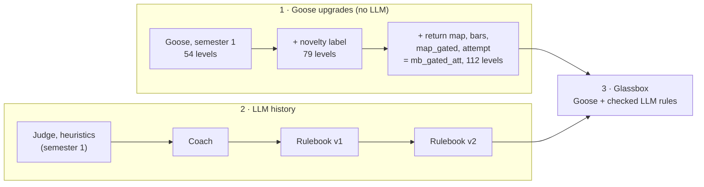

# Project map: from Goose to Glassbox

The project has three parts, and the docs folders follow them in order:

1. **[Goose upgrades](1-goose-upgrades/)**: improvements to the exploring agent itself. No LLM.
2. **[LLM history](2-llm-history/)**: the earlier attempts to add an LLM, and why each one stopped.
3. **[Glassbox](3-glassbox/)**: the current LLM plan, built on what parts 1 and 2 taught.

Levels are counted on all 25 public games × 3 seeds × 100,000 actions each.

## 1. Goose upgrades: the agent, step by step

Goose is a small CNN that learns online which actions change the screen and
samples its moves from that prediction. Each upgrade below is a separate file
and switch, off by default. The adopted bundle is `--agent mb_gated_att`.

| Step | What changed, in plain words | Code (switch) | Result | Write-up |
|---|---|---|---|---|
| Baseline | Goose as inherited: learns "did this move change the screen?" | `custom_agents/action.py` (`--agent goose`) | 54 levels, 11 games | — |
| Plan B | **Novelty label:** learn "did this move reach a screen not seen before on this level?", with blinking cells and progress bars masked out | `canon.py` (`EVAL_LABEL=novel`) | **adopted:** 79 levels, 18 games | [plan](1-goose-upgrades/plan-B-goose-novelty.md), [dev](1-goose-upgrades/plan-B-dev-sweep-results.md), [confirm](1-goose-upgrades/plan-B-confirm-sweep-results.md) |
| Option 1 | **Return map:** remember which move leads from which screen to which, and walk back to untried places when stuck | `return_map.py` (`EVAL_RETURN_MAP=1`) | dev pass (45 vs 32); not adopted alone (hurt ar25, tr87) | [plan](1-goose-upgrades/option-1-return-map.md), [dev](1-goose-upgrades/option-1-dev-results.md), [confirm](1-goose-upgrades/option-1-confirm-results.md) |
| Upgrade screen | Nine small candidate upgrades screened in two rounds | `upgrades.py` (`EVAL_UPGRADES=...`) | winner: map + bars + map_gated + attempt | [round 1](1-goose-upgrades/upgrade-screen.md) ([results](1-goose-upgrades/upgrade-screen-results.md)), [round 2](1-goose-upgrades/upgrade-screen2.md) ([results](1-goose-upgrades/upgrade-screen2-results.md)) |
| Upgrade confirm | The winner as one agent | `presets.py` (`--agent mb_gated_att`) | **adopted:** 112 levels, 22 games; 31 better / 36 same / 8 worse | [plan](1-goose-upgrades/upgrade-confirm.md), [results](1-goose-upgrades/upgrade-confirm-results.md) |

`mb_gated_att` is **A0**, the reference every Glassbox result is compared
against. Its 75 confirm runs (`results/confirm_upgrade/20260927_221915/`) are
reused, never re-run.

## 2. LLM history: what was tried, and why it stopped

| Attempt | The idea | Test | Result | What it taught | Write-up |
|---|---|---|---|---|---|
| Semester 1 | An LLM judges which screen is more promising; an LLM writes scoring heuristics | Probes A and C | NO-GO (chance; never beat a one-line rule) | Per-move LLM judgement doesn't help | `legacy/llm_track/README.md` |
| Coach (Plan A) | When Goose stalls, the LLM reads a text summary of the screen and suggests what to try | offline probe, 100 points | NO-GO: 21 hits vs 21.2 expected by chance | Advice from a description isn't enough; the LLM needs to be checked against evidence | [plan A](2-llm-history/plan-A-llm-advisor.md), [Coach](2-llm-history/llm-coach.md), [results](2-llm-history/coach-probe-results.md) |
| Rulebook v1 | The LLM writes the game's mechanics as Python rules; every rule is replayed against Goose's recorded moves | Stage A; Tier 0a on 8 dev games | FAIL: 1 of 3, then 2 of 8. Rules did not carry to the next level (ft09 wrong on 58.8%) | Checking works; rules must carry between levels | [plan](2-llm-history/llm-rulebook.md), [Stage A](2-llm-history/rulebook-stageA.md), [Tier 0a](2-llm-history/rulebook-tier0a.md) |
| Rulebook v2 | Rules take their level facts as parameters and are re-fitted to each new level by search, with no LLM | CP0, CP1 (pre-registered) | CP1 FAIL: 2 of 8 games. Safety met: 0.0% wrong after re-fitting, on all 8 | **Transfer is fixed; the model now writes too few exact rules** (none on tu93, tr87, m0r0) | [plan](2-llm-history/rulebook-v2.md), [pre-registration](2-llm-history/rulebook-v2-prereg.md), [CP0](2-llm-history/rulebook-v2-cp0-results.md), [CP1](2-llm-history/rulebook-v2-cp1-results.md) |

The code for each attempt is frozen in `legacy/` (see `legacy/README.md`).

## 3. Glassbox: the current plan

Glassbox keeps what worked (replay checking, re-fitting rules to each new
level, pre-registered gates) and attacks v2's bottleneck, too few exact rules.
It is split into stages that each fix one problem and can be tested alone:

| Stage | The problem it fixes |
|---|---|
| S1 SEE | The LLM must work out from pictures what moved and what blocked it, and we can't tell "couldn't see it" from "couldn't write it" |
| H1 VOCAB | Rules are long raw numpy with boundary bugs; 44% of answers ran out of room |
| S2 WRITE | One rule tried to explain several mechanisms at once |
| S3 CHECK | Near-miss rules only became exact by covering less |
| S4 CARRY | A new level needs its rules re-fitted, and at first has little evidence |
| S5 ACT | Rules have never been used online to steer Goose |
| H2 SCHEDULER | LLM calls are slow and must come at useful moments, within a budget |
| H3 TEMPLATES | Every new game starts from zero rules |
| S6 SHOW | Results are spread over many files, with no way to see a prediction next to what happened |

- [The plan](3-glassbox/glassbox-plan.md): what each stage does, why, and how it's tested.
- [The pre-registration](3-glassbox/glassbox-prereg.md): the gates, fixed before each run.
- [G0, guard rescue](3-glassbox/g0-guard-rescue.md) (16 Oct): no rescue; m0r0's near-misses come from a gap in the decoration mask (the end of its move-budget bar), not missing conditions.
- [G0b, the bar mask](3-glassbox/g0b-bar-mask.md) (16 Oct): masking the whole bar makes all 11 of m0r0's near-misses trusted; its book goes from 0% to 53.5% of changed cells; T1 51.7% (memory 53.9%), wrong 4.3%.
- The code: [`custom_agents/gb/`](../custom_agents/gb/README.md).

## Notes

- `reports/` holds the progress documents written for the advisor, and the
  scripts that drew their charts.
- **Paths inside the history documents are as they were when written.** Until
  16 Oct 2026 every plan lived in `docs/plans/`; it is now in one of the three
  numbered folders under the same file name. Code paths moved too:
  `custom_agents/wm/` → `legacy/rulebook/wm/` (copied to `custom_agents/gb/core/`),
  `experiments/upgrade_*` → `legacy/goose_experiments/`,
  `experiments/rulebook/` → `legacy/rulebook/experiments/`.
